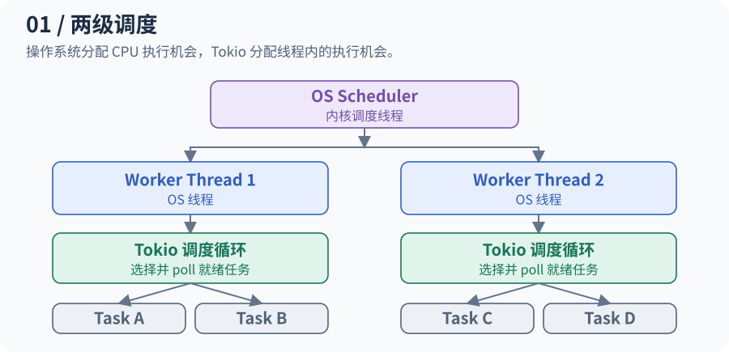
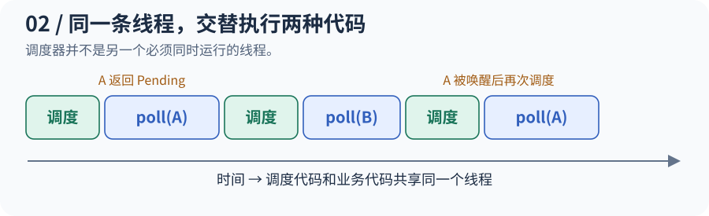
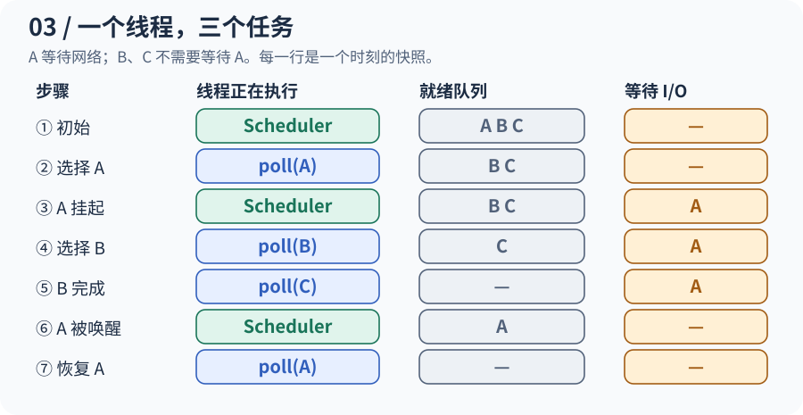
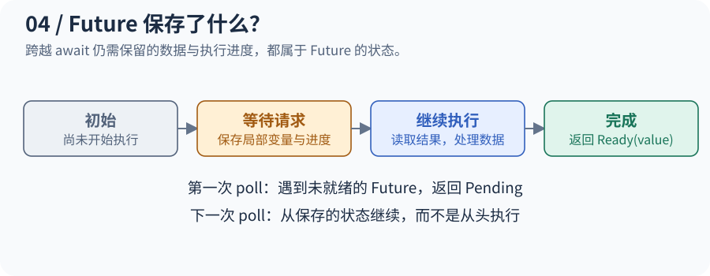
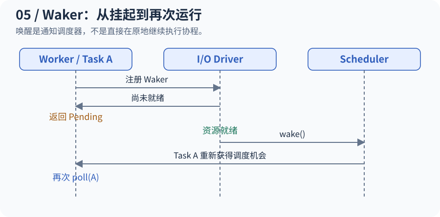
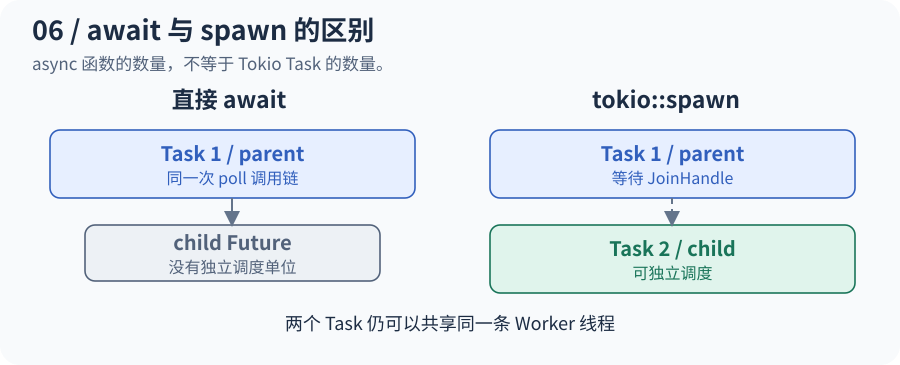
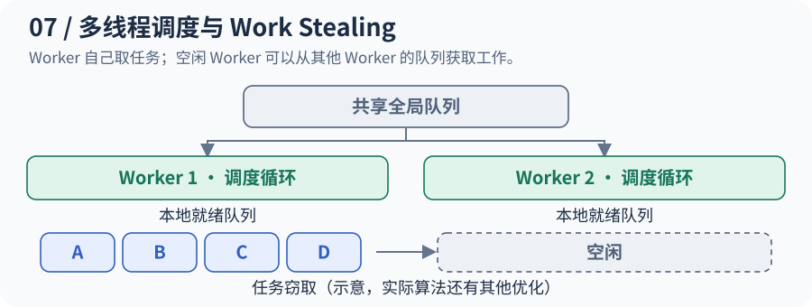
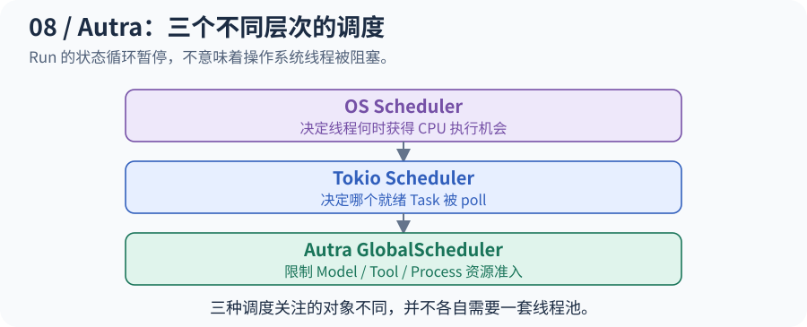

理解协程时，我一直有一个疑问：**如果协程调度器负责决定哪些协程上线程执行，那么协程调度器本身又运行在哪里？**

调度器是不是有一条专门的线程？如果所有线程都在执行协程，谁来负责下一次调度？当一个协程执行到 `await` 时，线程又是怎么切换到另一个协程的？

这些问题看似简单，却涉及异步 Runtime 最核心的执行模型。

先给出答案：**协程调度器本身也是普通代码，它运行在 OS 线程上。在 Tokio 的工作线程中，调度器代码和协程代码交替执行。**

接下来从一条线程、三个任务开始，把整个过程拆开来看。

<!-- truncate -->

## 1. 先理解两个不同层次的调度

线程是操作系统管理的执行单位。协程则是语言或 Runtime 提供的用户态执行抽象。在 Rust Tokio 中，我们通常把可以被独立调度的异步执行单位称为 Task。



这里存在两个调度器：

| 调度器 | 决定什么 | 运行在哪里 |
| --- | --- | --- |
| OS Scheduler | 哪个线程获得 CPU 执行机会 | 操作系统内核 |
| Tokio Scheduler | 哪个就绪 Task 接下来被执行 | Runtime 的工作线程或驱动线程 |

假设电脑有 4 个 CPU 核心，Tokio 有 4 条异步 Worker Thread，同时存在 100 个 Task。

操作系统负责让这些线程获得 CPU；Tokio 在每条线程内部选择 Task 来执行。操作系统不需要知道这 100 个 Task 的存在。

这就是多线程异步 Runtime 的 M:N 调度模型：多个用户态任务共享有限的 OS 线程。这里说的 4 条 Worker 只是示例，不包含可能存在的主线程、阻塞任务线程等。

## 2. 调度器和协程为什么可以运行在同一条线程上？

这正是最初的问题。

把 Tokio 的一条 Worker Thread 想象成一条正在执行下面循环的线程：

```rust
// 概念伪代码，不是 Tokio 的真实源码
fn worker_loop() {
    loop {
        let task = scheduler.next_ready_task();

        match task.poll() {
            Poll::Ready(value) => finish(task, value),
            Poll::Pending => save_for_future_wakeup(task),
        }
    }
}
```

注意：`scheduler.next_ready_task()` 和 `task.poll()` 都是普通函数调用。它们发生在同一条线程上。`save_for_future_wakeup` 仅代表保留未完成任务，不是 Tokio 真实 API；实际唤醒还要处理并发和竞态。

线程先运行调度逻辑，再运行任务代码。任务一旦返回，线程就重新回到调度循环。



所以不需要另一条线程持续监督正在执行的协程。

这和一个普通的 `for` 循环依次调用多个函数很相似，区别在于异步任务可以保存执行进度，之后再恢复。

**调度器选择任务并调用它，任务返回控制权后，调度器再选择下一个。**

## 3. 一个线程如何执行三个协程？

先把多线程忘掉。假设只有一条 Worker Thread，有三个已就绪的任务：

- A：发起一个网络请求，需要等待返回。
- B：执行一小段计算。
- C：执行另一小段计算。

初始时，就绪队列中有 A、B、C。

### 第一步：调度器选择 A

线程调用 A 的 `poll()`。A 发起网络请求，发现结果还没有准备好，于是注册唤醒机制并返回 `Pending`。

A 没有执行完成，但线程已经可以返回调度器了。

### 第二步：调度器选择 B 和 C

A 暂时不需要执行机会，因此线程可以依次执行 B 和 C。假设 B、C 很快就完成了。

### 第三步：A 的 I/O 就绪

网络数据到达后，Runtime 的 I/O Driver 可以通知任务 A 重新获得调度机会。调度器再次选择 A，A 从此前等待请求的状态继续执行。



这是一个可能的执行顺序，而不是 Tokio 承诺的固定顺序。图中的等待 I/O 一列是逻辑状态，并不表示 Tokio 必然维护这样一张统一的等待队列。

最重要的是：**等待网络的那段时间，A 没有占着线程不放。** A 只是暂时不能继续执行，而其他任务仍可以运行。

如果没有任何任务就绪，线程也不需要一直空转；Runtime 可以停驻线程，等待任务、I/O 或定时器事件。

## 4. 为什么协程能够暂停并恢复？

普通同步函数通常依靠调用栈保存执行过程中的局部变量。Rust 的异步函数则会生成一个可以保存执行进度的 Future。

例如：

```rust
async fn fetch() -> String {
    let prefix = String::from("response: ");
    let data = request().await;
    format!("{prefix}{data}")
}
```

这里 `prefix` 在 `await` 之后还要使用。即使第一次执行时请求没有完成，`prefix` 也不能丢失。

编译器会把异步函数转换为状态机，把需要跨越暂停点保留的数据存储在 Future 的状态中。



可以想象，编译器生成的 Future 保存了这样的信息：

```rust
// 示意结构，不是编译器真实生成的 Rust 类型
// RequestFuture 代表内部网络请求的 Future

enum FetchState {
    Start,
    Waiting {
        prefix: String,
        request: RequestFuture,
    },
    Done,
}
```

当 Future 被再次执行时，它通过内部状态知道应该从哪里继续。它不会重新执行已经完成的初始化操作。

Rust 采用的是无栈异步模型：异步任务不需要为每个 Future 保留一条独立的 OS 线程调用栈；挂起时需要保留的状态由 Future 自身承载。

## 5. poll() 与 await 到底是什么关系？

Rust 的 Future trait 核心接口如下：

```rust
pub trait Future {
    type Output;

    fn poll(
        self: Pin<&mut Self>,
        cx: &mut Context<'_>,
    ) -> Poll<Self::Output>;
}
```

`poll()` 的意思不是“阻塞直到完成”，而是尝试推进 Future，并返回当前结果：

| 返回值 | 含义 |
| --- | --- |
| `Poll::Ready(value)` | 已完成，拿到了结果 |
| `Poll::Pending` | 目前还不能完成，等待后续唤醒 |

当代码执行 `request().await`，实际上需要推进内部的请求 Future。如果请求已就绪，外层代码可以立即继续执行；如果还没有就绪，而且外层 Future 也无法继续推进，外层 `poll()` 就返回 `Pending`。

可以粗略理解为下面的伪代码：

```rust
match request.poll(cx) {
    Poll::Ready(data) => {
        // 继续执行 await 后面的代码
        process(data)
    }
    Poll::Pending => {
        // 保存执行状态后返回
        return Poll::Pending;
    }
}
```

于是整个调用链退出本次 `poll()`，控制权重新回到 Worker 的调度循环。

:::note
`await` 并不必然引发协程切换。如果等待的 Future 已经就绪，它可能直接继续执行。真正让调度器拿回控制权的是顶层任务的 `poll()` 返回，而不是 `await` 这个语法本身。
:::

## 6. Waker：谁告诉调度器 A 可以继续了？

现在问题来了：A 已经返回了 `Pending`，调度器正在执行其他任务。等网络数据到了，谁通知调度器重新执行 A？

这就涉及 `Waker`。

调用 Future 的 `poll()` 时，Runtime 会通过 `Context` 传入当前任务的唤醒句柄。当 Future 暂时不能继续时，它需要建立适当的唤醒机制。例如等待 socket 可读时，可以借助 I/O Driver 保存或注册 Waker。



在这个简化的例子中，整个过程是：

1. Worker 调用 A 的 `poll()`。
2. 网络资源尚未就绪，注册 Waker，A 返回 `Pending`。
3. Worker 执行其他任务。
4. I/O Driver 获知 socket 可读等事件。
5. 通过 Waker 通知调度器，A 可以再次尝试执行。
6. 某个 Worker 在之后的调度中再次调用 A 的 `poll()`。

在 Linux 上，Runtime 的 I/O Driver 通常借助 epoll 等操作系统机制等待 I/O 事件；其他平台有相应机制。对异步任务而言，并不需要为每个网络请求创建一条线程。

`wake()` 只是通知，不是立即执行任务，也不保证下一次 `poll()` 一定完成。资源可能仍然需要继续等待。

这解释了为什么异步 Runtime 不只有 Scheduler，还需要 I/O Driver 和 Timer：Scheduler 负责推进任务，Driver 与 Timer 等事件来源帮助等待中的任务再次获得运行机会。

## 7. 亲手验证：一条线程也能运行多个任务

下面是一个完整的 Tokio 示例。将它保存为 `src/main.rs`，并在 `Cargo.toml` 添加依赖：

```toml
[dependencies]
tokio = { version = "1", features = ["macros", "rt", "time"] }
```

```rust
use std::{thread, time::Duration};
use tokio::time::sleep;

#[tokio::main(flavor = "current_thread")]
async fn main() {
    let a = tokio::spawn(async {
        println!("A start: {:?}", thread::current().id());
        sleep(Duration::from_millis(500)).await;
        println!("A done:  {:?}", thread::current().id());
    });

    let b = tokio::spawn(async {
        println!("B start: {:?}", thread::current().id());
        sleep(Duration::from_millis(100)).await;
        println!("B done:  {:?}", thread::current().id());
    });

    a.await.unwrap();
    b.await.unwrap();
}
```

一种典型输出如下（线程 ID 和具体执行顺序可能不同）：

```text
A start: ThreadId(1)
B start: ThreadId(1)
B done:  ThreadId(1)
A done:  ThreadId(1)
```

A 和 B 都由同一条线程驱动，但 B 没有等 A 睡完才开始。两个任务的等待时间可以重叠，总耗时通常接近 500 毫秒，而不是 600 毫秒。

这里发生的是**并发**，不是 CPU 并行：只有一个线程，因此同一时刻只能执行其中一个任务的代码。

如果把 `sleep(...).await` 替换成 `std::thread::sleep(...)`，线程就真的被阻塞了，另一个任务无法在该线程上继续。这两种 sleep 的区别，正好体现了异步等待与同步阻塞的区别。

## 8. async、await 和 spawn 并不是同一件事

调用 `async fn` 会得到一个 Future，但不会自动创建可独立调度的 Task。

```rust
async fn parent() {
    child().await;
}
```

此处 child Future 在 parent 的 poll 调用链中执行。它没有自己的独立 Tokio Task。

而下面的代码不同：

```rust
async fn parent() {
    let handle = tokio::spawn(async {
        child().await;
    });

    handle.await.unwrap();
}
```

`spawn()` 将 Future 交给 Tokio，产生一个可以独立调度的 Task。父任务即使正在等待 `JoinHandle`，子任务也可以独立获得执行机会。



| 写法 | 是否新建独立 Task | 执行方式 |
| --- | --- | --- |
| `child().await` | 否 | 在父任务内推进子 Future |
| `tokio::join!(a(), b())` | 否 | 在一个 Task 中并发推进多个 Future |
| `tokio::spawn(child())` | 是 | Runtime 独立调度子 Task |
| `std::thread::spawn(...)` | 不适用 | 创建 OS 线程 |

:::tip 一句话区分 await 与 spawn

**`await` 是当前协程的潜在挂起点（Suspension Point），而不是创建新协程任务的地方。** 之所以说「潜在」，是因为 `await` 不一定触发调度。

```rust
async fn task_a() {
    step1();

    request().await;   // 潜在挂起点 ①

    step2();

    read_file().await; // 潜在挂起点 ②

    step3();
}
```

执行到 `await` 时有两种情况：

- 内部 Future 返回 `Ready`：直接继续执行，没有发生切换。
- 内部 Future 返回 `Pending`：当前 Future 挂起；如果整个 Task 也无法继续，`poll()` 返回 `Pending`，线程控制权交还给调度器。

而 `tokio::spawn(task_a())` 做的是另一件事：它把 Future 交给 Runtime，创建一个**可以独立调度的 Task**。spawn 创建调度单位，await 只是提供可以暂停的位置。

| 概念 | 含义 |
| --- | --- |
| `async` | 定义可暂停、可恢复的计算 |
| `spawn` | 创建独立调度单位 |
| `await` | 潜在挂起点 |
| `Pending` | 归还执行控制权 |
| `Waker` | 通知任务可以重新调度 |
| `Scheduler` | 选择下一个执行的 Task |
| `Thread` | 实际执行代码 |

这也是为什么 Autra 中即使有很多层 `async/await`，也不代表有很多独立协程任务。

**spawn 决定什么可以被独立调度，await 提供什么时候可以暂停执行的位置，Scheduler 决定接下来执行谁。**

:::

所以，async 函数有多少个、Task 有多少个、OS 线程有多少条，是三个不同的问题。

## 9. 多线程 Tokio：没有必要设置一个中央调度线程

前面讨论的是单线程模型。在 Tokio 的多线程模式下，多个 Worker 可以同时运行各自的调度循环。

每个 Worker 有自己的本地就绪队列，Runtime 还有共享队列。当 Worker 找不到合适的本地任务时，可以尝试从其他 Worker 获取任务。这种方式称为 Work Stealing（工作窃取）。



这样可以让空闲线程主动寻找工作，不需要一个中央线程不断决定每个 Task 应该交给谁。

一个满足 `Send` 要求的 Task 可能第一次由 Worker 1 执行，挂起后由 Worker 2 恢复。这并不意味着一个 Future 会同时被两个 Worker poll。一次 poll 需要独占地推进该 Future。

这张图省略了 Tokio 的其他调度优化，具体队列行为、窃取策略和优先规则属于 Runtime 的实现细节，并不是稳定 API 承诺。

## 10. 如果协程一直不返回，调度器怎么办？

这涉及抢占式调度与协作式调度的区别。

OS 通常可以抢占一条线程，将 CPU 交给另一条线程。但 Tokio 无法任意中断普通 Rust 代码来切换 Task。

例如：

```rust
async fn bad_task() {
    loop {
        std::hint::spin_loop();
    }
}
```

如果这个 Future 被 poll，它可能一直占据当前 Worker，调度循环就得不到控制权。在单线程 Runtime 中，其他 Task 也无法正常运行。

Tokio 在部分异步操作中提供协作预算机制，但它无法保证任意 CPU 密集型代码自动让出控制权。

对于同步阻塞操作，可以使用 `spawn_blocking`；对于大量 CPU 密集型计算，通常还需要限制并行度，或者使用 Rayon 等独立计算线程池。

## 11. 回到 Autra：Agent Runtime 的调度到底是什么？

以此前讨论的 [stack-call/autra](https://github.com/stack-call/autra/tree/mvp-v1) Runtime 为例，一个 Run 可以近似理解成一个主异步执行流程。

```rust
// 简化伪代码，不是 Autra 的真实接口
async fn drive() {
    loop {
        let effect = transition();
        let result = executor.execute(effect).await;
        update_state(result);
    }
}
```

当 Run A 调用 LLM，等待网络返回时，它的主状态循环暂停。但是如果底层使用非阻塞异步 I/O，Tokio 的 Worker 可以在此期间执行 Run B、Run C，或者其他 Task。



这里存在三种不同的调度职责：

| 层次 | 负责调度什么 |
| --- | --- |
| OS | 线程获得 CPU 的机会 |
| Tokio | 就绪 Task 获得执行机会 |
| Autra GlobalScheduler | Model、Tool、Process 的并发资源额度 |

Autra 的 GlobalScheduler 不是另一套协程调度器。它主要约束业务资源准入，例如多少个工具可以同时执行，而不是把工具映射到指定的 OS 线程上。

此外，Coordinator 在 `drive()` 内直接等待 Executor，与把 Executor 拆成独立 Worker、通过消息回传结果，是两种不同的控制流结构。

```text
异步函数调用：
Run ── await Effect ──→ 返回结果 ──→ 更新状态

异步消息驱动：
Coordinator ──提交 Effect──→ Executor Task
     ↑                            │
     └────────结果事件────────────┘
```

两种结构都可以运行在同一个 Tokio Runtime 上。消息驱动可以为同一 Run 在等待 Effect 时处理其他允许的事件创造条件，但它并不是异步 I/O 或多 Run 并发的前提。

Autra 段落沿用此前讨论的 `mvp-v1` 架构作为说明，未重新核验分支最新提交，图示不是对实际源码逐行展开。

## 12. 总结：用一句话串起整个过程

现在可以重新回答开头的问题：协程调度器到底运行在哪里？

**它就运行在 OS 线程上，和协程代码交替执行。**

Rust 编译器生成 Future，保存异步任务的状态；Tokio Task 提供独立的调度单位；Worker 执行调度循环，选择就绪 Task 并调用其 `poll()`；如果任务无法继续，便返回 `Pending`，线程转而执行其他任务；相关资源就绪后，Waker 通知调度器再次推进该任务。

把这几个概念连起来，便得到了异步 Runtime 的基本执行模型：

```text
OS 调度线程
    ↓
Worker 运行 Scheduler
    ↓
Scheduler 选择就绪 Task
    ↓
Task.poll() 推进 Future
    ├── Ready   → 完成
    └── Pending → 返回调度循环
                       ↑
                Waker 通知重新调度
```

协程并没有创造新的物理执行资源，它只是让已有线程能够更高效地管理和推进多个具有独立执行状态的任务。

## 参考资料

- [Rust 标准库：Future](https://doc.rust-lang.org/std/future/trait.Future.html)
- [Rust 标准库：Waker](https://doc.rust-lang.org/std/task/struct.Waker.html)
- [Tokio：Runtime 与调度行为](https://docs.rs/tokio/latest/tokio/runtime/)
- [Tokio：Task、阻塞与协作式调度](https://docs.rs/tokio/latest/tokio/task/)
- [Tokio：spawn_blocking](https://docs.rs/tokio/latest/tokio/task/fn.spawn_blocking.html)
- [Autra：公开源码](https://github.com/stack-call/autra/tree/mvp-v1)
