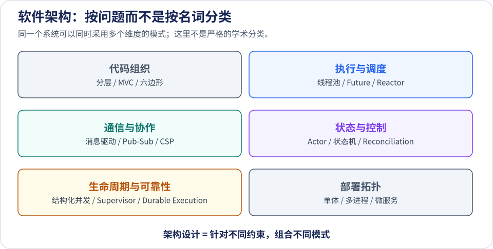
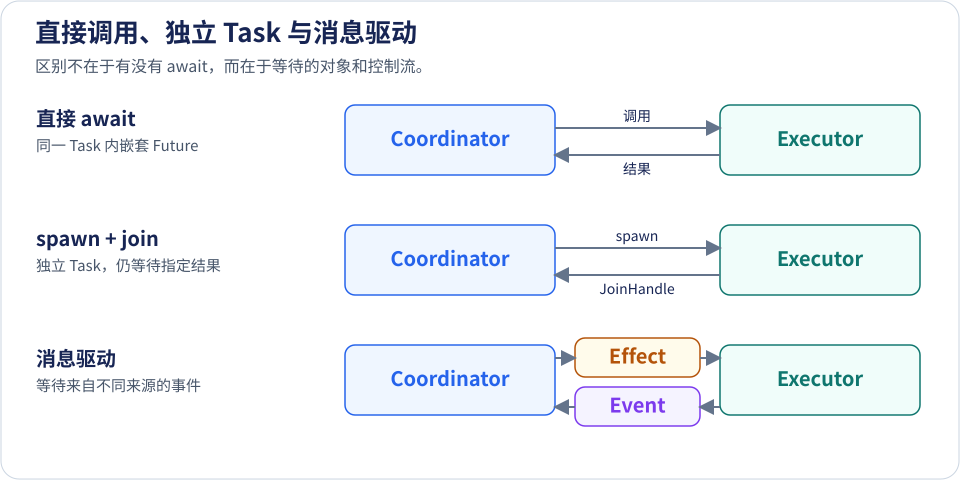
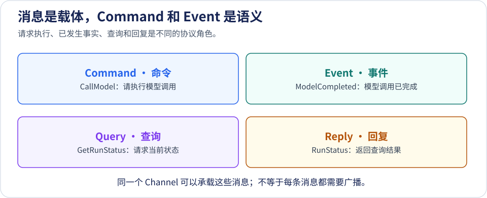
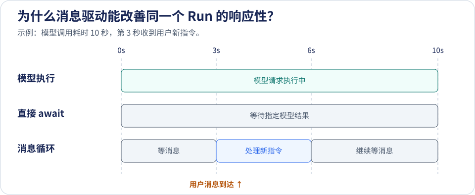
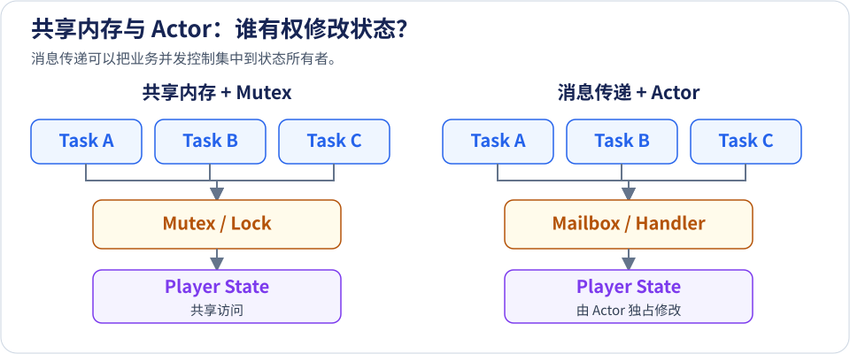
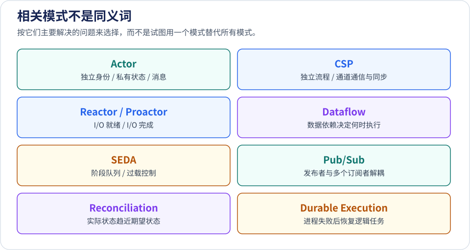
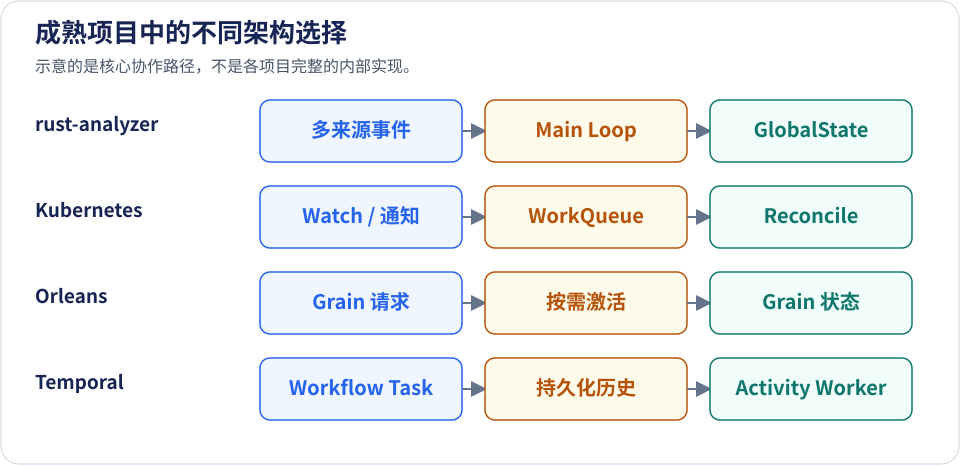
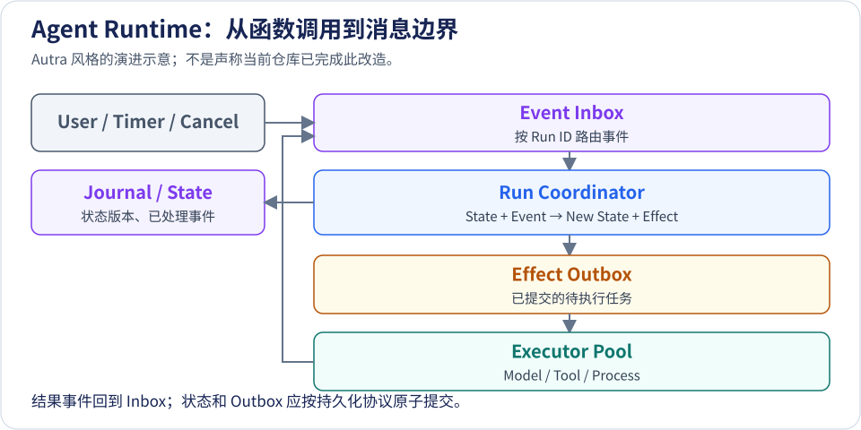
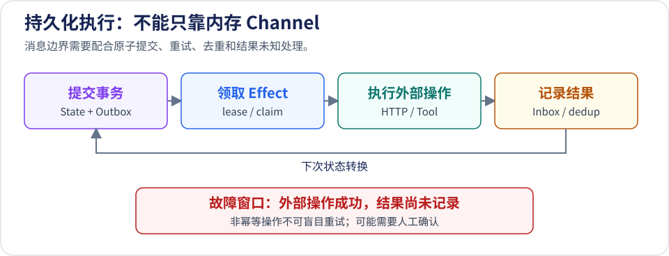

在设计一个运行时系统时，我们经常会遇到这样的问题：一个组件究竟应该直接调用另一个组件，还是把任务作为消息发送出去，让另一个组件独立处理？

例如，一个 Agent 正在等待大模型返回，用户突然发来新指令。负责管理 Agent 状态的 Coordinator，是否应该等到模型请求结束才能处理这条指令？如果模型调用、工具调用和用户交互都由不同的任务负责，这些任务又应该如何组织？

这类问题属于**软件架构（Software Architecture）**中的组件通信、并发协作和运行时系统设计。消息驱动架构、Actor 模型、CSP、Reactor 等，并不是为某一种编程语言或某一种应用创造的概念，而是软件工程中为不同问题形成的设计思想。

本文从一个简单的异步函数调用出发，建立这些概念之间的关系，并结合成熟项目，理解什么时候值得使用它们。

<!-- truncate -->

## 1. 软件架构究竟在设计什么？

我们常把软件架构理解成分层、MVC、微服务或者 DDD。但架构不只关心代码放在哪个目录，还关心程序运行时由哪些组件组成、这些组件如何交互，以及如何满足性能、可靠性、可维护性等约束。

例如，一个 HTTP 服务可以采用六边形架构来组织业务代码，同时使用线程池处理请求，通过消息队列执行后台任务，并通过数据库事务保证状态一致性。这些选择并不冲突，因为它们分别回答不同的问题。



| 架构维度 | 核心问题 | 典型模式或机制 |
| --- | --- | --- |
| 代码组织 | 模块的职责和依赖如何划分？ | 分层、MVC、六边形架构 |
| 执行与调度 | 代码在哪里运行，如何分配资源？ | Thread Pool、Future、Work Stealing、Reactor |
| 通信与协作 | 组件之间如何交换数据、发起操作？ | Message Passing、消息驱动、Pub/Sub、CSP |
| 状态与控制 | 谁拥有状态，什么时候改变状态？ | Actor、状态机、Event Sourcing、Reconciliation |
| 生命周期与可靠性 | 如何取消、恢复、隔离故障？ | Structured Concurrency、Supervision、Durable Execution |
| 部署拓扑 | 组件位于同一进程还是不同机器？ | 模块化单体、多进程、微服务 |

这是一种便于工程学习的分类，而不是严格的学术分类。例如 Actor 同时涉及通信与状态，Reactor 同时涉及事件与执行。所谓架构模式，是针对重复出现的系统设计问题所形成的可复用组织思路；协程和 Channel 则是实现这些思路时可使用的机制。

## 2. 从函数调用理解消息驱动的由来

假设我们有两个组件：Coordinator 负责决定下一步做什么，Executor 负责真正执行网络请求或工具。

最直接的实现是调用函数：

```rust
// 简化伪代码
async fn run() {
    loop {
        let effect = coordinator.next_effect();
        let result = executor.execute(effect).await;
        coordinator.handle_result(result);
    }
}
```

这段代码非常容易理解：决定操作，执行操作，拿到结果，再决定下一步。只要底层 I/O 是非阻塞的，等待期间 Tokio 就可以让当前线程运行其他任务。

然而，**当前 Run 的主循环仍然在等待这个指定结果**。其他 Run 能够继续，并不意味着这个 Run 的 Coordinator 也能处理新的事件。

### 将 Executor 拆成独立 Task 有用吗？

```rust
// 简化伪代码
let handle = tokio::spawn(async move {
    executor.execute(effect).await
});
let result = handle.await?;
coordinator.handle_result(result);
```

现在 Executor 拥有了独立的调度单位，但 Coordinator 仍在等待 JoinHandle。两者可以分别被 Tokio 调度，控制流却仍有等待关系。

如果改成向 Executor 发送任务，再让 Coordinator 回到事件循环，情况就不同了：

```rust
// 简化伪代码
command_tx.send(effect).await?;
while let Some(event) = event_rx.recv().await {
    coordinator.handle(event);
}
```



关键差异在于：直接调用等待一个特定操作的完成，事件循环等待协议允许的多种输入。它可以接收用户消息、模型结果、工具结果、取消通知和定时器事件。

这并不是说直接调用无法实现复杂交互。Rust 的 `tokio::select!`、取消令牌和并发 Future 都可以做到这一点。当事件类型和参与组件逐渐增加时，统一的消息入口往往更方便扩展。

## 3. 消息传递、消息驱动、事件驱动究竟是什么关系？

这三个术语很容易被混为一谈。

**Message Passing（消息传递）**是一种通信机制：发送者将数据或操作请求交给接收者，例如 Tokio Channel、Go Channel、进程间 IPC 或网络消息系统。

**Message-Driven Architecture（消息驱动架构）**是一种组织组件的方式：组件主要通过消息协议协作，而不是依赖彼此的函数调用栈。接收者在自己的控制流中处理消息。

**Event-Driven Architecture（事件驱动架构，EDA）**强调系统由发生的事件触发行为。一个事件表达已经发生的事实，消费者根据状态决定如何响应。事件可以通过 Channel、消息代理、回调等方式传递。

因此，事件驱动与消息驱动有很大重叠，却不是完全相同的概念。消息驱动系统可以传输命令和查询，不只是事件；事件驱动系统也不一定使用独立的消息队列或消息中间件。

### 消息是载体，事件是语义



| 类型 | 表达的语义 | 示例 |
| --- | --- | --- |
| Command（命令） | 要求接收者执行某个操作 | `CallModel`、`CancelRun` |
| Event（事件） | 描述已经发生的事实 | `ModelCompleted`、`RunCancelled` |
| Query（查询） | 请求获取信息，通常不改变业务状态 | `GetRunStatus` |
| Reply（回复） | 对特定请求返回结果 | `RunStatusResult` |

命令和事件尤其值得区分。`CancelRun` 是要求取消，`RunCancelled` 是确认取消已经发生。前者可能被拒绝，后者不能因为某个消费者处理失败而改变其事实语义。

另外，消息队列也不是 Pub/Sub 的同义词。工作队列通常让一个消费者领取一项任务，发布订阅则允许不同订阅者分别接收同一条事件。请求响应可以使用 Channel 加 oneshot，也可以通过消息代理加关联 ID 实现。

有关这些消息语义和通信拓扑，可以参考 [Enterprise Integration Patterns](https://www.enterpriseintegrationpatterns.com/patterns/messaging/) 的模式目录。

## 4. 消息驱动具体解决什么问题？

### 4.1 控制流解耦：等待任务时还能响应其他事件

设模型调用需要十秒，第 3 秒用户发送一条新指令。



直接 await 的主循环在模型返回前无法继续处理新事件，除非另有并发处理机制。消息驱动的 Coordinator 可以先处理新指令，模型完成后再处理模型结果。

但是“能够接收”不等于“必须立刻打断”。协议可以规定将指令暂存、取消旧请求、等待当前轮次结束，或标记旧结果过期。这个业务决定由状态机负责，而不是由 Channel 自动完成。

### 4.2 状态所有权：减少业务层共享可变状态

假设多人游戏中有多个任务需要修改同一个玩家的金币、血量和背包。最直接的方法是让所有任务共享 `Arc<Mutex<Player>>`，获得锁后修改玩家数据。

另一种方法是让一个独立任务拥有 Player 状态，其他任务向它发送命令。



```rust
// 共享内存模型
let mut player = player.lock().await;
player.gold += 100;
```

```rust
// 消息传递模型
player_tx.send(Command::AddGold(100)).await?;
```

接收者串行处理操作，因此可以把业务不变量集中在一个位置维护。这不是消除所有锁：Channel 底层仍可能使用锁和原子操作；如果多个组件仍直接修改同一份数据，使用 Channel 也无法自动避免竞态。

### 4.3 资源与生命周期解耦

一个拥有独立队列的 Executor 可以服务多个 Run。系统可以在队列处统一做并发限制、优先级调度、背压和负载分配，而不是让每个 Run 分别决定执行资源。

内存 Channel 可以让任务不必拥有对方的具体实现；如果进一步引入可靠持久化协议，Run 还可以在等待人工审批时卸载内存状态，等收到新事件再恢复。这里要强调：**内存消息队列不会自动赋予系统持久化、可靠交付或分布式能力。**

## 5. 实际运行一次：单线程 Tokio 中的消息驱动

消息驱动不要求多线程，更不要求 Kafka。下面用一个最小示例展示一个 Coordinator 在后台任务尚未完成时，能够先处理用户输入。

创建 Rust 项目并在 `Cargo.toml` 中加入：

```toml
[dependencies]
tokio = { version = "1", features = ["rt", "macros", "sync", "time"] }
```

```rust
use tokio::sync::mpsc;
use tokio::time::{sleep, Duration};

#[derive(Debug)]
enum Event {
    UserMessage(String),
    ModelCompleted(String),
}

#[tokio::main(flavor = "current_thread")]
async fn main() {
    let (tx, mut rx) = mpsc::channel::<Event>(8);

    let model_tx = tx.clone();
    let executor = tokio::spawn(async move {
        // 模拟耗时的异步 I/O
        sleep(Duration::from_secs(3)).await;
        model_tx.send(Event::ModelCompleted("模型结果".into()))
            .await.unwrap();
    });

    let user = tokio::spawn(async move {
        sleep(Duration::from_secs(1)).await;
        tx.send(Event::UserMessage("补充新指令".into()))
            .await.unwrap();
    });

    // Coordinator：唯一的状态修改者
    let mut instructions = Vec::new();
    while let Some(event) = rx.recv().await {
        match event {
            Event::UserMessage(text) => {
                println!("收到用户指令: {text}");
                instructions.push(text);
            }
            Event::ModelCompleted(text) => {
                println!("收到模型结果: {text}");
                println!("期间收到的指令: {instructions:?}");
            }
        }
    }

    executor.await.unwrap();
    user.await.unwrap();
}
```

典型预期输出如下（时间是模拟设定，不是性能测试）：

```text
收到用户指令: 补充新指令
收到模型结果: 模型结果
期间收到的指令: ["补充新指令"]
```

这个例子中，三个异步执行流程共享一个 `current_thread` Runtime。Coordinator 的 `recv().await` 在队列为空时挂起；生产者发送消息后，Channel 的唤醒机制通知 Tokio，让接收者有机会再次被 poll。它不需要专门的线程不断检查队列。

这里使用了一个有限容量的 `mpsc` Channel。生产速度超过消费速度时，`send().await` 可能等待。这就是一种背压机制。示例中所有发送端最终被释放，所以接收循环正常退出。

想继续学习实际的请求响应模式，可以参考 [Tokio 官方 Channels 教程](https://tokio.rs/tokio/tutorial/channels)：它使用独立 Task 管理 Redis 连接，并结合 `mpsc` 与 `oneshot` 传递请求和回复。

## 6. Actor、CSP 与消息驱动的区别

使用消息并不意味着一个系统已经采用 Actor 模型。Actor 是一种更具体的计算与并发组织模型。

### Actor Model：以具有身份的状态所有者为中心

Actor 通常具有逻辑身份、私有状态、消息接收机制和处理行为。它可以接收消息、改变自己的行为、发送其他消息，以及创建新的 Actor。常见 Actor Runtime 为单个 Actor 提供串行的状态访问语义，但具体框架也可能允许重入等受控并发。

典型用途包括游戏玩家、聊天室、设备、账户等需要独立管理状态的实体。Erlang/OTP、Akka、Orleans 都提供相关机制。

### CSP：以通信的执行流程为中心

CSP 是 Communicating Sequential Processes 的缩写，由 C. A. R. Hoare 提出。它描述独立顺序进程如何通过通信进行协作与同步。Go 的 Goroutine 和 Channel 受到 CSP 思想启发，但 Go 的缓冲 Channel 等机制并不完全等同于经典 CSP 的形式模型。

```go
// 示意：两个执行流程通过 Channel 传递结果
ch := make(chan int)
go func() {
    ch <- 42
}()
result := <-ch
```

| 维度 | Actor | CSP 风格 |
| --- | --- | --- |
| 主要组织对象 | 有身份的 Actor | 独立顺序执行流程 |
| 通信中心 | Actor 地址、邮箱 | 通道和通信操作 |
| 状态组织 | 强调私有状态和行为 | 强调通信与同步关系 |
| 常见实现 | Erlang、Orleans、Akka | Go 的 Goroutine + Channel |

如果业务中的核心概念是一个个拥有状态的独立实体，Actor 很自然；如果核心是几个持续协作的处理阶段，Channel/Pipeline 风格可能更直接。两种思路可以组合。详见 [Effective Go：Concurrency](https://go.dev/doc/effective_go#concurrency) 与 [Orleans Overview](https://dotnet.github.io/orleans/docs/overview/) 。

## 7. 还有哪些值得了解的架构模式？

消息驱动并不是孤立存在的。设计运行时系统时，还会遇到执行、I/O、状态、调度和可靠性方面的问题。



| 模式或机制 | 主要解决什么问题 | 参考实现或应用 |
| --- | --- | --- |
| Shared Memory | 多执行单元共享数据与同步 | Mutex、RwLock、原子操作 |
| Thread Pool | 复用有限线程 | Java Executor、Tokio 阻塞池 |
| Work Stealing | 分配可运行任务，改善负载均衡 | Tokio、Rayon |
| Reactor | 监测 I/O 就绪并分发处理 | Nginx、Mio |
| Proactor | 提交 I/O 操作并处理完成通知 | IOCP、Boost.Asio 的接口模型 |
| Dataflow | 根据数据依赖决定任务的执行 | Spark、Flink 等数据处理系统 |
| SEDA | 按阶段组织队列和资源，控制过载 | Welsh 等人的 SEDA 架构 |
| Pub/Sub | 发布者与多个订阅者解耦 | NATS、Kafka 的相关模式 |
| State Machine | 定义合法状态及事件转换 | 协议、工作流、Agent |
| Event Sourcing | 以事件历史作为状态事实来源 | 事件存储系统 |
| CQRS | 分离读模型和写模型的职责 | 复杂读写业务系统 |
| Reconciliation | 实际状态不断趋近期望状态 | Kubernetes Controller |
| Structured Concurrency | 约束父子任务的取消和生命周期 | Python Trio、Kotlin |
| Supervision Tree | 监控失败、选择重启或升级策略 | Erlang/OTP |
| Virtual Actor | 逻辑实体按需激活和回收 | Microsoft Orleans |
| Durable Execution | 跨进程失败保存并恢复执行进度 | Temporal、Restate |

这张表混合了计算模型、架构模式和实现机制，是为了按问题建立知识地图，而不是说它们属于同一抽象层次或只能选其一。

几个容易混淆的点：

- Reactor 通知资源可能可以进行 I/O，Proactor 通知已经提交的 I/O 操作完成；具体实现可以组合就绪机制与完成式 API。
- Dataflow 用数据依赖驱动节点执行；消息驱动中的消息不一定构成 DAG，也可以形成循环。
- SEDA 将高并发服务划分为具有显式队列的阶段，以便独立管理负载和资源。队列满时必须决定等待、拒绝、限流还是降级。
- Event Sourcing 要求事件历史作为事实来源；仅仅记录日志，并不等于采用 Event Sourcing。
- 结构化并发约束任务树的生命周期，监督树关注失败后的恢复策略。两者可以配合，但裸 `spawn` 不会自动提供这些保证。

进一步阅读：[POSA Volume 2](https://www.cs.wm.edu/~dcschmidt/POSA/POSA2/)、[SEDA 原始论文（2001）](https://doi.org/10.1145/502059.502057)、[Erlang Supervisor](https://www.erlang.org/doc/apps/stdlib/supervisor.html)。

## 8. 大型项目真的会这样设计吗？

会，但不会把所有组件都改造成一种模式。成熟系统通常按照问题选择机制。



### rust-analyzer：主事件循环

Rust 语言服务器需要响应编辑器的 LSP 消息、文件变化、后台分析、Cargo 检查等不同来源的输入。它的 `main_loop.rs` 将输入抽象成不同的事件类型，通过 Channel 接收并分发，再协调全局状态和后台任务。

这里的重点是主状态与并发后台工作的边界。它不需要 Tokio 才能采用这种模式，普通线程与 Crossbeam Channel 同样可以实现事件循环。

源码：[rust-analyzer/main_loop.rs](https://github.com/rust-lang/rust-analyzer/blob/master/crates/rust-analyzer/src/main_loop.rs)。

### Chromium：消息传递与进程隔离

浏览器主进程、渲染进程以及其他服务需要跨进程协作。Chromium 的 Mojo 提供消息管道、接口定义和绑定机制，为组件之间的通信建立边界。这里消息传递的价值不仅是异步协作，也包括进程隔离和接口设计。

Mojo 也能支持请求响应等调用风格；不能据此把 Chromium 的所有模块都称为 Actor。

参考：[Chromium Mojo](https://github.com/chromium/chromium/tree/main/mojo)。

### Orleans：虚拟 Actor 与按需激活

Orleans 将虚拟 Actor 称为 Grain。应用通过逻辑身份访问 Grain，Runtime 负责路由请求并在需要时创建内存实例，长时间空闲的实例可以被回收。持久状态的保存和加载需要相应的存储配置和应用逻辑。

这让逻辑实体与物理内存实例的生命周期不必一一对应。大量不活跃的玩家或其他业务实体，无须始终对应一个运行中的 Task。

参考：[Orleans Overview](https://dotnet.github.io/orleans/docs/overview/)、[Activation collection](https://dotnet.github.io/orleans/docs/host/configuration-guide/activation-collection/)。

### Kubernetes：控制循环与 Reconciliation

用户声明希望运行三个副本。当一个副本消失，Controller 会观察系统实际状态，计算它与期望状态的差距，并发起相应操作。常见实现通过 Watch、Informer 和 WorkQueue 将需要协调的资源交给 Controller。

事件在这里通常是重新检查状态的触发信号，而不是必须依次执行的完整命令历史。即使通知被合并，控制器仍应根据实际状态作出正确的协调决策。

参考：[Kubernetes Controllers](https://kubernetes.io/docs/concepts/architecture/controller/)、[client-go](https://github.com/kubernetes/client-go)。

### Temporal：持久化执行与外部副作用

Temporal 将工作流逻辑与 Activity 分开。Worker 从 Task Queue 领取工作，工作流进度由服务端记录在 Event History 中。发生故障时，工作流逻辑可以通过确定性的历史重放重新建立执行状态，并继续运行。

值得注意的是，工作流开发者仍可以使用顺序代码和 await 风格的 API。底层是持久化事件与任务调度，并不意味着上层必须以消息循环形式编程。已经记录的 Activity 结果会在工作流重放中被使用；Activity 本身在失败等场景下可能重试，所以外部操作仍需考虑幂等性。

参考：[Temporal Workflows](https://docs.temporal.io/workflows)、[Tasks](https://docs.temporal.io/tasks)、[Event History](https://docs.temporal.io/encyclopedia/event-history)。

## 9. 回到 Agent Runtime：如何设计 Coordinator 与 Executor？

以 [Autra](https://github.com/stack-call/autra/tree/mvp-v1) 风格的 Rust Agent Runtime 为例，可以从功能上划分：Harness 决定行为，Stepper 根据状态和事件提出转换，Coordinator 管理状态，Executor 执行外部操作。

在直接调用式实现中，Coordinator 可以将 Effect 交给 Executor 并 await 返回值。在需要更丰富的交互时，则可以探索以下消息驱动方案。这里讨论的是**设计方案，而非 Autra 当前版本已经完成的实现声明**。



可以将运行时抽象为：

```text
State + Event → New State + EffectIntent
```

Coordinator 是状态的所有者；Executor 不直接修改 Run 状态，只报告操作结果。所有结果带上 Run ID、Effect ID，必要时还带上 Attempt ID，方便关联请求、去重和识别过期结果。

例如，模型要求调用两个工具 A 和 B，A 先完成。Stepper 接到 `ToolCompleted(A)` 后保存结果，继续等待 B；收到 `ToolCompleted(B)` 后发现依赖全部满足，才产生下一轮 `CallModel`。业务依赖并没有被消除，只是从 Executor 的批次返回条件移动到明确的状态机协议中。

这种设计可以让 Coordinator 在等待模型或工具期间处理取消、定时器和其他合法事件，同时仍保证同一 Run 的状态串行推进。

不过，如果一个 Agent 只是标准的 ReAct 循环，且不需要执行期间响应其他事件，直接 await 通常已经足够。可以保留简单实现，等真实需求出现后再拆出独立 Worker，而不是一开始就引入复杂架构。

## 10. 消息驱动如何进一步演进为持久化 Runtime？

内存中的消息队列只在当前进程生命周期内存在。如果进程崩溃，尚未处理的消息与 Future 的状态都可能丢失。

要实现可以等待数天、跨越进程重启的 Run，需要进一步设计持久化协议。



一种常见思路是 Transactional Outbox：在同一事务中更新 Run State 并记录待执行 Effect。Worker 领取已提交的 Effect、执行外部操作，将结果可靠地记录或投递到 Inbox，Coordinator 再消费结果进行下一轮状态转换。

这里至少需要明确：

- 状态版本及单写者机制：防止多个 Coordinator 同时修改同一个 Run，可用 CAS、租约等方案，并配合 fencing 防止旧所有者继续写入。
- 可靠提交与投递：避免状态已更新但消息没有保存，或消息重复进入 Inbox。
- 幂等性与去重：通过稳定的业务操作 ID、Effect ID 等避免重复应用结果。
- 未知结果处理：外部系统可能已经执行成功，但进程在写入结果前崩溃。非幂等操作不能无条件重试，需要查询外部状态或人工确认。
- 取消与恢复：取消之后的迟到结果如何处理，失败操作是否重试，正在执行的任务如何清理。

有了这些能力，Run 才有可能只以持久化状态的形式存在，收到消息后再按需激活。逻辑任务的生命周期与某个具体 Future、线程或进程的生命周期实现更深层次的解耦。

## 11. 什么时候使用消息驱动？什么时候不要用？

| 需求 | 优先考虑 |
| --- | --- |
| 操作顺序清晰、请求短暂、错误处理简单 | 直接函数调用或 async/await |
| 同一任务需要等待多种异步来源 | `select!` 或小型事件循环 |
| 多任务需要共享一个异步 I/O 资源 | 专用 Task + Channel |
| 大量独立业务实体，各自拥有状态 | Actor 或单写者模式 |
| 独立阶段需要负载控制、限流和背压 | 有界队列、Worker Pool、SEDA |
| 一个事件需要通知多个独立消费者 | Pub/Sub |
| 任务持续数天，需跨崩溃恢复 | Durable Execution、Inbox/Outbox |
| 跨机器部署，需要独立扩缩容 | 按需求选择 IPC、RPC 或可靠消息系统 |

消息驱动也有代价。消息协议需要版本管理，队列需要明确容量和过载策略，结果需要关联 ID，跨队列的等待可能产生死锁，取消和退出需要协议，分布式投递更会遇到重试、顺序、幂等性和一致性问题。

例如，一个 Coordinator 在满队列上等待发送 Effect，而 Worker 同时在满队列上等待向 Coordinator 回传结果，双方可能形成循环等待。增加更多队列并不能自动解决这个问题，需要设计独立的消费路径、容量策略或可持久化的非阻塞提交机制。

架构的选择不取决于项目规模，而取决于具体的约束。能用简单的同步调用、异步调用或锁解决的问题，就没有必要拆成多个 Actor。

## 12. 如何系统学习这些知识？

如果目标是设计 Runtime、网络框架、Agent 执行引擎或分布式计算系统，可以按照问题逐层学习。

| 学习阶段 | 重点 | 推荐阅读 |
| --- | --- | --- |
| 执行基础 | 线程、Future、Task、Waker、内存模型 | [Tokio Tutorial](https://tokio.rs/tokio/tutorial)、[Rust Atomics and Locks](https://marabos.nl/atomics/) |
| 并发协作 | 消息传递、锁、Actor、CSP | [Tokio Channels](https://tokio.rs/tokio/tutorial/channels)、rust-analyzer、Effective Go |
| 并发架构 | Reactor、Proactor、Active Object、SEDA | [Pattern-Oriented Software Architecture, Volume 2](https://www.cs.wm.edu/~dcschmidt/POSA/POSA2/) |
| 消息模式 | 命令、事件、请求回复、路由、Pub/Sub | [Enterprise Integration Patterns](https://www.enterpriseintegrationpatterns.com/) |
| 状态与生命周期 | 状态机、监督、虚拟 Actor、协调循环 | Erlang/OTP、Orleans、Kubernetes |
| 持久化与分布式 | 日志、事务、幂等、租约、故障恢复 | Temporal、Designing Data-Intensive Applications |

想从理论上理解不同计算模型，还可以阅读 Peter Van Roy 与 Seif Haridi 的 *Concepts, Techniques, and Models of Computer Programming*，关注其中的数据流、消息传递与共享状态模型。

## 总结

软件架构不是简单地选择一个流行的模式，而是明确系统需要解决的各种问题，再选择合适的结构和机制。

- 协程和调度器解决执行资源如何复用。
- Message Passing 解决执行单元如何传递信息。
- Message-Driven Architecture 解决组件如何通过消息组织协作。
- Event-Driven Architecture 解决系统如何响应发生的事件。
- Actor Model 解决独立逻辑实体的状态和并发组织。
- Durable Execution 解决逻辑任务如何跨越物理执行资源的生命周期。

这些概念处于不同抽象层，可以在同一个系统内组合使用。

真正值得学习的，不只是记住模式的名称，而是能够回答：**我现在面对的是什么问题？当前架构为什么不够？新模式能提供什么保证，又会引入什么代价？**

当这些问题能够被清晰回答时，软件架构就不再是零散的名词，而是一套可以用来推导系统设计的工具。
