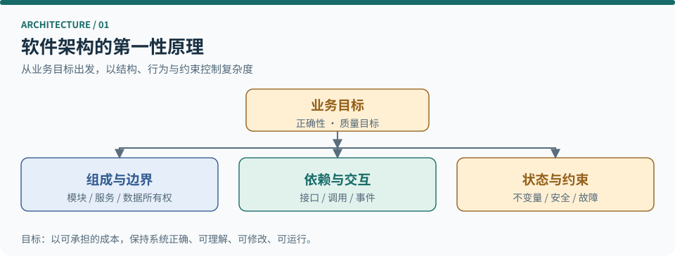
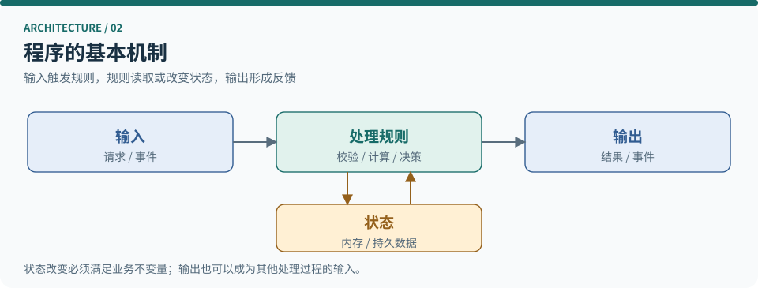
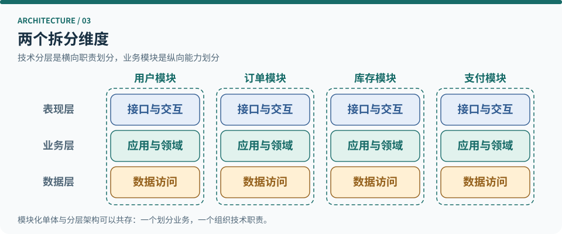
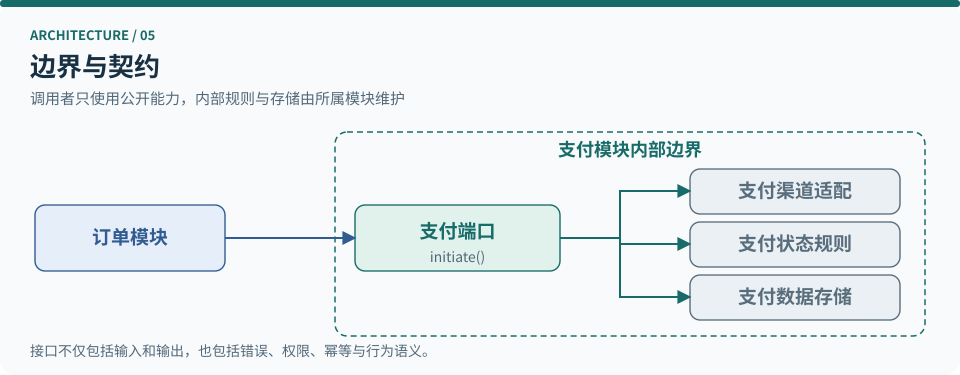
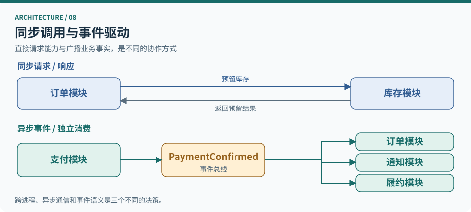
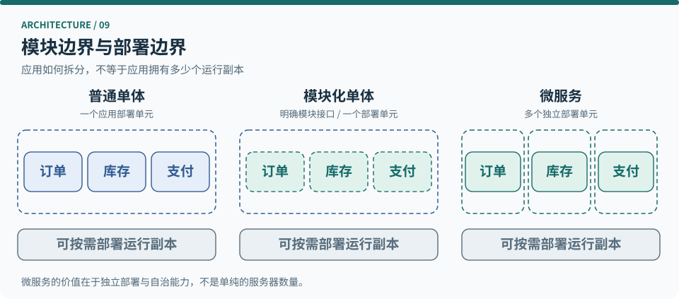
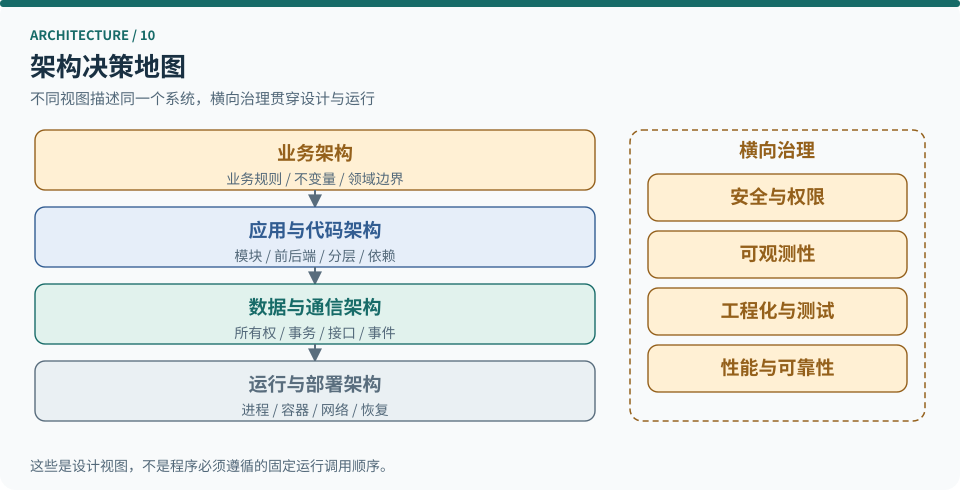
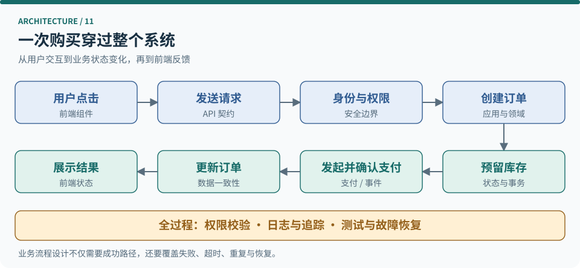
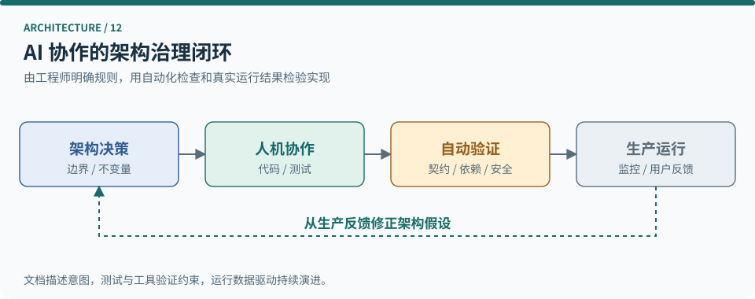

为什么一个程序可以同时采用前后端分离、DDD、模块化单体、整洁架构和事件驱动？为什么拆成微服务之后，原本简单的事务突然变得复杂？在 AI 能够辅助生成大量代码的时代，工程师真正需要掌握的又是什么？

答案不在某个框架里。架构是对系统的组成、边界、依赖、状态与交互进行有意识的设计，以控制复杂度、变化成本和运行风险。

<!-- truncate -->



*图 01 · 架构不是一张技术清单，而是一组相互约束的设计决策。*

## 01 从最原始的程序开始

一个有状态的业务程序，可以抽象为：接收输入，依据规则读取或改变状态，产生输出。下面是一个极简的购买程序（金额用整数分表示）：

```python
balance = 10000
price = 3000
quantity = 2
inventory = 10

total = price * quantity
if quantity > 0 and balance >= total and inventory >= quantity:
    balance -= total
    inventory -= quantity
    print("购买成功")
else:
    print("购买失败")
```

它没有数据库、API、微服务或 MVC，但仍能执行购买规则。现实中的程序之所以需要架构，是因为功能持续增加、业务不断变化、多人协作以及运行环境不可靠。上面的程序甚至无法处理并发、持久化、身份认证或中途失败。

> **第一性原理：** 在满足业务正确性和质量目标的前提下，以可以承担的成本管理复杂度。架构不是为了让程序看起来专业，而是为了使它能够长期运行和改变。



*图 02 · 程序的基本机制。状态改变必须遵守业务规则，运行结果又会成为下一次处理的输入。*

## 02 分而治之：为什么需要拆分

当商品、用户、订单、库存、支付、物流全部混在一起时，理解任何一个功能都可能需要阅读整个系统。拆分的目的，是让人能够独立理解一个局部，而不必同时理解所有细节。

软件有两种常见的拆分维度：按技术职责横向划分（表现、应用、领域、数据访问），以及按业务能力纵向划分（用户、订单、库存、支付）。



*图 03 · 横向分层与纵向业务模块可以同时成立。每个业务模块可以独立拥有自己的接口、规则与数据访问逻辑。*

这解释了为什么模块化单体与分层架构不冲突：前者决定业务模块如何组织和部署，后者决定模块内部的职责如何划分。DDD 的战略设计关注业务模型和限界上下文，不等于必须拆成微服务；一个限界上下文也不必机械对应一个服务。

实际项目中可以从一个简单模块起步，随着独立变化的原因出现再拆分。目录数量并不是架构质量指标。

## 03 高内聚、低耦合：按照变化原因拆分

**内聚**衡量模块内部职责是否紧密相关；**耦合**描述模块之间依赖的程度。真正重要的不是依赖数量本身，而是某个决策发生变化时，影响会传播到哪里。


*图 04 · 减少不必要的依赖，可以限制变化传播；低耦合不等于完全没有依赖。*

例如，订单创建、取消和状态转换通常围绕订单生命周期；支付渠道适配器却会因第三方协议变化而变化。如果把支付渠道的细节散落在订单、库存和物流模块里，替换渠道就会变成全局修改。

判断边界是否合理，可以使用一个问题：**一次常见的需求变更，需要同时修改多少不相关的模块？** 需要一起保持一致的规则应当尽量聚在一起；由于不同原因变化的细节可以隔离。不要为了减少依赖而拆散本来必须共同维护的不变量。

## 04 边界与契约：独立的部分如何合作

拆分之后，模块必须协作。边界规定谁可以访问什么，契约规定双方如何协作。封装的意义不是藏起代码，而是让调用方不必知道不属于它的实现细节。

假设订单模块需要发起支付。如果它直接写支付表，就会依赖支付模块的数据库结构、状态约定和内部规则。更好的方式是通过一个明确的接口提交支付请求：

```typescript
interface PaymentPort {
  initiate(input: {
    orderId: string;
    amountInCents: number;
    idempotencyKey: string;
  }): Promise<{ paymentId: string; status: 'PENDING' | 'CONFIRMED' }>;
}
```

注意，接口不只是函数签名。它还需要规定金额单位、错误语义、超时后的行为、幂等键的作用域、权限与状态含义。支付发起成功也不一定代表资金已经到账。



*图 05 · 调用者依赖公开契约，内部实现由拥有它的模块自行维护。*

函数、类、模块、API、服务都具有边界，但尺度不同。容器提供的是运行环境和资源隔离，不能替代代码与数据的所有权设计。

## 05 隔离变化：依赖方向比目录更重要

业务规则不需要知道数据库品牌、HTTP 框架或者页面样式。整洁架构、六边形架构和洋葱架构的共同思想，是把核心业务和外部技术实现隔离，通过端口与适配器控制依赖方向。

```typescript
interface OrderRepository {
  save(order: Order): Promise<void>;
}

class CreateOrder {
  constructor(private readonly repo: OrderRepository) {}

  async execute(order: Order) {
    // 实际应用还需校验规则、控制事务与处理异常
    await this.repo.save(order);
  }
}
```

应用层定义所需要的能力，基础设施层实现接口，由应用的装配入口注入具体实现。应用层调用存储实现，但在源代码中不需要 import 具体的 PostgreSQL 适配器。


*图 06 · 运行时调用与源代码依赖是不同的关系。依赖倒置不会改变存储操作最终仍然需要执行的事实。*

普通分层架构也可以使用依赖倒置；并不是所有程序都需要完整的整洁架构目录。业务规则复杂、外部集成容易变化或者测试隔离重要时，这种抽象更有价值。简单 CRUD 的直接实现则可能更经济。

## 06 数据与不变量：什么绝对不能被破坏

软件真正需要保护的是业务事实与规则，而不只是漂亮的模块结构。例如，库存不能小于零、同一笔支付不能重复扣款、订单状态必须按合法路径转换。这些在操作过程中始终应当成立的规则，称为业务不变量（invariant）。

| 业务事实 | 所有者 | 需要保证的规则 |
| --- | --- | --- |
| 订单状态 | 订单模块 | 不能非法跳过状态转换 |
| 可用库存 | 库存模块 | 不得超卖；预留必须可追踪 |
| 支付结果 | 支付模块 | 不得因重试重复扣款 |
| 页面状态 | 前端 | 与服务端事实协调，允许短暂加载态 |

在一个数据库事务中，可以使用条件更新、锁或合适的隔离级别维护相关不变量。比如使用 `UPDATE ... WHERE available >= quantity` 并检查影响行数，避免仅仅先读库存再无条件扣减导致并发错误。

当系统拆分到不同数据库时，本地事务不再能覆盖全部操作。外部支付平台通常也不受本地数据库事务控制，因此必须设计可恢复的业务流程。


*图 07 · 简化示例：先预留库存再发起支付；如果支付失败，释放预留。若结果未知，先查询或对账，而非盲目重复扣款。*

常见机制包括事务 Outbox（业务数据与待发布事件同一事务提交）、幂等消费、有限重试、Saga 补偿及定期对账。补偿不是数据库的时间倒流，而是新的业务动作；补偿也可能失败，需要重试或人工处理。

## 07 信息流：同步调用与事件驱动

同步调用适合需要立即取得结果的操作，例如检查库存或读取订单详情。事件适合发布已经发生的事实，例如 `PaymentConfirmed`，使订单、通知和履约模块独立响应。



*图 08 · 同步调用和异步协作是不同的信息流动方式，并不等价于单体和微服务。*

事件驱动不是简单地加入 Kafka。它要求设计事件语义、消息投递、重复消费、顺序、失败恢复和可观测性。单体可以使用进程内事件，微服务也可以使用 HTTP 或 gRPC 同步通信。是否跨进程、是否异步、是否通过事件表达业务事实，是不同的决策。

### 把通信与运行时放在同一张模型中

一次业务处理会同时涉及多个决策，它们互相配合，但并非同一层概念：

| 设计问题 | 选择与作用 | 需要决定什么 |
| --- | --- | --- |
| 调用方如何获得结果？ | 同步请求等待结果；异步交互允许发起后稍后获取结果 | 何时返回、结果如何通知或查询、超时如何处理 |
| 工作或事实如何传递？ | 直接调用、进程内事件或消息队列 | 消息表达待办任务还是已发生的事实，谁负责消费 |
| 工作由谁执行？ | 进程、线程、线程池、协程 | 并发量、资源隔离、共享状态和任务生命周期 |
| 如何等待多个网络连接？ | 非阻塞 I/O 与 `select`、`poll`、`epoll` 等多路复用机制 | 连接规模、运行时支持以及就绪后的处理方式 |
| 如何应对容量不足？ | 限流、有界队列、背压、拒绝或降级 | 每个环节的容量、等待时间和过载策略 |

例如，订单保存后可以发布 `OrderCreated` 事件，通知服务消费消息并发送通知：

```text
订单请求 → 保存订单和待发布事件 → 发布到消息队列 → 通知服务消费 → 发送通知
                                                    ↓
                                         线程池或协程执行消费任务
```

这是一种可选组合：业务数据和待发布事件可以通过事务 Outbox 一起提交，再由发布程序投递；消费端需要根据投递保证设计确认、幂等处理、重试和失败消息处理。消息队列能缓冲短时流量高峰，也让消费者按自身速度处理，但如果长期生产速度超过消费能力，消息仍会积压，因此需要监控积压及消息等待时间，并限制入口或提升有效处理能力。队列不保证天然不丢失、只处理一次或严格有序，这些取决于具体系统和配置。

**异步是交互方式，消息队列是传递消息的基础设施，线程和协程是组织执行的方式。** 异步不一定需要消息队列；使用消息队列也不必然意味着调用方不等待结果。接下来还要看，一个执行线程如何同时等待多个连接。

## 08 执行模型：工作由谁执行，资源如何分配

一次购买请求进入服务后，系统不仅要知道订单、库存和支付如何协作，还要决定：**每项工作在哪里执行，等待期间能否处理其他工作，以及资源耗尽时怎么办？** 这些选择共同构成运行时的执行模型。模块边界清晰，并不自动意味着系统能够承受并发流量。

先沿请求识别工作：参数校验通常是短暂计算；查询数据库和调用支付平台需要等待外部结果；生成复杂报表可能长时间占用 CPU。再结合语言运行时、所用库和负载特点选择执行方式：

| 工作特点 | 可以考虑的设计 | 需要注意 |
| --- | --- | --- |
| 大量并发网络等待，依赖支持非阻塞接口 | 用协程和事件循环组织任务 | 协程在适当的等待点让出执行权；阻塞调用或长时间计算会拖住事件循环 |
| 必须调用阻塞式 SDK 或执行阻塞 I/O | 交给线程池执行 | 线程和排队任务都需要限制；等待外部系统时线程仍被占用 |
| 长时间 CPU 密集计算 | 使用适当的工作线程、独立进程或计算服务 | 能否并行取决于语言运行时；例如普通 CPython 中纯 Python 线程受 GIL 约束，进程间通信也有成本 |

这不是按任务名称机械选技术：线程也能处理网络 I/O，协程也能执行短计算。关键是测量等待、计算和资源占用，并确认具体库的行为。**同步或事件驱动描述的是协作方式；线程或协程描述的是任务如何执行，两者可以组合。**

### 多路复用和协程如何配合

大量连接大部分时间都在等待网络数据时，可以用 I/O 多路复用让一个线程同时关注多个连接。在一种常见的协程运行时中，任务等待网络 I/O 时暂停，事件循环借助多路复用器等待就绪事件，再安排对应任务继续运行：

```text
多个连接 → I/O 多路复用器 → 事件循环 → 恢复相应协程 → 尝试读写和处理
```

就绪通知表示可以尝试读写，并不表示业务操作已经完成；程序仍需处理暂时无法读写、连接关闭和错误。协程负责组织可暂停和恢复的任务，多路复用负责等待多个 I/O 事件；两者可以配合，也可以分别使用。它们不能消除 CPU、数据库连接或下游服务的容量限制，事件循环中的阻塞调用还可能拖慢其他任务。

### 从支付流程设计执行资源

假设服务采用协程处理请求，数据库驱动支持异步接口，但支付 SDK 只有阻塞接口。可以让请求协程完成校验和数据库操作，再把 SDK 调用交给**专用的有限线程池**；同时限制支付调用的并发和排队数量。支付平台变慢时，新的工作只在有限范围内等待，达到上限后按业务策略拒绝或降级，避免无限积压。

这个设计还需要回答几个相互关联的问题：

- **容量与隔离：** 支付线程池、数据库连接池和下游支付接口各能承受多少并发？报表等任务是否需要独立资源，避免互相挤占？单实例的限制乘上副本数后，也要落在下游承受范围内。
- **队列与背压：** 队列多长、最多等多久？到达上限时向调用方返回什么？限流和拒绝是有意识的过载策略，而不是无限增加线程或协程。
- **生命周期与失败：** 请求超时或取消后，谁负责剩余工作？取消等待不一定能终止已经运行的阻塞调用，也不代表支付平台没有处理请求。支付结果未知时应记录状态，并按平台契约查询或对账；后台任务则需要明确持久化、重试与负责人。
- **共享状态与观测：** 并发任务如何保护共享数据和业务不变量？应观测队列等待时间、活跃任务数、线程池和连接池占用、超时率及下游延迟，用实际负载检验容量假设。

具体大小不能只凭经验固定：需要依据流量、延迟目标、下游配额和压测结果调整。执行模型设计的目标，是让工作在有限资源下可推进、可隔离，并在过载和失败时保持可预期。

任务准入、按需激活、长期等待与重启恢复等问题，可继续阅读[运行时架构的第一性原理：如何用有限资源承载大量任务](../2026-11-27-runtime-architecture/index.md)。

## 09 运行与故障：代码结构不等于部署结构

一个模块是逻辑边界，一个服务可以是部署边界，一个进程或容器则是运行边界。模块化单体可以部署多个副本，也能通过负载均衡实现横向扩容。微服务带来的关键能力是独立发布、扩缩容以及故障隔离的可能性，而不是单纯的进程数量。



*图 09 · 模块边界与部署边界并不必然重合。单体也能多副本运行。*

在任何部署方式下，都需要考虑网络中断、进程崩溃、流量突增和权限攻击。超时、限流、负载均衡、备份、认证授权、告警、回滚等机制都来自对这些风险的分析，而不是必须安装某个中间件。

## 10 架构之间的关系：它们回答不同的问题

前面已经推导了多种架构的动机。现在可以把它们归纳为一张决策地图。

| 设计维度 | 核心问题 | 典型方案 |
| --- | --- | --- |
| 业务建模 | 什么规则与事实必须成立？ | DDD、状态机、不变量 |
| 应用结构 | 如何划分业务边界？ | 模块化单体、微服务 |
| 代码依赖 | 代码如何组织和隔离变化？ | 分层、MVC、整洁架构、六边形 |
| 用户交互 | 如何组织页面与客户端状态？ | 组件化、路由、状态管理、SSR/CSR |
| 数据设计 | 谁拥有数据，如何维护一致性？ | 数据模型、事务、缓存、Outbox |
| 通信与协作 | 如何交互、传递消息和处理失败？ | 同步调用、异步交互、事件、消息队列 |
| 执行与 I/O | 工作由谁执行，如何等待和分配资源？ | 线程池、协程、事件循环、I/O 多路复用、限流 |
| 运行 | 在哪里运行，如何发布与恢复？ | 容器、负载均衡、集群 |
| 横向治理 | 如何保证持续正确、安全、可维护？ | 测试、权限、可观测性、CI/CD |

例如一个中小型商城可以采用 React 前端、模块化单体后端、按业务划分模块、复杂模块使用整洁架构、REST API、PostgreSQL 和 Docker。它们可以共存，因为分别对应不同的设计维度。



*图 10 · 各种架构是对同一个系统的不同视图。安全、可观测性和工程治理横跨这些视图。*

## 11 一次购买如何穿过整个系统

以一个简化的商城为例：用户点击购买；前端发送请求；后端验证身份、订单参数与权限；订单用例协调价格确认和库存预留；系统保存待支付订单；支付模块发起支付并等待确认；订单依据确认事件更新状态；前端查询或接收通知后更新页面。



*图 11 · 这是示意性的模块化商城流程，不是具体支付平台的接入规范。*

在设计这个流程时，不能只画成功路径。需要同时决定支付未知、库存不足、重复提交、通知延迟、数据更新失败等情况。前端隐藏按钮不能代替后端授权；前端加载状态也不能代替订单真实状态。

## 12 所有架构都是权衡

不存在能够同时最大化所有质量属性的通用架构。微服务提高独立发布能力，却引入网络故障和跨服务一致性问题；缓存降低读延迟，却可能产生陈旧数据；抽象接口隔离变化，却增加理解与维护成本。

| 选择 | 获得的能力 | 引入的代价 |
| --- | --- | --- |
| 模块化单体 | 清晰边界、本地事务、部署简单 | 独立发布与独立扩容受限 |
| 微服务 | 独立部署、扩容与故障隔离潜力 | 网络、数据一致性、运维开销 |
| 同步调用 | 直接反馈、流程易追踪 | 调用链延迟、运行时依赖 |
| 异步事件 | 削峰、独立消费、时间解耦 | 重复、乱序、最终一致性 |
| 缓存 | 降低读取负载和延迟 | 失效策略与一致性 |
| 依赖倒置 | 更易测试与替换实现 | 额外接口、装配与抽象成本 |

先明确质量目标，比如核心 API 的延迟目标、可接受的数据丢失量、恢复时间目标、发布频率和团队维护能力，然后选能够满足这些目标的最简单方案。没有指标和现实约束的架构对比，很容易退化为技术偏好。

## 13 AI 时代：把架构转化为可执行的约束

AI 可以辅助代码实现，但并不会自动知道业务的不变量、模块所有权或部署限制。工程师需要把这些隐含决策转化为可以检查的规则。



*图 12 · 架构约束由工程师定义，代码由人工和 AI 共同实现，并通过自动化验证和生产反馈持续演进。*

一个示意性的项目结构如下：

```text
project/
├── docs/
│   ├── architecture.md       # 系统边界与质量目标
│   ├── business-rules.md     # 不变量、状态转换
│   └── adr/                  # 架构决策与取舍
├── frontend/src/features/    # 前端业务功能
├── backend/modules/
│   ├── order/
│   │   ├── domain/
│   │   ├── application/
│   │   ├── infrastructure/
│   │   └── presentation/
│   ├── inventory/
│   └── payment/
├── contracts/               # API 与事件契约
├── tests/                   # 契约、集成、架构测试
├── deploy/                  # 部署和运行环境
└── AGENTS.md                # AI 协作指引
```

文档表达意图，类型系统约束数据结构，测试验证业务规则，依赖检查防止跨边界导入，CI 阻止不合格的变更进入发布流程。生产日志和指标再检验当初的架构假设。

例如 AI 要求新增取消订单功能时，先明确哪些状态允许取消、库存如何释放、支付如何退款、重复请求怎样处理，然后要求它只通过公开端口调用其他模块，并编写成功、异常和重复请求的测试。这比仅仅告诉 AI “使用 Clean Architecture” 更有效。

## 14 一套可以反复使用的架构设计问题

面对任何新项目，先回答这些问题，而不是从框架选型开始：

1. **目标：** 谁使用系统，要完成什么任务？质量目标是什么？
2. **规则：** 哪些业务不变量必须始终成立？哪些状态变化合法？
3. **拆分：** 哪些职责共同变化，哪些职责需要独立变化？
4. **边界：** 谁拥有数据和实现？哪些能力需要公开？
5. **依赖：** 源代码依赖、运行时调用和数据依赖分别是什么？
6. **协作：** 调用要同步还是异步？失败、重复与乱序如何处理？
7. **执行：** 任务如何运行、等待和隔离？容量耗尽或任务取消时怎么办？
8. **运行：** 如何部署、观测、扩容、回滚和恢复？
9. **演进：** 一次真实的需求变更将影响哪些部分？如何验证？

这些不是固定的瀑布式步骤。设计过程应该根据业务反馈、测试和运行数据迭代。

## 结语：架构不是记忆模式，而是管理变化

模块有边界，服务有边界，系统同样有边界；每个尺度都需要决定内部规则、外部契约、依赖关系与失败行为。真正掌握架构之后，你不必从模式名称寻找问题，而能从问题出发选择合适的模式。

**架构师真正管理的不是代码数量，而是整个系统的复杂度、正确性、变化成本和运行风险。**

### 延伸阅读

- [David Parnas: On the Criteria To Be Used in Decomposing Systems into Modules](https://doi.org/10.1145/361598.361623) — 按设计决策和信息隐藏拆分模块。
- [Martin Fowler: Microservices](https://martinfowler.com/articles/microservices.html) — 服务自治与独立部署的设计思想。
- [Robert C. Martin: The Clean Architecture](https://blog.cleancoder.com/uncle-bob/2012/08/13/the-clean-architecture.html) — 依赖规则与核心业务隔离。
- [Microsoft: Compensating Transaction pattern](https://learn.microsoft.com/en-us/azure/architecture/patterns/compensating-transaction) — 跨系统操作失败时的补偿设计。
