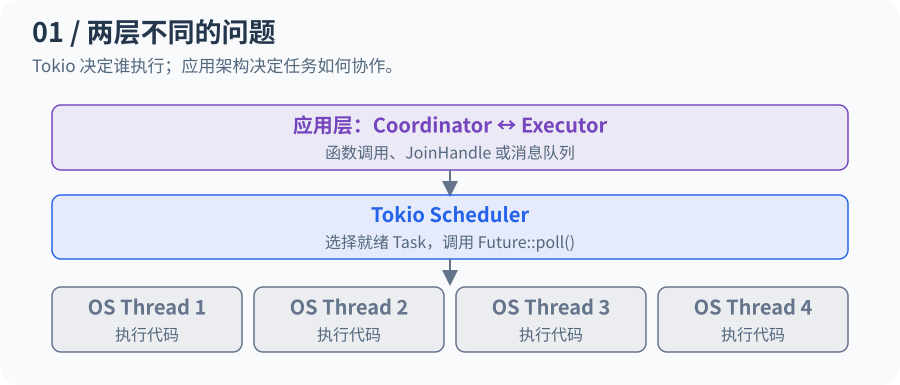
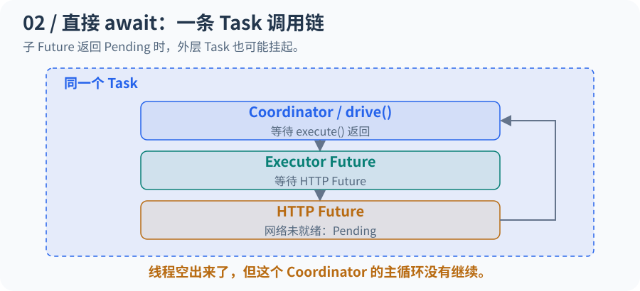
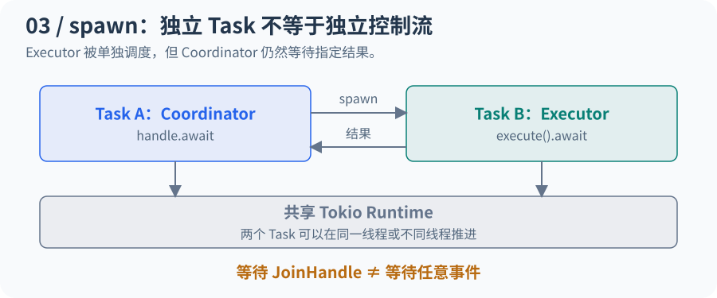
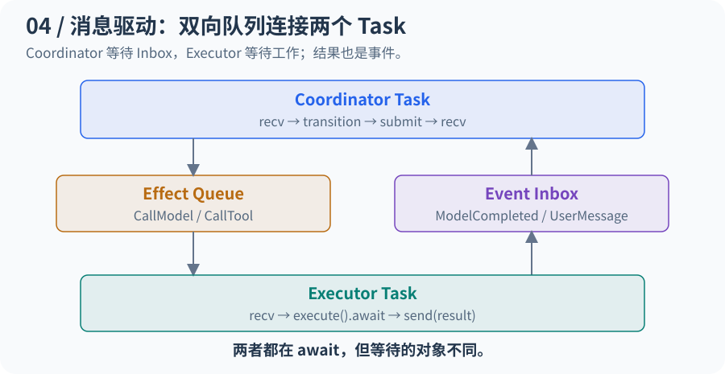
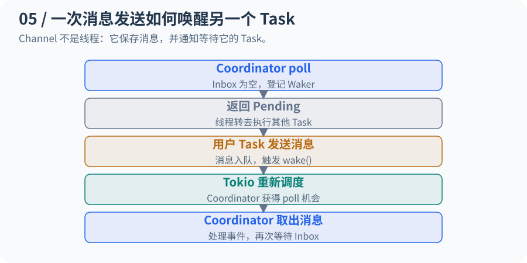
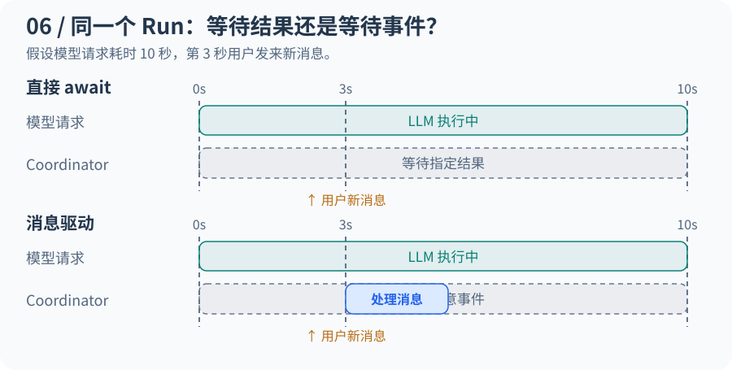
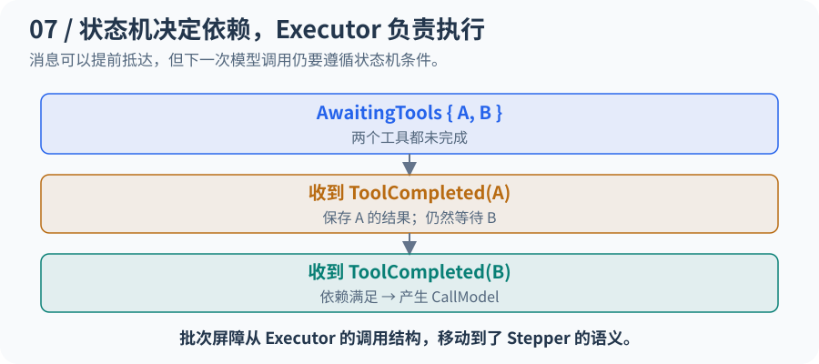
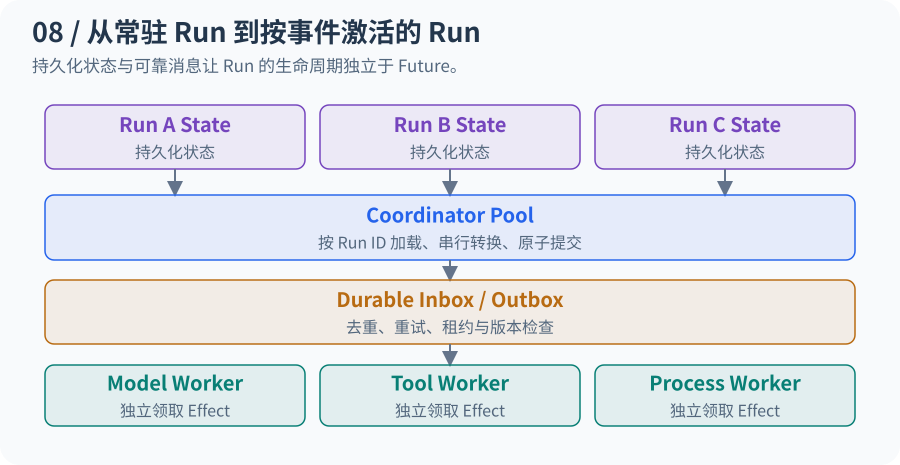

在设计一个异步 Runtime 时，一个很自然的问题是：既然 `async/await` 已经可以让多个协程共享线程，为什么还需要消息队列？为什么要把 Coordinator 和 Executor 拆成独立任务？直接调用异步函数不就可以了吗？

这两个问题分别属于不同层次：**协程调度解决的是执行资源如何复用，消息驱动解决的是执行单元之间如何协作。**

本文以 Rust Tokio 为例，从一段最简单的 `await` 代码出发，逐步理解独立 Task、消息队列、Actor 和可恢复 Agent Runtime。

## 1. 先区分两个层次：协程调度与应用架构

假设一台机器上有四条 Tokio Worker 线程，同时运行许多异步 Task。Tokio 负责决定哪一个就绪 Task 获得执行机会，通过调用 Future 的 `poll()` 推进任务。当任务等待尚未完成的 I/O 并返回 `Pending` 时，线程可以去执行其他任务。

但是，Tokio 不会替我们决定一个应用应该由几个 Task 组成，也不会替我们决定它们之间怎么传递数据。



| 层次 | 解决的问题 |
| --- | --- |
| 操作系统调度 | 哪个线程获得 CPU 执行机会？ |
| Tokio 调度 | 哪个就绪 Task 接下来被 poll？ |
| 应用架构 | 哪些逻辑属于同一个 Task？如何通信？ |

我们用一个 Agent Runtime 作为例子。Coordinator 负责读取事件、推进 Agent 状态，Executor 负责真正调用 LLM、工具或者外部进程。接下来看看两者可以怎样协作。

## 2. 最简单的架构：直接 await

假设 Coordinator 产生了一个需要执行的 Effect，例如一次模型调用：

```rust
// 架构伪代码
async fn drive() {
    loop {
        let effect = coordinator.transition();
        let result = executor.execute(effect).await;
        coordinator.update(result);
    }
}
```

看起来这里有 Coordinator、Executor 和网络请求三个部分。它们是否分别对应三个协程？不一定。

在 Rust 中，调用 `async fn` 得到的是 Future；直接 `.await` 不会自动创建新的 Tokio Task。如果 `drive()` 是一个 Task 的主 Future，那么 `execute()` 及其内部的 HTTP Future 可以是这个 Task 内部的嵌套 Future。



当 HTTP Future 暂时无法推进时，`Pending` 沿着调用链向外返回，直到顶层 Task 归还线程的执行机会。此时其他 Run 可以继续运行。

但对于当前 Run 而言，Coordinator 主循环还停留在 `executor.execute(effect).await`。它必须等这个 Future 返回，才能执行下一条 `coordinator.update(result)`。

这不是线程阻塞，而是**控制流依赖**。

举个例子：假设 Agent A 正在等待一个耗时十秒的模型调用，Agent B 正在读取文件。Tokio 可以在 Agent A 挂起期间执行 Agent B。但 Agent A 的 Coordinator 主循环不会因此自动处理用户发来的新消息。

这就是异步调用的特点：线程可以继续工作，但一条顺序执行的业务流程仍然可以等待某个操作完成。

## 3. 第一步拆分：用 spawn 创建独立 Task

如果把 Executor 单独放进一个 Task，会发生什么？

```rust
// 架构伪代码，省略所有权与错误处理细节
let handle = tokio::spawn(async move {
    executor.execute(effect).await
});

let result = handle.await.unwrap();
coordinator.update(result);
```

这次 Executor 确实是一个可被 Tokio 独立调度的 Task。Coordinator 和 Executor 可以在不同 Worker 上执行，也可以在同一个 Worker 上交替执行。



不过注意这一句：`handle.await`。

Coordinator 虽然没有直接调用 Executor 的 Future，却仍然需要等这个特定 Task 的结果返回才能继续下一步。把执行逻辑从一个 Task 拆成两个 Task，并没有自动改变业务上的等待关系。

**拆分 Task 不等于解耦控制流。**

此外，`spawn` 还改变了取消和生命周期语义。直接等待的 Future 随外层 Future 被丢弃时通常也会被丢弃；而丢弃 Tokio 的 `JoinHandle` 并不会自动取消它对应的 Task。因此，独立 Task 需要明确管理退出、取消和错误传播。

## 4. 第二步拆分：让 Task 通过消息协作

不妨换一种思路：Coordinator 不直接等 Executor 的返回值，而是向一个队列提交工作，再回到自己的事件循环。Executor 完成工作后，将结果作为事件发回去。

先定义两类消息（以下为架构示意）：

```rust
enum Effect {
    CallModel(ModelRequest),
    CallTool(ToolRequest),
}

enum Event {
    ModelCompleted(ModelResponse),
    ToolCompleted(ToolResult),
    UserMessage(String),
    Cancel,
}
```

Effect 表示希望外部执行什么；Event 表示已经发生了什么，或者收到什么输入。



Coordinator 的主要职责变成：接收事件、执行状态转换、提交 Effect。

```rust
// 架构伪代码
while let Some(event) = event_rx.recv().await {
    let proposal = stepper.transition(&state, event)?;
    state = proposal.next;

    for effect in proposal.intents {
        effect_tx.send(effect).await?;
    }
}
```

Executor 则独立领取工作、执行 I/O、发送结果：

```rust
// 架构伪代码
while let Some(effect) = effect_rx.recv().await {
    let result_event = execute(effect).await;
    event_tx.send(result_event).await?;
}
```

两边仍然有 `await`。区别不是有没有 `await`，而是等的是什么：

```rust
// 调用驱动：等待某个特定执行结果
let result = executor.execute(effect).await;

// 消息驱动：等待下一条可处理的事件
let event = event_rx.recv().await;
```

只要 Coordinator 正在等待 Inbox 且协议允许，新用户输入、工具结果、定时器和取消事件都可以成为下一条消息。它不必等之前发出的模型请求结束才回到事件循环。

这里的 Channel 可以只是进程内的内存队列，不需要 Redis、Kafka，也不需要专门的消息线程。Tokio 的 `mpsc` 是多生产者、单消费者通道；需要多个 Executor 时，可以由一个 Dispatcher 消费并分派任务，或者为 Worker 设置各自的队列，而不是直接克隆 `mpsc::Receiver`。

## 5. 消息队列是怎么与协程调度器配合的？

假设 Coordinator 已经发送了一次 LLM 请求，正在执行 `event_rx.recv().await`。此时 Inbox 为空。

Channel 的接收 Future 返回 `Pending`，并利用 Waker 建立唤醒机制。Coordinator 暂停运行，Worker 线程转去处理其他 Task。

当用户输入所在的 Task 将消息放入 Inbox，Channel 可以唤醒等待消息的 Coordinator。Tokio 重新安排它执行，Coordinator 再次 poll 接收 Future，从队列取出消息。



从 Tokio 的视角看，等待网络与等待消息并没有引入两套调度机制。它们都是 Future，在无法推进时挂起，在相关条件改变时通过 Waker 获得再次 poll 的机会。

`wake()` 不意味着立即抢占正在执行的任务，也不意味着下一次 poll 必定成功。它通知调度器该任务值得再次推进。

所以消息队列不是另一个协程调度器，而是 Task 之间传递数据并建立唤醒关系的通信机制。

## 6. 具体差异：同一个 Run 能否处理其他事件？

假设 LLM 请求耗时十秒，用户在第三秒发来一条消息：请改用更简短的回答方式。



在直接 `await` 的简单实现里，主循环仍在等待 LLM 请求，必须通过额外机制才能处理用户消息。

在消息驱动实现里，Coordinator 在等待 Inbox，因此可以先收到 `UserMessage`，将其保存为下一轮指令，或者按协议决定是否取消旧请求。第十秒收到 `ModelCompleted` 后，再根据最新状态处理结果。

注意：**提前接收用户消息不等于自动改变一个已经发出去的模型请求。** 如果要撤销旧请求或者忽略迟到结果，需要显式的取消机制、请求 ID 和状态检查。已经发生的外部副作用也不一定能够撤销。

对于简单的事件需求，不一定要拆分 Executor。使用 `tokio::select!` 同样可以让一个 Task 同时等待多个 Future，例如：

```rust
let model = call_model();
tokio::pin!(model);

loop {
    tokio::select! {
        result = &mut model => {
            handle_model_result(result);
            break;
        }
        Some(event) = inbox.recv() => {
            handle_event(event);
        }
    }
}
```

这段伪代码将模型 Future 保存在循环之外，避免每收到一次消息就重新创建请求。实际使用时还需要考虑 Channel 关闭、错误、取消安全和退出策略。

由此可见，消息驱动不是实现响应性的唯一方法。它更适合把多个来源的事件统一起来，并让 Executor 生命周期独立于 Coordinator 的场景。

## 7. 亲手验证：单线程也能运行消息驱动架构

下面写一个完整的小程序。我们用 `tokio::time::sleep` 模拟耗时两秒的 LLM 调用，用另一个异步任务模拟半秒后发送的用户消息。Runtime 刻意配置为单线程，证明消息驱动不依赖更多 OS 线程。

创建项目，向 `Cargo.toml` 添加依赖：

```toml
[dependencies]
tokio = { version = "1", features = ["macros", "rt", "sync", "time"] }
```

`src/main.rs`：

```rust
use std::time::Duration;
use tokio::{sync::mpsc, time::{sleep, Instant}};

#[derive(Debug)]
enum Event {
    UserMessage(&'static str),
    ModelCompleted(&'static str),
}

#[tokio::main(flavor = "current_thread")]
async fn main() {
    let start = Instant::now();
    let (tx, mut rx) = mpsc::channel::<Event>(8);

    // Executor Task：模拟模型请求
    let model_tx = tx.clone();
    let executor = tokio::spawn(async move {
        sleep(Duration::from_secs(2)).await;
        model_tx.send(Event::ModelCompleted("模型结果"))
            .await.unwrap();
    });

    // 外部输入 Task
    let user_tx = tx.clone();
    let user = tokio::spawn(async move {
        sleep(Duration::from_millis(500)).await;
        user_tx.send(Event::UserMessage("请简短回答"))
            .await.unwrap();
    });

    // 不再保留多余的 Sender，便于正常关闭 Channel。
    drop(tx);

    // Coordinator：由 main Future 驱动。
    while let Some(event) = rx.recv().await {
        match event {
            Event::UserMessage(text) => {
                println!("{:?}: 收到用户消息：{}", start.elapsed(), text);
            }
            Event::ModelCompleted(text) => {
                println!("{:?}: 收到模型结果：{}", start.elapsed(), text);
            }
        }
    }

    executor.await.unwrap();
    user.await.unwrap();
}
```

运行 `cargo run` 后，预期输出大致如下（具体耗时取决于机器和调度）：

```text
500ms: 收到用户消息：请简短回答
2s: 收到模型结果：模型结果
```

虽然模型执行需要两秒，Coordinator 并没有一直等待该结果；它先处理半秒时到达的用户消息。

而且整个程序只有一个异步调度线程驱动这些 Task。`sleep().await` 挂起时不占用线程执行机会，Channel 收到消息时又可以唤醒 Coordinator。

这个示例为了突出事件入口，只为模型调用创建一个 Task，没有实现完整 Effect Queue、取消和持久化。它是上面架构的最小子集，而不是一个生产级 Agent Runtime。

## 8. 状态机与 Executor 如何真正解耦？

考虑一个更复杂的 Agent：模型返回两个工具调用 A 和 B，A 一秒完成，B 六十秒完成。下一轮模型推理必须等待两者都返回。

在调用驱动模式中，Executor 可以并发运行 A 和 B，再通过 `execute_tool_batch().await` 返回整批结果。批次屏障位于 Executor 的函数调用结构中。

在消息驱动模式中，每个工具可以独立发送结果事件。Coordinator 先收到 A 的结果，保存下来；收到 B 后，Stepper 发现依赖条件满足，才发出下一次模型调用。



状态机可能具有类似这样的状态：

```rust
// 架构伪代码
struct AwaitingTools {
    pending: HashSet<ToolCallId>,
    results: HashMap<ToolCallId, ToolResult>,
}
```

每个 `ToolCompleted` 事件只移除对应的 pending ID，并保存结果。直到 pending 集合为空，才产生 `CallModel`。

这时 Executor 只关心工具如何执行，不必负责 Agent 为什么需要等待这些工具，也不必决定什么时候进入下一轮推理。

两种架构都可以并发执行工具，完成整批工具的时间未必有差异。消息驱动的价值是将**业务依赖从执行器的调用结构移动到状态机的语义中**。

当然，如果协议要求按工具调用顺序构造上下文，就需要在 Stepper 中显式排序；消息到达顺序不一定等于工具调用顺序。

## 9. 从独立 Task 到 Actor：让状态拥有清晰的所有者

所谓 Actor，可以简单理解为一个拥有自己状态、通过 Mailbox 收取消息的逻辑执行单元。

在 Agent Runtime 中，可以让每个 Run 对应一个 Actor：所有状态变化都通过这个 Run 的 Coordinator 处理，其他 Task 不能直接修改 Run 的可变状态，而是发送事件。

```text
Run A Actor ── 独占 State A
Run B Actor ── 独占 State B
Run C Actor ── 独占 State C
       │
       └── 共享 Executor / Scheduler
```

这样，多个 Run 可以并发工作，而同一个 Run 的状态转换仍然是串行的。它不需要为了每一次状态修改都让多个 Worker 竞争同一把业务状态锁。

独占状态不意味着整个系统没有锁；Channel、存储和调度器内部仍然可能使用同步机制。

如果系统有很多 Run，每个 Run 一个常驻 Tokio Task 是一种自然的实现。进一步看，如果 Run 的状态已经持久化，输入输出也都通过可靠消息表达，那么 Run 甚至不必一直保留一个 Future。

## 10. 让 Run 脱离协程生命周期：持久化消息驱动

假设某个 Agent 提交人工审批后，需要等待三天。我们可以让它的 Future 挂起，但也可以将 Run 的状态写入持久化存储，释放其执行资源。三天后，审批事件到达时再加载状态并执行下一次转换。



这种设计类似虚拟 Actor：Run 是逻辑实体，Task 只是处理事件时使用的执行资源。

不过，内存 Channel 本身不能保证进程崩溃后的消息恢复。要实现可靠执行，还需要以下机制：

- Durable Inbox：记录进入系统的事件，以及是否已经被处理。
- Durable Outbox：将状态更新和待执行 Effect 原子提交，避免状态已经改变但任务丢失。
- Run 所有权、租约或版本 CAS：确保同一个 Run 的状态转换不会并发覆盖。
- Effect ID、Attempt ID 和幂等键：将迟到、重复、重试结果与对应执行关联。
- 取消、超时与恢复策略：对于非幂等外部操作，不能因结果未知就盲目重试。

消息化并不会自动获得 Exactly Once、分布式一致性或可靠性；这些仍需要明确的协议与存储保证。对于大规模系统，它提供的是进一步拆分执行位置和生命周期的边界。

## 11. 回到 Autra：什么是语义分离，什么是调度分离？

[Autra](https://github.com/stack-call/autra/tree/mvp-v1) 是一个 Rust Agent Runtime 项目。以本文讨论的 `mvp-v1` 架构模型为例，它已经有 `AcceptedEvent`、`TransitionProposal`、`EffectIntent` 等抽象，将状态机与实际副作用区分开。

我们可以把之前讨论过的 Run 主驱动简化为：

```text
Event → Stepper → Proposal → Execute Effect (await) → Result
          ↑                                            │
          └────────────────────────────────────────────┘
```

这种方式已经实现了状态转换与副作用执行的**语义分离**：Stepper 决定做什么，Executor 决定如何执行。

如果未来让 Coordinator 只处理 Inbox，让 Executor 独立领取 Outbox 中的任务，则可以进一步实现**调度与生命周期分离**：

```text
Event Inbox → Coordinator / Stepper → Effect Outbox
     ↑                                      │
     └────────── Executor Workers ──────────┘
```

这里并没有引入另一套线程池。两种架构仍然可以使用同一套 Tokio Runtime，Autra 的业务调度器也仍然负责模型、工具和进程的资源准入，而不是代替 Tokio 调度 Task。

上述图示是对该版本讨论中的控制流的抽象，以及一种可能的演进方案，不是对仓库当前每个执行路径的逐行描述，也不代表消息驱动 Worker 已经实现。普通 ReAct Agent 往往只需顺序等待 LLM 和工具，现有调用驱动模式完全可以满足需求。

## 12. 消息驱动是不是一定更好？

并不是。它减少了一种耦合，但同时引入了新的复杂度。

| 维度 | 直接 async/await | 独立 Task + 消息驱动 |
| --- | --- | --- |
| 异步 I/O | 支持 | 支持 |
| 多 Run 并发 | 支持 | 支持 |
| 同 Run 接收多个事件来源 | 可用 select 等机制 | 可统一进入 Inbox |
| 控制流 | 等待指定结果 | 消费任意可处理事件 |
| 取消与生命周期 | 嵌套 Future 较易管理 | 需要明确管理 Task 与协议 |
| 队列与背压 | 相对简单 | 需要设计容量与过载策略 |
| 持久化与独立 Worker | 也可实现 | 消息边界更便于进一步拆分 |
| 代码理解成本 | 较低 | 较高 |

特别是有界 Channel：当队列满了，`send().await` 本身也可能等待。因此，如果 Coordinator 等待 Effect Queue 空位，同时 Executor 等待 Event Inbox 空位，就可能形成循环等待。生产级设计需要保证持续消费、为控制事件预留通路，或者通过持久化 Outbox、合理限流等机制消除这种依赖。

实践中，可以先从直接调用做起。当业务出现多来源事件、长生命周期、复杂协作或者独立 Worker 的需求，再引入消息驱动；不要仅仅因为架构看起来更先进而增加复杂性。

## 总结

从底层往上看，整个系统的职责是这样的：

- OS 调度线程。
- Tokio 调度就绪 Task。
- Channel 传递消息，并通过 Waker 通知等待它的 Task。
- Coordinator 维护 Run 状态，Stepper 根据事件决定下一步。
- Executor 执行 Effect，返回结果事件。

直接 `await`、`spawn` 后等待 JoinHandle、消息驱动，三者都可以是异步的。真正的区别在于 Task 的划分、控制流的等待对象和生命周期的依赖关系。

**协程调度解决的是谁获得执行机会，消息驱动解决的是谁应该处理什么事件。** 当状态与消息可以独立保存时，Run 还可以进一步成为一个按事件激活的逻辑实体，而非必须一直存活的协程。

## 参考资料

- [Tokio Tutorial：Channels](https://tokio.rs/tokio/tutorial/channels)
- [Tokio Tutorial：Select](https://tokio.rs/tokio/tutorial/select)
- [Tokio：Task](https://docs.rs/tokio/latest/tokio/task/)
- [Tokio：JoinHandle](https://docs.rs/tokio/latest/tokio/task/struct.JoinHandle.html)
- [Tokio：MPSC Channel](https://docs.rs/tokio/latest/tokio/sync/mpsc/)
- [Rust：Future](https://doc.rust-lang.org/std/future/trait.Future.html)
- [Rust：Waker](https://doc.rust-lang.org/std/task/struct.Waker.html)
- [Autra：mvp-v1 分支](https://github.com/stack-call/autra/tree/mvp-v1)
