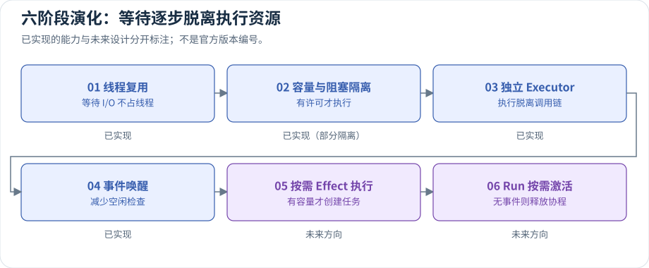
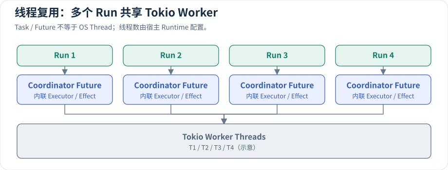
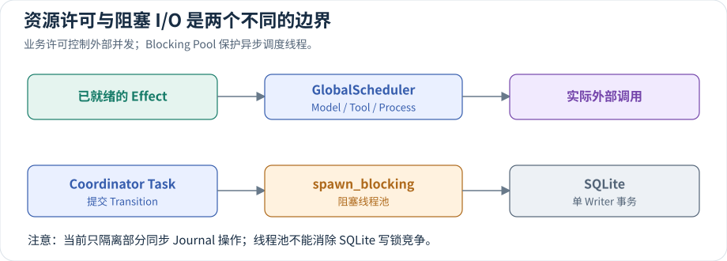
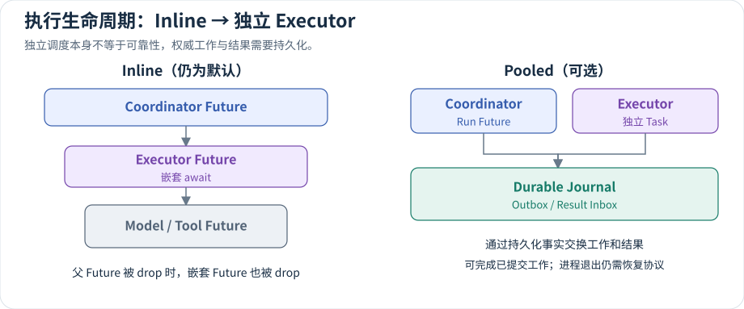
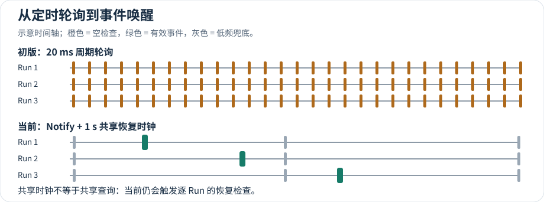
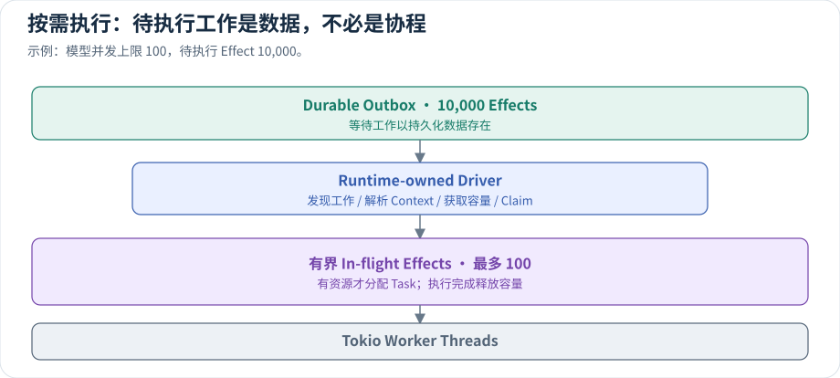
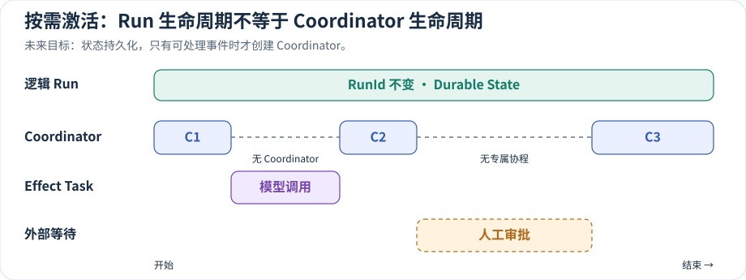
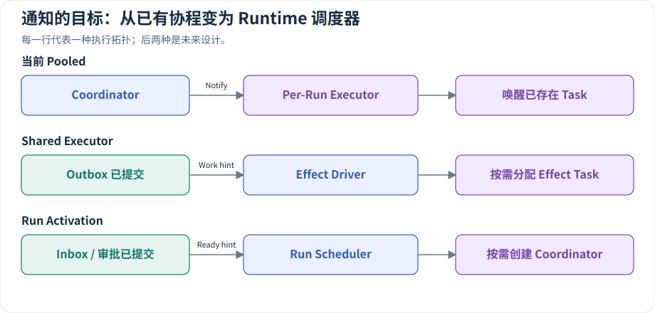
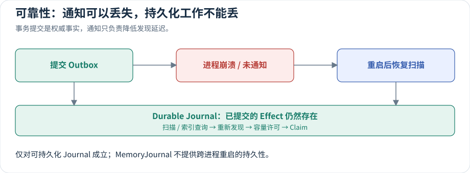
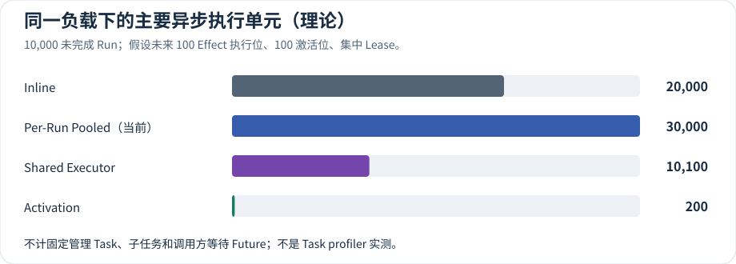

Autra Runtime 的演化并不只是把同步代码改成异步代码，也不是简单地将执行模块拆分成更多协程。它真正要解决的问题是：**在大量并发 Run 下，让线程、协程、内存和外部执行资源尽量只服务于当前需要处理的工作。**

从最初的异步线程复用，到独立 Executor、事件唤醒，再到未来的共享执行与 Run 按需激活，贯穿其中的是同一个原则：将等待中的逻辑工作与实际执行资源分离。

:::info 阅读范围
本文以 `stack-call/autra` 默认分支 `mvp-v1` 的提交 [`8d05a0f`](https://github.com/stack-call/autra/commit/8d05a0f1263d97f3e60fa570c9f65dda36c876b4)（2026-11-26）为源码基准。六个阶段是本文为理解资源演化划分的分析框架，并非项目的官方版本号。第一至第四阶段描述已实现的能力（阻塞 I/O 隔离尚不完整）；第五、六阶段是根据现有机制推导的设计方向。当前 Inline 仍为默认模式，Pooled 是可选的 Journaled 模式。
:::



## 1. 统一视角：我们究竟在优化什么？

需要先区分逻辑执行与实际计算资源，否则很容易把业务调度、协程池和物理线程池混为一谈。

| 层次 | 概念 | 作用 |
| --- | --- | --- |
| 逻辑工作 | Run / Effect | Run 是一次 Agent 执行；Effect 是模型调用、工具调用等执行意图 |
| 执行职责 | Coordinator / Executor | 前者推进状态，后者执行 Effect |
| 异步计算 | Future / Tokio Task | Future 是可被 poll 的状态机；Task 是 Tokio 独立调度的执行单元 |
| 物理资源 | OS Thread / Blocking Thread | 真正执行机器指令的线程；阻塞线程可承载同步 I/O |
| 业务容量 | Permit | 限制模型、工具、进程、环境等资源的并发占用 |

`async fn` 返回 Future；调用 `.await` 不会自动创建 Task。只有诸如 `tokio::spawn` 的操作才为 Future 分配独立的 Tokio 调度身份。多线程 Tokio 可以在 Worker Thread 之间调度可迁移的 Task，但不会为每个 Task 创建一个 OS Thread。本文用“协程”泛指异步执行单元，在涉及计数时明确区分 Future 和独立 Task。

从资源角度看，至少需要观察四类成本：物理线程占用、常驻 Future 与 Context 的内存、每秒无效唤醒与 Journal 访问、外部资源竞争。四者不等价：一个 Pending Future 可以不消耗 CPU，却仍占用内存；减少协程数量也不必然提高吞吐量。

下文始终使用相同的视角：工作何时产生、何时创建执行单元、何时占用线程、等待时保留什么、以及谁负责恢复执行。

## 2. 第一阶段：线程复用——等待不占用线程

**问题：** 如果每个 Agent Run 都由一条同步阻塞线程承载，那么大量等待模型、网络工具或子进程的 Run 会占用大量线程栈和调度资源。

Autra 使用 Rust Async / Tokio，使多个 Run Future 可以共享少量异步 Worker Thread。



最简单的 Inline Agent 可以用下面的概念代码表示：

```rust
async fn run() {
    loop {
        let action = decide();
        let result = execute(action).await;
        update_state(result);
    }
}
```

当模型调用的 Future 返回 `Poll::Pending` 时，父 Task 暂时停止执行，线程可以去 poll 其他就绪 Task。网络响应到达后，Waker 使原 Task 再次具备运行资格。此过程并不要求原 Task 在同一条线程上恢复。

这里解决的是物理资源问题，而非所有资源问题：一万个 Run 仍可能对应一万个长期存活的 Future。它们还可能同时试图获取模型、工具和数据库资源。

**阶段结论：等待异步 I/O 不需要持续占用物理线程。**

## 3. 第二阶段：资源许可与阻塞隔离——有容量才执行

历史位置：2026-11-23 至 11-25。模块化 Runtime 形成后，执行并发和存储竞争成为明确的设计问题。

### 3.1 Tokio 不知道业务资源有多少

假设有 10,000 个 Run 同时需要调用模型，但只希望允许 100 个模型请求在飞行中（in flight）。Tokio 知道如何调度 Task，却不知道模型服务的并发限制，也不知道不同工具是否占用同一个 Sandbox。

一个基本方案是用 Semaphore 限制外部调用：

```rust
// 示意：许可在整个外部调用期间持有。
let permit = model_semaphore.acquire().await?;
let result = model.complete(request).await;
drop(permit);
```

Autra 将这类业务限制发展为 `GlobalScheduler`。当前默认 Model、Tool、Process 并发限制分别为 16、64、8，每个资源池的等待队列上限为 1,024（均可配置）。Scheduler 还处理 Run-aware 公平调度、取消、Environment 选择和环境容量。

**资源许可池并不是协程池。** 它限制多少 Effect 可以占用某类资源，但不直接限制系统里等待许可的所有 Task 数量。

### 3.2 Async 不代表所有操作都非阻塞

SQLite 使用同步接口。即使在 `async fn` 中调用同步数据库方法，执行该方法的 Worker Thread 也会被占用；锁竞争尤其容易延迟其他 Run 的调度和 Lease 续租。



部分 Transition Commit 已被转移至 Tokio Blocking Pool：

```rust
// 示意：同步存储操作进入阻塞线程池。
let committed = tokio::task::spawn_blocking(move || {
    journal.commit_transition(/* ... */)
}).await??;
```

异步 Task 等待提交结果期间可以释放 Worker Thread。阻塞线程池并不会消除 SQLite 单 Writer 的限制，所以仍需要有界提交、写锁诊断和合适的准入策略。当前版本的 Inbox 读取、Outbox 检查、部分审批与 Lease 操作仍直接调用同步 Journal；不能宣称已完成全面的异步 I/O 隔离。

相关提交：[`10945cd` 公平调度](https://github.com/stack-call/autra/commit/10945cdf7)、[`ad2f83b` SQLite 读写结构](https://github.com/stack-call/autra/commit/ad2f83bee)、[`f5793b5` 阻塞提交](https://github.com/stack-call/autra/commit/f5793b5dc)。

**阶段结论：有业务资源许可才执行；同步阻塞工作不应挤占异步 Worker。**

## 4. 第三阶段：独立 Executor——执行生命周期不依附于调用链

历史位置：2026-11-25 至 11-26 上午。

Inline 模式中，Coordinator 通过 `.await` 调用 Executor，后者是前者内部的 Future。如果外层 Future 被 drop，其嵌套 Future 也会被 drop。但外部副作用并不一定随之撤销，例如已经发出的请求、已修改的文件或已启动的进程。

为了支持已提交 Effect 的独立执行和恢复，Autra 增加了 Pooled 模式，使 Executor 具有独立 Task 身份。



最初的 Pooled 实现虽然用 `tokio::spawn` 拆出了 Executor，却仍在 Coordinator 结束时通过 `PoolGuard` abort Executor。随后 Owned Executor 与 Durable Result Inbox 重构才使 Executor 能在 Coordinator 脱离后继续完成已提交的工作（进程与 Tokio Runtime 仍需存活；进程崩溃依靠 Journal 恢复）。

现在，执行协议大致如下：

1. Coordinator 接受 Event，生成 Transition 与 Effect，并在同一事务内提交状态及已授权 Outbox。
2. Executor 从 Outbox 发现候选工作，在具有执行资源后 Claim Effect，持久化 Dispatched 状态，再进行外部 I/O。
3. Executor 原子保存 Effect/Attempt 结果、写入 Result Inbox 并退休 Outbox 记录。
4. Coordinator 消费已持久化的结果，并将其纳入下一次原子状态转换。

Claim、Lease、Fencing、结果消费去重和 `OutcomeUnknown` 保护上述协议。尤其是遇到不确定是否已产生副作用的 Dispatched Effect，不能因为进程恢复就无条件重试。这不是对任意外部系统副作用的 exactly-once 保证。

当前 `pool.rs` 的实际执行入口（节选，省略实现）：

```rust
pub(super) fn spawn(
    context: Arc<RunExecutionContext>,
    mut recovery: watch::Receiver<u64>,
) -> tokio::task::JoinHandle<()> {
    tokio::spawn(async move {
        // 只执行 context.run_id 对应的待执行 Effect
    })
}
```

因此当前所谓 Pooled，仍然是 **Per-Run Executor**，而不是真正的跨 Run 共享池。每个 Journaled Run 还有一个独立 Run Lease Task。

假设每个 Coordinator 由一个独立 Task 承载，N 个活跃 Journaled Run 的主要执行单元从 Inline 的约 2N（Coordinator + Lease），增加到 Pooled 的约 3N（Coordinator + Executor + Lease），另有少量公共管理任务。这个阶段首先获得执行独立性，而不是减少 Task 数量。

相关提交：[`6b6be3f` 独立 Executor](https://github.com/stack-call/autra/commit/6b6be3fb8)、[`f10c441` Owned Executor](https://github.com/stack-call/autra/commit/f10c441f9)、[`d31300f` Durable Inbox](https://github.com/stack-call/autra/commit/d31300fe9)。

**阶段结论：已提交工作的执行生命周期不应完全依赖发起它的 Coordinator。**

## 5. 第四阶段：事件唤醒——不让空闲协程反复检查

历史位置：2026-11-26 下午。此阶段是当前默认分支上 Pooled 路径的实际架构。

### 5.1 为什么空闲协程也会产生开销？

最初的 Per-Run Executor 使用 20 ms 定时检查：没有任务时等待一个短定时器或工作通知，再次扫描 Outbox。它不是占满 CPU 的忙循环，但大量定时器同时触发时会产生大量无意义的 Task 调度、Journal 访问和锁竞争。

如果 N = 10,000，间隔为 20 ms，理想化的周期检查次数约为 N × 50，即每秒 500,000 次。实际次数受调度和查询耗时影响，且一次检查可以调用多个 Journal API，因此不能把该理论数值当成实测数据库调用次数。



### 5.2 当前实现如何减少这些开销？

当前 Worker 等待真实工作通知、恢复时钟、取消或接收端关闭。`pool.rs` 的等待分支如下（节选）：

```rust
tokio::select! {
    _ = &mut work => {},
    _ = recovery.changed() => {},
    _ = context.events.closed() => {},
    _ = context.cancel.cancelled(), if !cancellation_seen => {
        cancellation_seen = true;
    },
}
```

Coordinator 在 Outbox 或授权事务成功后通知 `work_ready`；Executor 持久化结果后通知 `result_ready`。结果本身以 Journal 为准，流式增量属于非权威消息，不能作为状态推进依据。

这里还有一个细节：Worker 会先注册等待通知，再查询 Journal，以缩小“查询结果为空、刚好有新工作到达、随后才开始等待”的竞态窗口。共享恢复时钟进一步为通知丢失、外部发布、过期 Claim 提供兜底检查。

不过共享的是每秒一次的 Recovery Clock，而不是全局 Work Discovery。每个 Run 仍然会分别检查 Journal。Run Lease Task 每秒检查取消，正常每 20 秒续租一次（TTL 60 秒）；Executor 在执行批次期间还存在额外的持久化取消检查。

`RunContextRegistry` 同时将 Context 的查找从固定调用链中提取出来。Registry 使用 `RunId -> Weak<RunExecutionContext>`，Worker 持有 `Arc`；同一 Registry 内的 Context 代际交接会共享 BudgetHandle。它是未来跨 Run 执行的基础，但不是跨进程持久化 Context，也不是全局队列。

### 5.3 已有性能数据说明什么？

仓库历史 Linux 基线：10,000 个空闲 Memory Pooled Run 的 Journal API 调用约为 912,200 次/秒。最新 Windows 索引优化版本为 29,940 次/秒。因为不是同一台机器，不应将其直接换算为严格的性能提升倍数。

最新 Windows 测试中，使用 4 个 Tokio Worker、最多 32 个 Blocking Thread、100 Model / 100 Tool 并发许可，执行合成任务（每个成功 Run 两次模型调用、一次工具调用）：

| 10,000 Run 指标 | Memory Inline | Memory Pooled | SQLite Inline | SQLite Pooled |
| --- | ---: | ---: | ---: | ---: |
| 吞吐量（Run/s） | 5,934 | 4,742 | 291 | 210 |
| 空闲 CPU（核） | 0.00 | 0.08 | 0.11 | 0.48 |
| 空闲 RSS（MiB） | 335.3 | 385.0 | 259.8 | 304.3 |
| 空闲 Journal API/s | 9,964 | 29,940 | 9,494 | 29,879 |

95/96 个场景全部成功，共完成 539,999/540,000 个 Run；其中一个 5,000 Run SQLite mixed 场景出现锁错误。统计使用替代了三次磁盘空间不足尝试后的矩阵。没有测得 Lease 丢失，但集中释放时的续租尾延迟仍值得关注。

这些数据说明轮询和存储访问值得优化，也说明当前 Pooled 的吞吐量并不优于 Inline。它们尚不能证明共享 Executor 一定更快。

相关提交：[`1b88896` Wakeup / Context](https://github.com/stack-call/autra/commit/1b888964a)、[`a240cae` Outbox 索引与 Budget 交接](https://github.com/stack-call/autra/commit/a240cae4674554c903656e064c5b6351d3f0b911)。测试来源见文末。

**阶段结论：没有工作时应休眠；有事件时精准唤醒；仍需可靠的低频恢复检查。**

## 6. 第五阶段：共享 Executor——有工作、有容量才分配协程

:::note 未来方向
此阶段尚未实现。当前 `pool::spawn` 依然为每个 Pooled Run 启动专属 Executor。
:::

事件唤醒解决的是“已经存在的 Task 什么时候应该运行”。下一步要问的是：“没有工作的时候，这个 Task 是否还需要存在？”

假设 10,000 个 Run 都有模型 Effect 等待执行，但模型并发容量只有 100。若先为所有 Effect 创建 Task，再在 Task 内等待 Permit，则可能存在 9,900 个仅用于等待许可的 Task。它们没有占满 9,900 条线程，但仍然保留异步状态及等待资源。

共享执行可以将等待工作以数据形式留在 Durable Outbox 中，只在具有可用容量时分配执行单元。



### 6.1 为什么不直接 `tokio::spawn`？

直接按 Effect spawn 是可行的简化方案，也值得首先评估。但如果瞬间有 100,000 个 Effect 到达，无约束 spawn 仍会创建大量等待 Task。将资源准入移动到创建执行任务之前，就需要某个共享入口协调工作发现与容量。

共享池共享的是**执行容量**，不一定是固定的一组永久协程。可以选择固定 Worker、一个 Driver 加 `FuturesUnordered`，或一个 Driver 加有界 `JoinSet`。单一 FuturesUnordered 集合内的 Future 由同一父 Task poll；独立 JoinSet Task 可以由 Tokio 分配到不同线程。后者便于追踪任务完成、panic 与有序关闭，但不应预先为全部等待工作创建 Task。

### 6.2 如何复用现有 Autra 组件？

| 组件 | 设计用途 |
| --- | --- |
| Durable Outbox | 权威待执行任务；按资源与 Run 发现候选 |
| Work Discovery / Ready Hint | 集中发现工作，内存提示仅作为加速层 |
| RunContextRegistry | 根据 RunId 查找正确模型、工具、取消、Budget 与执行上下文 |
| GlobalScheduler | 提供全局及环境容量，不再另造一套互相竞争的许可系统 |
| Runtime-owned Driver | 根据可用容量启动有界执行任务，并管理生命周期 |
| Durable Result Inbox | 保存结果，通知对应 Run 处理 |

概念流程（非可直接编译的 Rust 实现）：

```rust
// 由 Runtime 持有，不由任何单个 Coordinator 持有。
loop {
    let job = discover_admissible_work().await;
    let context = resolve_context(job.run_id).await;

    // 在占用执行位置前获得必要容量。
    let permits = reserve_capacity(&context, &job).await;
    let claim = claim_effect(&job).await;

    spawn_tracked(async move {
        // 仍使用现有 fencing / dispatched / result 协议。
        execute_and_publish(context, claim, permits).await;
    });
}
```

上面的伪代码只展示因果顺序。真实实现必须避免 Driver 因等待一种资源而阻塞其他资源的调度，并处理已满容量、Claim 失败、取消与关闭时的清理。已经发生的副作用不能因为 Task abort 就被视为撤销。

关键不变量：先获得容量再 Claim（取消或不确定状态的无外部 I/O 恢复路径另行处理）；每次从正确的 Run Context 获取参数；不允许跨 Run 重用同一个 DispatchOptions；保证每 Run 并行限制、Budget Reservation 和 Environment 绑定；协调 ChildRun 的嵌套资源等待，避免所有 Tool 许可被等待子 Run 的父任务占据。

可以先复用当前 `execute_pending_notifying` 接口做有限的 Run-batch 调度，验证去掉常驻 Per-Run Worker 的效果，再提取单 Effect 调度入口。Registry 的弱引用不能单独保证脱离后的工作仍可执行，因此还要明确待执行工作及在飞行中工作如何保留或恢复 Context。

**阶段结论：没有工作就不分配专属 Executor；等待容量的 Effect 保留为数据，而不是大量等待 Task。**

## 7. 第六阶段：Run Parking / Activation——无事件则释放 Coordinator

:::note 未来方向
仓库 [ADR-0060](https://github.com/stack-call/autra/blob/8d05a0f1263d97f3e60fa570c9f65dda36c876b4/docs/adr/0060-a-run-can-park-on-an-approval-wait.md) 提出了 Approval Parking，状态为 proposed。完整的 Run Activation 仍是更进一步的设计，不是当前实现。
:::

即使实现共享 Executor，每个等待中的 Run 仍可能拥有自己的 Coordinator Future。对于需要等待几小时甚至几天的人类审批，这个 Future 可能几乎不执行，却一直保留状态、局部变量与 Run Lease。

这里需要区分 Pending 与 Parked。

| | Pending | Parked（目标） |
| --- | --- | --- |
| CPU | 异步等待时通常不占用 | 不占用专属 Coordinator CPU |
| Coordinator Future | 仍存在 | 已结束 |
| 局部状态 | 保留在 Future 中 | 可从持久化状态恢复 |
| Run Lease | 通常仍持有 | 安全交接后可释放 |
| 恢复方式 | Waker 唤醒原 Future | 调度器创建新的 Activation |
| 进程重启 | Future 本身无法恢复 | 通过 durable 状态与事件恢复 |



RunId 不变，但执行它的 Coordinator 可以是不同 Task。一次激活只处理当前可推进的状态，持久化结果后退出。等待模型结果、工具结果或审批时，若不需要 Coordinator 继续处理其他输入，就可以安全 Parking；正在执行的 Effect 仍需要自己的执行资源与 Claim Lease。

```rust
// 未来设计的伪代码：一次短生命周期状态推进。
async fn activate(run_id: RunId) {
    let lease = acquire_run_lease(run_id).await;
    let state = restore_state(run_id).await;

    advance_ready_events(state, &lease).await;

    // 持久化等待原因；处理停车与新事件到达的竞争。
    park_or_reschedule(run_id, lease).await;
}
```

实现完整 Activation 还需要 durable Ready 发现、单 Run 排他推进、状态恢复、重建执行配置、Budget 持久化、可恢复审批及取消输入、Parking 与事件到达之间的竞态处理，以及合理的激活时间片。需要明确同步 `run().await` API 可能仍保留调用方等待 Future；真正大量 Parked Run 需要 Submit / Subscribe / Resume 等解耦的生命周期接口。

**阶段结论：逻辑 Run 的生命周期可以独立于协调协程；有事件才分配状态推进资源。**

## 8. 最终还需要通知吗？从唤醒协程到调度工作

**需要工作发现机制；显式通知并非理论上不可替代，但在低延迟、低空闲开销的设计中仍非常有价值。** 通知的对象与语义会随执行资源架构改变。



### 8.1 Inline：通过函数调用链传递结果

Coordinator 调用 Executor 并等待结果，不需要专门的跨 Executor Task 应用层通知。Tokio 与网络 I/O 仍有底层 Waker：I/O 就绪时，原 Future 会被恢复 poll。不要把“不需要业务通知”理解为“不需要异步唤醒”。

### 8.2 当前 Pooled：唤醒已经存在的 Run 专属 Task

Coordinator 提交 Outbox 后，通过 `work_ready` 唤醒对应 Executor；Executor 发布 Result Inbox 后，通过 `result_ready` 唤醒对应 Coordinator。两者通常已经存在，通知与 Run 的内存 Context 关联。

```rust
// 示意：持久化提交完成后才发出通知。
commit_authorized_effect().await?;
context.work_ready.notify_one();
```

此时通知的语义是：“这个已经存在的执行协程可以检查工作了。”

### 8.3 Shared Executor：通知 Runtime 分配执行容量

当 Executor 不再与 Run 一一绑定时，不应该通知一个可能根本不存在的 Run 专属 Executor。通知对象变为共享 Executor Driver，提示新的工作已进入 Outbox。

```rust
// 未来概念接口；不是当前 API。
commit_authorized_effect().await?;
runtime.hint_effect_ready(run_id);
```

Driver 被唤醒后按资源类别、Run 公平性和剩余容量发现并 Claim Effect，再启动执行 Task。如果容量已满，工作继续留在 Outbox；容量释放本身也可以成为调度事件。

此时通知的语义是：“有工作，请在有容量时安排执行。”

### 8.4 Run Activation：通知 Runtime 创建新的 Coordinator

如果 Coordinator 也不常驻，Effect 执行结束后，`result_ready.notify_one()` 的接收对象可能不存在。Runtime 应根据已经持久化的 Result Inbox 激活对应 Run，而不是寻找上一次的 Future。

```rust
// 未来概念接口；不是当前 API。
commit_effect_result().await?;
runtime.hint_run_ready(run_id);
```

类似地，用户审批、取消请求、外部输入、到期定时器、恢复事件都可能使一个 Parked Run 进入 Ready 状态。调度器检查是否有尚未消费的有效事件，并通过 Run Lease / CAS 防止同一 Run 被并发推进。

此时通知的语义是：“某个 Run 可能需要状态推进，请按需创建新的 Activation。”

| 架构 | 通知接收方 | 通知之后 |
| --- | --- | --- |
| Inline | Future / Waker（底层） | 恢复原调用链 |
| Per-Run Pooled（当前） | Run 专属 Coordinator 或 Executor | 唤醒现有 Task |
| Shared Executor（未来） | Runtime Effect Driver | 分配执行容量、创建或复用执行单元 |
| Run Activation（未来） | Runtime Run Scheduler | 创建短生命周期 Coordinator |

因此最终仍需要 Tokio 的底层唤醒、外部 I/O 的就绪事件、执行容量释放通知与运行时工作发现；真正可以消除的是大量长期存在的 **Per-Run 等待者及其独立轮询机制**。

## 9. 通知是提示，Journal 是权威事实

一个 Durable Runtime 不能把工作是否存在建立在某次内存通知是否成功之上。

假设 Coordinator 已经提交 Outbox，进程却在发出 Notify 之前崩溃。如果 Notify 是唯一的任务来源，那么工作就会丢失。但如果 Outbox 是权威记录，使用可跨重启持久化的 Journal，Runtime 重启后仍能找到尚未执行的 Effect。



这意味着通知与任务记录应分离：

| 机制 | 职责 |
| --- | --- |
| Journal / Outbox | 记录哪些工作真实存在、是否合法、是否已经提交 |
| Result Inbox | 记录已经产生的、待状态机消费的结果 |
| Notify / Ready Hint | 降低发现延迟；允许合并、重复或丢失 |
| Scheduler / Admission | 根据资源与公平性决定何时执行 |
| Claim / Lease / Fencing | 防止多个 Owner 同时合法地执行或提交 |
| Recovery Scan | 发现漏通知、外部发布、过期 Claim 或待激活 Run |

:::tip 设计原则
事务先提交，再发通知。通知只表达“可能有工作”，调度器必须重新检查持久化事实；一次通知可以代表一批工作。不要把通知次数等同于 Effect 数量，也不要依赖通知提供 exactly-once 执行语义。
:::

### 9.1 为什么不完全依赖数据库扫描？

集中调度器完全可以使用定时扫描实现按需执行，不一定需要业务 Notify。但存在延迟和空闲成本之间的权衡：

| 工作发现方式 | 优点 | 局限 |
| --- | --- | --- |
| 高频扫描 | 工作发现延迟通常较低 | 无工作时也消耗存储和调度资源 |
| 低频扫描 | 空闲开销较低 | 新工作可能延迟到下一次扫描 |
| 仅内存 Notify | 响应及时、空闲开销低 | 可能遗漏崩溃窗口或外部写入 |
| Notify + 集中恢复扫描 | 兼顾低延迟与可靠发现 | 需要幂等、扫描索引与并发控制 |

比较合适的目标是：正常路径事件驱动，低频集中扫描兜底；调度器一次发现多个 Run / Effect，而不是每个 Run 定期查自己的 Outbox。集中扫描也不意味着查询成本恒定，需要根据实际 backlog、索引、分页和并发容量控制扫描开销。

### 9.2 怎样避免丢失唤醒和广播风暴？

- 等待前注册通知，再检查持久化事实；检查为空后才能进入等待，或使用等价的带版本 / 队列的握手机制。
- Ready 记录可以去重、合并，但不能因此丢失尚未消费的工作；调度器应在有容量时继续 drain，直至没有合格候选。
- Recovery 不应在每次 Tick 无条件唤醒所有 Run。更适合按待处理 Outbox、未消费 Result、取消请求和到期 Lease 索引查找相关对象。
- 运行中 Effect 的完成、取消、超时及 Permit 释放需要纳入调度；单一资源类别饱和不应阻塞其他类别的可执行工作。
- 在 Parking 与新事件到达之间建立可靠的重新激活协议，避免 Run 刚释放 Lease 就遗漏新事件；恢复扫描是最后一道保障。

这也是从“协程主动问有没有工作”演化为“Runtime 主动发现哪些工作值得调度”的关键。

## 10. 用同一负载比较四种执行拓扑

考虑 10,000 个未完成 Journaled Run 的示例负载：9,000 等待审批，800 等待执行许可，100 正在执行 Effect，100 正在推进状态。假设使用相同的四个异步 Worker Thread，未来模型配置最多 100 个 Effect 执行位、100 个 Coordinator 激活位，并实现集中 Lease 管理。

| 资源 | Inline | Per-Run Pooled（当前可选） | Shared Executor（未来） | Activation（未来） |
| --- | ---: | ---: | ---: | ---: |
| Coordinator Future / Task | 10,000 | 10,000 | 10,000 | 100 |
| 独立 Executor / Effect Task | 0 | 10,000 | 100 | 100 |
| 专属 Run Lease Task | 10,000 | 10,000 | 0 | 0 |
| 主要异步执行单元 | 20,000 | 30,000 | 10,100 | 200 |
| 异步 Worker Thread（假设） | 4 | 4 | 4 | 4 |



这里假设每个常驻 Coordinator Future 由一个独立 Task 承载，并以 JoinSet / 固定 Worker 等有界执行模型计数；忽略共享 Driver、Lease Manager、Recovery、网络库、ChildRun、Blocking Pool 及调用方长期等待 Task。若采用 FuturesUnordered，独立 Task 数量与嵌套 Future 数量还需分别统计。上述数字是理论结构推算，不是压测结果或可承载 Run 数量的承诺。

设 N 为未完成且常驻的 Run 数量，W 为有界 Effect 执行位，C 为有界 Coordinator 激活位，则主要执行单元的近似模型为：

```text
Inline (journaled)          : 2N       + 固定辅助开销
Per-Run Pooled              : 3N       + 固定辅助开销
Shared Executor             : N + W    + 固定辅助开销
Activation                  : C + W    + 固定辅助开销
```

后两项假设 Run Lease 已集中管理。在 Activation 架构中，等待 Run 的持久化状态和可能存在的缓存仍占用存储与内存；变化的是专属活跃执行资源不再需要与全部未完成 Run 成线性关系。

## 11. 下一步建议：先证明收益，再改变执行拓扑

当前 Pooled 的主要收益是执行生命周期解耦，并未在现有压测中超过 Inline 吞吐量。共享 Executor 是一个值得验证的方向，而非仅凭减少 Task 数量就能证明的必然优化。

| 优先级 | 建议 | 验证目标 |
| --- | --- | --- |
| P0 | 补齐 Journal I/O 隔离与有界准入 | 异步 Worker 不被同步 I/O 长期占用，Lease 尾延迟下降 |
| P1 | 集中 Work Discovery、取消与 Lease 检查 | 减少逐 Run 空检查和广播唤醒 |
| P2 | 最小 Shared Executor Driver，先 Run-batch 后 Effect-level | 在保留持久化协议的前提下消除专属空闲 Executor |
| P3 | Approval Parking | 人工等待时释放 Coordinator 与 Run Lease |
| P4 | Run Activation Scheduler | 只在有有效事件时分配有界状态推进任务 |

Approval Parking 与 Shared Executor 不存在必须按此顺序实施的依赖，实际可以根据收益和风险调整。不要为了共享调度破坏现有 Claim、Fencing、授权与 Budget 语义，也不必提前引入分布式框架。

建议使用相同主机、相同 Journal、同一工作负载和相同资源额度比较 Inline、Per-Run Pooled 与 Shared Executor。记录常驻 Task/Future 数量、空闲 CPU/RSS、Journal 调用次数、吞吐量、P95/P99 结果延迟、续租滞后、存储竞争、恢复正确性与公平性，并验证 lost wakeup、取消、重复消费、进程恢复及 ChildRun 资源竞争。指标目标需要实验确定。

## 12. 总结

| 阶段 | 主要问题 | 资源原则 | 状态 |
| --- | --- | --- | --- |
| 1. 线程复用 | 每 Run 占一条线程的成本 | 等待异步 I/O 不占线程 | 已实现 |
| 2. 资源许可与隔离 | 外部资源有限，同步 I/O 阻塞 | 有许可才执行 | 已实现，I/O 隔离不完整 |
| 3. 独立 Executor | 执行依赖发起者存活 | 已提交工作独立执行 | 已实现（可选 Pooled） |
| 4. 事件驱动 | 大量空闲 Task 周期检查 | 有事件才唤醒 | 已实现，仍有逐 Run 恢复检查 |
| 5. Shared Executor | 无工作或无容量却保留 Task | 有工作、有容量才分配执行单元 | 未来方向 |
| 6. Run Activation | 长期等待仍保留 Coordinator | 有状态需要推进才激活 | 未来方向 |

最终架构不追求消灭线程、协程或通知，而追求合理分配这些资源：Tokio 负责物理线程和异步任务调度，Autra Runtime 负责 Run 与 Effect 的业务调度，Journal 负责权威的执行事实。

**整个演化的本质是不断把等待中的工作从执行资源中剥离：先不占线程，再不频繁唤醒协程，再不提前创建协程，最终让等待中的 Run 可以只是一份持久化状态。** 通知则从唤醒既有协程演变为提示 Runtime 按需分配执行资源。

## 源码与参考资料

以下源码链接固定在本文基准提交，以免未来分支变更导致历史分析失去参照。

- [LocalEngine：模式与依赖配置](https://github.com/stack-call/autra/blob/8d05a0f1263d97f3e60fa570c9f65dda36c876b4/crates/autra-runtime/src/engine/mod.rs)
- [Coordinator：Context 注册和 Per-Run Worker 启动](https://github.com/stack-call/autra/blob/8d05a0f1263d97f3e60fa570c9f65dda36c876b4/crates/autra-runtime/src/engine/coordinator/mod.rs#L108-L145)
- [Executor Worker：pool.rs](https://github.com/stack-call/autra/blob/8d05a0f1263d97f3e60fa570c9f65dda36c876b4/crates/autra-runtime/src/engine/pool.rs)
- [RunContextRegistry](https://github.com/stack-call/autra/blob/8d05a0f1263d97f3e60fa570c9f65dda36c876b4/crates/autra-runtime/src/engine/context.rs)
- [GlobalScheduler](https://github.com/stack-call/autra/blob/8d05a0f1263d97f3e60fa570c9f65dda36c876b4/crates/autra-runtime/src/scheduler/mod.rs)
- [Dispatcher：资源许可与 Claim](https://github.com/stack-call/autra/blob/8d05a0f1263d97f3e60fa570c9f65dda36c876b4/crates/autra-runtime/src/dispatcher.rs#L789-L898)
- [Run Lease](https://github.com/stack-call/autra/blob/8d05a0f1263d97f3e60fa570c9f65dda36c876b4/crates/autra-runtime/src/engine/lease.rs)
- [Blocking I/O helper](https://github.com/stack-call/autra/blob/8d05a0f1263d97f3e60fa570c9f65dda36c876b4/crates/autra-runtime/src/blocking.rs)
- [Message-driven Runtime 设计](https://github.com/stack-call/autra/blob/8d05a0f1263d97f3e60fa570c9f65dda36c876b4/docs/message-driven-runtime.md)
- [Event-driven waits and registered Run execution context](https://github.com/stack-call/autra/blob/8d05a0f1263d97f3e60fa570c9f65dda36c876b4/docs/runtime-wakeup-context.md)
- [历史 Linux Scalability 基线](https://github.com/stack-call/autra/blob/2e0fbb86d596c205e1dc06e24ea486ac3d2eb437/docs/performance/runtime-scalability.md)
- [最新 Indexed Windows Scalability 报告](https://github.com/stack-call/autra/blob/8d05a0f1263d97f3e60fa570c9f65dda36c876b4/docs/performance/runtime-indexed-scalability.md)
- [ADR-0060：Approval Parking（proposed）](https://github.com/stack-call/autra/blob/8d05a0f1263d97f3e60fa570c9f65dda36c876b4/docs/adr/0060-a-run-can-park-on-an-approval-wait.md)

本文基于上述关键历史提交、当前源码和仓库已公开的 Benchmark 报告整理，未独立编译、运行压测或进行线程级 profiling。未来架构、示意代码和数量模型是设计分析，不代表 Autra 已实现或验证的能力。
