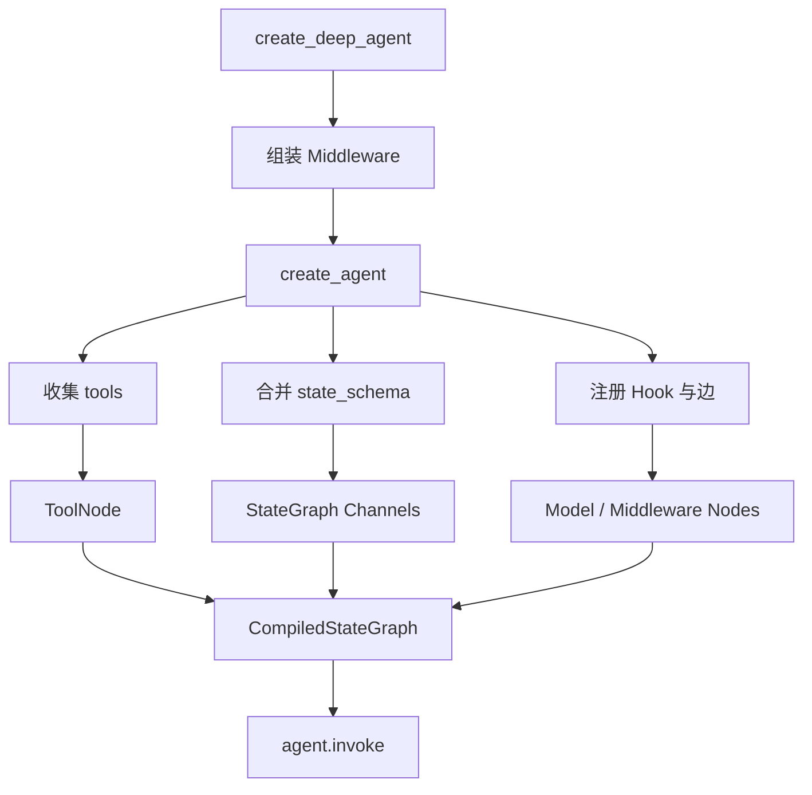
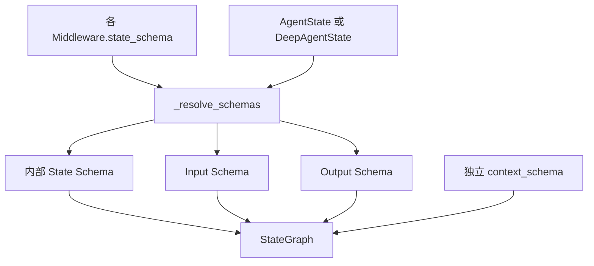
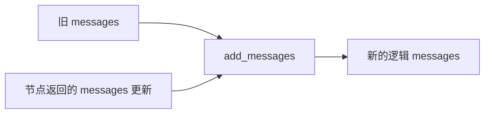
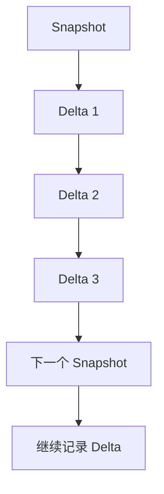
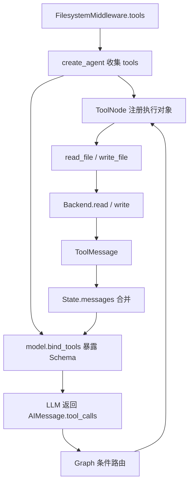
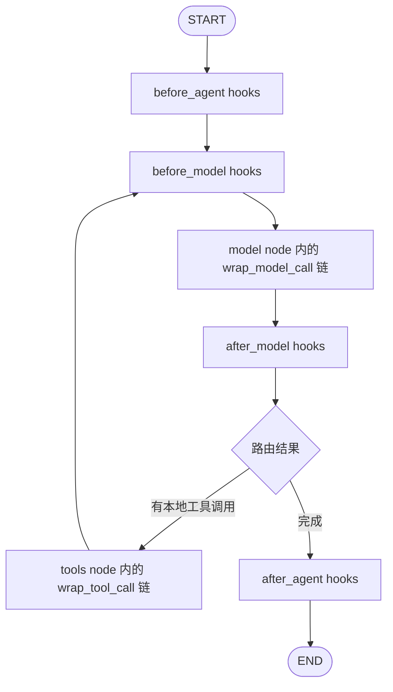

# 第五章：Graph State、Reducer、DeltaChannel 与 Checkpoint

在上一章，我们知道了 `create_deep_agent()` 最终调用 LangChain 的 `create_agent()`。真正值得追问的是：**DeepAgents 添加这么多 Middleware 后，工具如何注册、状态如何共享、模型请求如何被拦截，以及长任务如何保存和恢复？**

答案不是“所有 Middleware 都按顺序执行一次”。更准确地说，Middleware 通过 **三个彼此独立的入口**参与 Agent：

1. `tools`：向 Agent 注册可执行能力；
2. `state_schema`：声明需要存入 Graph State 的字段；
3. `before_*` / `after_*` / `wrap_*`：在生命周期的指定位置修改状态、模型请求或工具执行。

这三条路径最终汇入 LangGraph 的运行循环。本文基于本文引用的 DeepAgents、LangChain 源码及 API 文档解释设计；不同版本与 Harness Profile 可能使最终 Middleware 列表变化。

## 1. 从 `create_deep_agent()` 到 LangGraph

`create_deep_agent()` 先准备模型、Backend、子 Agent 和 Middleware，然后把准备好的列表交给 `create_agent()`：

```python
return create_agent(
    model,
    tools=_tools,
    middleware=deepagent_middleware,
    state_schema=state_schema if state_schema is not None else DeepAgentState,
    checkpointer=checkpointer,
    store=store,
    # ...
)
```

这里最重要的设计是：**DeepAgents 负责组装能力，LangChain 负责执行循环，LangGraph 负责状态和调度。**



Middleware 的三种贡献是**可以独立存在**的。例如 `PatchToolCallsMiddleware` 主要使用 Hook 修复历史消息，不需要自己注册一个新工具；`SubAgentMiddleware` 则通过 `task` 工具让另一个 Agent 成为可调用能力。

## 2. 先区分 State、Request、Context 和 Backend

这些东西都可能承载数据，但不应该混为一谈。

| 名称 | 保存或传递什么 | 谁使用它 | 是否等于 Graph State |
| --- | --- | --- | --- |
| `State` | `messages`、`structured_response`、Middleware 扩展字段 | Graph 节点、工具、Middleware | 是 |
| `ModelRequest` | 当前模型、消息、工具列表、系统提示词与设置 | `wrap_model_call`、模型执行函数 | 否，是一次调用的请求对象 |
| `Runtime Context` | 当前运行的外部上下文 | 节点和工具 | 否，不通过普通 State Reducer 更新 |
| `Backend` | 文件及其他外部资源 | 文件工具、Skills、Memory 等 | 不一定；`StateBackend` 使用 Graph State |
| `Checkpointer` | 图执行快照与恢复所需信息 | LangGraph 运行时 | 否，是 State 的持久化机制 |
| `Store` | 跨线程可访问的数据 | 应用、工具或 Backend | 否 |

例如 `FilesystemMiddleware.wrap_model_call()` 可以把过长的 HumanMessage 换成**本次模型请求中的短预览**。这不代表它必须把 Graph State 中的原始消息直接替换掉。相反，某些卸载操作还会配合状态更新，记录内容保存位置。

**设计原因**：把“当前真实的任务状态”和“这一次想让模型看到的材料”分开，才能压缩上下文而不丢失恢复能力。

## 3. 所有主要 Middleware 的 State、Tools、Hooks

以下矩阵以你提供的 `create_deep_agent()` 组装代码为范围；“无专属工具”表示该 Middleware 的主要能力不是通过它自己的 `tools` 注册，**不是说它不能修改模型可见工具**。

| Middleware | 主要 State / 数据 | 注册给 ToolNode 的工具 | 主要 Hook / 接入方式 | 为什么这样设计 |
| --- | --- | --- | --- | --- |
| `FilesystemMiddleware` | 使用 `StateBackend` 时的 `files`；另有内部 payload 字段 | `ls`、`read_file`、`write_file`、`edit_file`、`glob`、`grep`；配置允许时还有 `execute` 等 | `wrap_model_call`、`wrap_tool_call` | 工具操作 Backend，调用前后还能过滤能力与卸载大内容 |
| `SubAgentMiddleware` | 管理父子状态传递、私有字段过滤；不必为每次子任务单独在父 State 增添完整消息列表 | `task` | `wrap_model_call` + `task` 工具 | 把一个完整 Agent 包装成主 Agent 能调用的工具 |
| `_ParentNotifierMiddleware` | 父子执行通信相关的内部信息 | 无专属工具 | 内部 Hook / 通知机制 | 管理父子任务之间的事件和通知；不是新的 Agent Loop |
| `SummarizationMiddleware`（DeepAgents 适配） | 消息历史；摘要事件等内部状态 | 默认自动摘要流程不需要专属工具 | 主要 `before_model` | 调模型前判断上下文是否需要压缩 |
| `PatchToolCallsMiddleware` | 修复 `messages` 中不完整的工具调用历史 | 无专属工具 | `before_agent` | 避免恢复后遗留未配对工具调用导致模型请求出错 |
| `AsyncSubAgentMiddleware` | `async_tasks`，保存后台任务状态/ID | 启动、查询、更新、取消、列出异步任务的工具 | 工具注册及相应执行逻辑 | 主 Agent 可以继续执行，而后台子 Agent 独立推进 |
| Harness Profile `extra_middleware` | 完全取决于 Profile | 完全取决于具体实例 | 取决于具体实例 | 模型或运行环境可以定制行为 |
| 用户自定义 Middleware | 由用户的 `state_schema` 决定 | 可选 `tools` | 任意生命周期 Hook | 在不修改核心框架前提下扩展 Agent |
| `SkillsMiddleware` | `skills_metadata`（技能索引） | 通常不额外注册独立技能工具 | `before_agent`、`wrap_model_call` | 先读技能目录信息，再按需让模型通过文件工具获取详细内容 |
| Prompt Caching Middleware | 通常不需要自己的持久业务 State | 无专属工具 | 模型请求包装等 | 根据提供方能力添加缓存控制信息 |
| `MemoryMiddleware` | `memory_contents` | 无专属工具 | `before_agent`、`wrap_model_call` | 启动时读取 `AGENTS.md`，模型调用时注入记忆文本 |
| `HumanInTheLoopMiddleware` | 使用图的中断与恢复机制 | 无专属工具 | `after_model` | 在模型提出高风险工具调用后、实际执行前暂停审批 |
| `UnsupportedContentMiddleware` | 不要求额外持久业务字段 | 无专属工具 | `wrap_model_call` | 对当前模型不支持的多模态内容进行请求级兼容处理 |
| `_ToolExclusionMiddleware` | 无需额外业务字段 | 无专属工具 | 请求期工具筛选 | 防止被排除的工具再次暴露给模型 |

> **注意**：表格只对已核实的主要字段和 Hook 做肯定描述。`_ParentNotifierMiddleware`、Profile 自定义扩展和某些内部状态结构的精确实现要看安装版本；不能仅凭 Middleware 名称断言所有字段或 Hook。`SummarizationToolMiddleware` 还可以显式提供 `compact_conversation` 工具，但它是额外可组合能力，不应当和默认的自动摘要 Middleware 混为一谈。

### 3.1 为什么有些 Middleware 只有 State，没有 Tools？

`MemoryMiddleware` 把 `AGENTS.md` 读取到 `memory_contents`，再把相关文本放入模型系统提示词。模型并不需要主动调用 `load_memory()`，所以不必为了这件事注册新工具。

`SkillsMiddleware` 类似：先保存技能索引 `skills_metadata`，使模型知道哪些技能存在；技能详细内容可以通过已经注册的文件读取工具按需加载。这就是 **渐进式披露**：不把所有 Skill 内容在每一轮都塞给模型。

### 3.2 为什么有些 Middleware 只有 Tools，而不是给父 Agent 增加大量 State？

`SubAgentMiddleware` 的主要入口是 `task`。子 Agent 有自己的执行流程和消息历史；主 Agent 通常只需要发任务并获得经过整理的结果。否则子 Agent 的每条临时工具日志都会污染主 Agent 的上下文。

异步子 Agent 不同：调用可能很早就返回任务 ID，因此必须维护 `async_tasks`，才能在后续轮次里追踪尚未结束的后台工作。

## 4. State 是怎样合并进 `StateGraph` 的？

`factory.py` 的关键代码是：

```python
base_state = state_schema if state_schema is not None else AgentState
state_schemas = [*(m.state_schema for m in middleware), base_state]
resolved_state_schema, input_schema, output_schema = _resolve_schemas(state_schemas)

graph = StateGraph(
    state_schema=resolved_state_schema,
    input_schema=input_schema,
    output_schema=output_schema,
    context_schema=context_schema,
)
```

可以把它看成：



**不要把 Input、内部 State、Output 理解成三份互不相关的消息历史。** 它们是同一个图状态在输入、运行、返回阶段的不同视图。`messages` 这个字段重名不是冲突；关键在于内部最终采用什么 Channel / Reducer。

例如：

- `InputAgentState.messages`：接受消息对象或者用户传入的消息字典；
- `AgentState.messages`：普通 Agent 内部的消息历史；
- `OutputAgentState.messages`：最终向调用者暴露消息历史；
- `DeepAgentState.messages`：保留逻辑消息历史，同时改变持久化方式。

在你提供的 `factory.py` 中，基础 Schema 位于 Middleware Schema 之后，合并时对同名字段有较高优先级。这是为什么 DeepAgents 强调自定义状态应继承 `DeepAgentState`，不要无意破坏 `messages` 的 `DeltaChannel` 定义。

## 5. Reducer：为什么节点不能简单地覆盖 `messages`？

假设初始状态是：

```python
state = {"messages": [HumanMessage(content="读取 main.py")]}
```

模型节点返回：

```python
{"messages": [AIMessage(tool_calls=[...])]}
```

如果 `messages` 使用普通“新值覆盖旧值”的规则，用户问题就可能被丢掉。LangGraph 因此允许给字段声明 **Reducer**，例如：

```python
messages: Annotated[list[AnyMessage], add_messages]
```

`add_messages` 根据消息 ID 合并：新 ID 通常追加，重复 ID 可以替换已有消息。这既能累积工具对话，也允许消息纠正或上下文整理。



但不是每个 State 字段都该使用同一个 Reducer：

- 计数器可能用加法；
- 临时配置可能用最后一个值；
- 待办列表可能使用专门的合并策略；
- 同一步并发写入同一个**无适当 Reducer**的字段，可能触发 `InvalidUpdateError`。

**设计原因**：节点只报告发生了什么变化；字段自己的合并规则决定如何更新整体 State。

## 6. DeltaChannel：与 `add_messages` 到底差在哪里？

DeepAgents 中：

```python
class DeepAgentState(AgentState):
    messages: Required[
        Annotated[
            list[AnyMessage],
            DeltaChannel(_messages_delta_reducer, snapshot_frequency=50),
        ]
    ]
```

`add_messages` 重点在于**逻辑消息列表如何合并**。`DeltaChannel` 则进一步解决**长任务反复保存状态时的存储成本**。

假设消息历史越来越长：

```text
第 1 轮： [H1]
第 2 轮： [H1, A1]
第 3 轮： [H1, A1, T1]
第 4 轮： [H1, A1, T1, A2]
```

如果每次检查点都重复存整份不断增长的列表，会产生大量重复数据。DeltaChannel 可以保存增量，并周期性生成快照（这里 `snapshot_frequency=50`），在重建时按相应合并逻辑恢复可读取的状态。



所以：**DeltaChannel 不是让模型只能看到最新的一条消息**。模型仍可以拿到重建后的逻辑历史；改变的是 Checkpoint 中如何表示历史更新。

同样思路也可以用于 `FilesystemState.files`：只修改 `/notes.md` 时，更新可以针对这个文件，而不必每次重新传递完整虚拟文件表。

## 7. `FilesystemMiddleware`：State、工具、Hook 同时工作

它是最能说明 Middleware 设计的例子。

### 工具注册

`FilesystemMiddleware` 创建可调用工具，放入 `self.tools`；`factory.py` 会收集各 Middleware 的工具：

```python
middleware_tools = [
    t for m in middleware for t in getattr(m, "tools", [])
]
available_tools = middleware_tools + regular_tools
tool_node = ToolNode(tools=available_tools, ...)
```

`ToolNode` 保存工具名与工具对象的映射。模型收到的不是 Python 函数源码，而是通过 `bind_tools()` 转换和传入的工具名称、描述及参数 Schema。

### 模型如何调用工具



`wrap_model_call()` 还能依据 Backend 能力过滤工具，例如无 Shell 能力时不向模型暴露 `execute`；`wrap_tool_call()` 则能检查过大的工具结果并将它卸载到文件系统。

**为什么不只提供几个 Python 函数？** 因为函数只能在被调用时工作，而 Middleware 能在**模型调用之前**调整本次工具列表和提示词，并在**工具执行之后**处理结果。

## 8. 为什么要有 `before_*`、`after_*`、`wrap_*` 六类 Hook？

这些 Hook 解决的是**介入位置不同**的问题。

| Hook | 调用时机 | 适合做什么 | 为什么不选别的 Hook |
| --- | --- | --- | --- |
| `before_agent` | Agent 开始时 | 加载 Memory、Skills 索引，修补历史 | 一次任务只需准备一次，不必每轮重复 |
| `before_model` | 每次模型调用前 | 判断是否需要摘要压缩 | 压缩后应先更新状态，再执行模型 |
| `wrap_model_call` | 包裹每次模型调用 | 动态工具筛选、注入提示词、重试、模型路由 | 需要拿到 `ModelRequest` 和 `handler`，而非只读 State |
| `after_model` | 模型返回后、执行工具前 | 审查模型工具请求，触发人工审批 | 此时已经知道模型准备调用什么工具 |
| `wrap_tool_call` | 包裹工具执行 | 权限处理、失败重试、截断大结果 | 需要拦截真正的工具执行及返回值 |
| `after_agent` | Agent 完成时 | 清理、收尾处理 | 不需要在每轮模型调用时执行 |

### Hook 和 Wrapper 的本质区别

普通生命周期 Hook 通常是一个图节点，返回状态更新：

```python
# 概念性示例
class MyMiddleware(AgentMiddleware):
    def before_model(self, state, runtime):
        return {"step_count": state.get("step_count", 0) + 1}
```

Wrapper 则拿到一个 `handler`，可以决定是否、何时、用什么请求去执行下一层：

```python
# 概念性示例
class MyMiddleware(AgentMiddleware):
    def wrap_model_call(self, request, handler):
        changed_request = request.override(tools=[...])
        result = handler(changed_request)
        return result
```

若有三层 Wrapper：

```text
A.wrap_model_call(
    B.wrap_model_call(
        C.wrap_model_call(
            实际模型调用
        )
    )
)
```

第一个包装器可以在内层调用前执行，也可以在内层返回后处理结果。这就是为什么**超时、重试、路由、请求改写**适合 Wrapper，而**预加载与状态更新**适合生命周期 Hook。

异步版本使用 `abefore_model`、`awrap_model_call` 等；这是同一设计在异步执行路径中的实现。

## 9. Middleware 如何变成图上的节点？

`factory.py` 会识别哪些 Middleware 真正覆盖了生命周期方法，并为它们创建 Graph Node：

```python
graph.add_node("model", RunnableCallable(model_node, amodel_node, trace=False))

if tool_node is not None:
    graph.add_node("tools", tool_node)

# 另外为实现了 before_agent / before_model /
# after_model / after_agent 的 Middleware 注册节点与边
```

典型运行图如下：



这是一张**概念图**：某些 Hook 可能不存在，特殊工具的 `return_direct`、结构化输出和 Middleware 跳转也可能改变路径。不要把每个 `wrap_model_call` 都当成单独的图节点——它们通常在 `model` 节点内部组成调用链。

## 10. 各主要 Middleware 为什么选这样的 Hook？

### 10.1 `PatchToolCallsMiddleware` → `before_agent`

问题：上一次执行异常中断，历史中可能保留 `AIMessage(tool_calls=...)`，却没有对应 `ToolMessage`。如果不修复，下一次发给模型的消息可能违反工具调用的配对要求。

因此它在 Agent 重新开始时**先修复消息历史**，而不是等工具执行阶段才处理。

### 10.2 `SummarizationMiddleware` → `before_model`

问题：长时间运行后，`messages` 过长。应该在下一次模型请求前决定是否压缩，而不是等模型已经失败后才处理。

因此在每轮模型前检查阈值，必要时摘要并更新状态。它侧重**历史状态的整理**；文件卸载则进一步支持保留细节供后续检索。

### 10.3 `SkillsMiddleware` 和 `MemoryMiddleware` → `before_agent` + `wrap_model_call`

问题分为两步：

1. 从 Backend 读取知识，得到可复用数据；
2. 在这一次模型调用中，把当前需要的信息放进系统提示词。

所以 `before_agent` 负责加载或复用 State 中的数据，`wrap_model_call` 负责把它放进 `ModelRequest`。如果合成单个 Hook，就会把文件 I/O 与每轮提示词改写强行捆绑在一起。

### 10.4 `HumanInTheLoopMiddleware` → `after_model`

审批应该发生在模型**已经提出工具调用**之后、ToolNode **尚未执行**之前。`after_model` 正好处在这个位置：它能检查工具名称与参数，并在必要时中断，等待批准、编辑或拒绝。

### 10.5 `FilesystemMiddleware` → `wrap_model_call` + `wrap_tool_call`

前者负责“模型看到什么”：提供正确的工具列表、处理大输入；后者负责“执行后留下什么”：检查工具结果，将超大内容保存到 Backend，仅在上下文中留下可检索引用。

### 10.6 `UnsupportedContentMiddleware` → `wrap_model_call`

同一 Thread 中可能存在图片等多模态内容，而当前被路由到的模型不支持它。正确做法通常是只修改**本次发给模型的请求**，保留 State 中的原始内容：将来切换到支持该模态的模型时，仍能访问原始信息。

## 11. Checkpoint 保存的是什么？怎么恢复？

需要区分三层：

```text
逻辑 Graph State
   ├── messages
   ├── files（StateBackend 时）
   ├── skills_metadata / memory_contents（启用时）
   └── async_tasks / 其他 Middleware 字段（启用时）
             ↓
       Checkpointer
   保存图的状态与恢复信息
             ↓
   相同 thread_id 的后续运行
```

`Checkpointer` 并不是普通工具，也不等于长期知识库。它保存某个 Thread 的 Graph 执行快照，帮助后续继续运行和中断恢复。`Store` 则处理跨 Thread 的持久化信息。

一个最小的会话例子：

```python
from langgraph.checkpoint.memory import InMemorySaver
from langchain.agents import create_agent

agent = create_agent(
    model="openai:gpt-4.1",
    tools=[],
    checkpointer=InMemorySaver(),
)

config = {"configurable": {"thread_id": "demo-thread"}}
agent.invoke({"messages": [{"role": "user", "content": "你好"}]}, config=config)
agent.invoke({"messages": [{"role": "user", "content": "继续刚才的话题"}]}, config=config)
```

这里是进程内的 Checkpointer，只用于演示 Thread 连续性；不能把它当作重启后仍然保留的生产数据库。

### 为什么 DeltaChannel 与 Checkpoint 要一起理解？

Reducer/Channel 决定 State 怎样吸收节点更新，而 Checkpointer 决定这些状态怎样被持久化。长任务里不断增长的 `messages` 和 `files` 最容易产生重复快照，因此 DeepAgents 用 DeltaChannel 降低增量持久化成本。

但要区分两种“保存”：

- `StateBackend` 的文件可以存在**图状态**中，并随该 Thread 的 Checkpoint 保存；
- `FilesystemBackend` 或 `StoreBackend` 中的文件属于其自身存储机制，不能因为图启用了 Checkpointer 就假设文件自动存进 `State.files`。

## 12. 实际追踪一个 `read_file` 调用

假设用户问：“读取 `/project/main.py` 并总结。”

1. `FilesystemMiddleware` 在创建时提供 `read_file` Tool；
2. `create_agent()` 收集工具并交给 `ToolNode` 注册；
3. `_get_bound_model()` 使用 `bind_tools()` 告诉模型工具名称、说明和参数；
4. 模型生成 `AIMessage(tool_calls=[...])`，**此时文件尚未被读取**；
5. 条件边把流程送入 `tools`；
6. `ToolNode` 根据工具名称找到执行对象；`read_file` 调用 `backend.read()`；
7. 工具结果包装为 `ToolMessage`；如果太大，`wrap_tool_call` 可能先卸载结果；
8. `messages` Channel 合并新增的 AIMessage / ToolMessage；
9. Graph 回到模型节点，模型根据读取结果继续回答；
10. Checkpointer（如果配置）保存对应步骤的图执行状态。

这条链将四个关心的问题串起来：**工具从哪里来、模型怎么知道、谁真正执行、执行结果保存到哪里。**

## 13. 最后总结：六个最容易混淆的设计决定

| 设计问题 | 结论 |
| --- | --- |
| 为什么 Middleware 有 `tools`？ | 让功能模块自己声明可执行能力，不把所有工具写死在 Agent 工厂里 |
| 为什么有 `state_schema`？ | 让模块声明自己需要持久保存的字段，交给统一的 Graph State 管理 |
| 为什么 `before_model` 不等于 `wrap_model_call`？ | 前者适合状态预处理；后者可以修改或控制真正的模型调用 |
| 为什么工具已经注册还要 `bind_tools()`？ | 注册是供 ToolNode 执行，绑定是让 LLM 知道工具名称和参数 Schema |
| 为什么需要 Reducer 与 DeltaChannel？ | 前者确定状态更新语义，后者优化长任务中的增量存储和重建 |
| 为什么还要 Checkpointer？ | Reducer 不保存历史快照；Checkpoint 才使 Thread 状态得以恢复 |

最重要的调用关系是：

```text
DeepAgents Middleware
   ├── tools ──────────> ToolNode ──────────> 工具执行
   ├── state_schema ──> StateGraph Channels ─> 状态更新
   └── Hooks ─────────> Model / Tool 执行链 ─> 请求处理

Graph State ──> Checkpointer ──> 后续恢复
```

**最终结论：Middleware 负责扩展能力和控制调用，ToolNode 负责执行工具，StateGraph 负责组织状态与路由，Reducer / DeltaChannel 决定如何更新和保存状态，Checkpointer 负责让任务能够继续。**

---

## 源码阅读路径与参考资料

建议按以下顺序交叉阅读，避免只看一个 Middleware 文件就丢失调用上下文。

1. [DeepAgents `graph.py`](https://github.com/langchain-ai/deepagents/blob/main/libs/deepagents/deepagents/graph.py)：Middleware 组装、`DeepAgentState`、`create_agent()` 调用入口。
2. [DeepAgents Middleware 架构](https://github.com/langchain-ai/deepagents/blob/main/libs/ARCHITECTURE.md)：为什么用 Middleware 而不是只用 Tools。
3. [DeepAgents `middleware/` 目录](https://github.com/langchain-ai/deepagents/tree/main/libs/deepagents/deepagents/middleware)：文件、Skills、Memory、Subagent 与其他 Middleware 的实现。
4. [LangChain `factory.py`](https://github.com/langchain-ai/langchain/blob/master/libs/langchain_v1/langchain/agents/factory.py)：收集工具、合并 Schema、注册 Hook、组装 Graph。
5. [LangChain `middleware/types.py`](https://github.com/langchain-ai/langchain/blob/master/libs/langchain_v1/langchain/agents/middleware/types.py)：`AgentState`、`AgentMiddleware` 和生命周期 Hook 定义。
6. [LangChain Middleware 执行架构](https://github.com/langchain-ai/langchain/blob/master/openwiki/agent-execution.md)：Hook、Node、Edge 的运行逻辑。
7. [FilesystemMiddleware API](https://reference.langchain.com/python/deepagents/middleware/filesystem/FilesystemMiddleware)、[SkillsMiddleware API](https://reference.langchain.com/python/deepagents/middleware/skills/SkillsMiddleware)、[MemoryMiddleware API](https://reference.langchain.com/python/deepagents/middleware/memory/MemoryMiddleware)、[SubAgentMiddleware API](https://reference.langchain.com/python/deepagents/middleware/subagents/SubAgentMiddleware)：分别核对工具、状态字段与 Hook。
8. [AsyncSubAgentMiddleware API](https://reference.langchain.com/python/deepagents/middleware/async_subagents/AsyncSubAgentMiddleware)、[HumanInTheLoopMiddleware API](https://reference.langchain.com/python/langchain/agents/middleware/human_in_the_loop/HumanInTheLoopMiddleware)、[UnsupportedContentMiddleware API](https://reference.langchain.com/python/deepagents/middleware/unsupported_content/UnsupportedContentMiddleware)：后台任务、审批与多模态兼容。

> 本章的简化代码和 Mermaid 图用于解释调用关系，不等同于完整的原版实现。尤其是 Profile 扩展、用户自定义 Middleware、工具排除及安装版本差异，都会影响最终组装结果。
