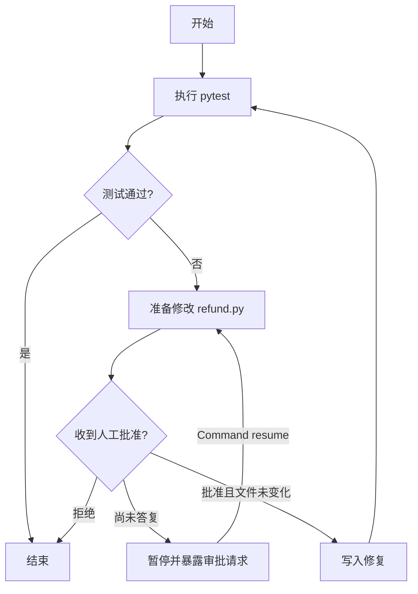

> **LangChain × LangGraph 源码精读 · 第 11 章**  
> 上一篇：[第 10 章｜执行中断以后，LangGraph 怎样找回上一步？](./11how-to-checkpoint-graph-state.md)  
> **本章唯一的主问题：** 当 Agent 已经知道如何修复 `refund.py`，但修改文件需要人类审核时，它怎样停在危险操作之前，并在收到批准后**仅在该批准有效时**继续？

上一章我们让 Agent 在第一次 `pytest` 失败后恢复执行。Checkpoint 让 Runtime 记住任务进行到了哪里。但现在有一个不同的问题：**不只是因为进程出错而需要恢复，我们还希望程序主动停下来，把决定权交给一个真实的人。**

这两类暂停很像，却不是一回事。

我们继续使用贯穿全系列的退款精度 Bug。`refund.py` 里仍然有浮点加法：

```python title="refund.py（实验初始文件）"
def refund_amount():
    return 0.1 + 0.2
```

测试要求退款金额等于十进制的 `0.30`：

```python title="test_refund.py"
from decimal import Decimal
from refund import refund_amount


def test_partial_refund():
    assert refund_amount() == Decimal("0.30")
```

我们已经有 `pytest` 的失败证据，也已经有一个修复方案：用 `Decimal("0.30")` 返回金额。最小的 Agent 当然可以马上覆写文件、重新运行测试，然后报告成功。但假设这次目标不是临时练习项目，而是一个需要代码审查的真实仓库。**测试失败，不自动意味着 Agent 获得了修改权限。**

这一章不再增加模型推理能力，也不设计复杂审批系统。我们只增加一项必要机制：**在执行修改前，向调用方提出一个包含具体文件与变更内容的审批请求；调用方给出决定后，再进入修改逻辑。**

<!-- truncate -->

## 1. 上一章的固定断点为什么还不够？

上一章使用过：

```python title="上一章用过的固定断点"
graph = builder.compile(
    checkpointer=InMemorySaver(),
    interrupt_before=["patch"],
)
```

它确实能让 Runtime 在 `patch` 节点运行之前暂停。如果只是想调试节点边界，这已经够了。但假设用户询问：“你想把 `refund.py` **具体改成什么**？”固定断点只表达“到了 `patch` 这个节点”，并不天然携带一次动态生成的补丁内容。更重要的是，批准或拒绝到底怎样交给这次正在等待的程序？

我们可以自行写一个外部标志位：

```python title="概念伪代码：只能建立直觉，非框架实现"
if not approval_granted:
    return "waiting"

write_refund_file()
```

对简单脚本来说，这种设计有价值，但它会把 **等待状态、审批请求、恢复入口** 分散在业务逻辑和外部调用者之间：返回 `waiting` 后，外部何时再次调用？调用时怎样保证仍然对应这一次补丁？如果模型又跑了一轮，审批是否还有效？

我们真正缺少的是一个程序可以主动发起的 **“我要在这里等待一个外部值”** 的执行边界，而不是再增加一个 `if`。

这时才有必要引入 **动态中断 `interrupt()`**：它允许节点运行到某个位置时，交出一个有意义的请求；调用方处理这个请求后，再送回恢复值。下面先不依赖框架，验证这个机制最小应该表现为什么样。

## 2. 先用纯 Python 复现“暂停—审批—继续”

我们把需要人工判断的地方抽象成：

```python title="教学化简：展示最小的调用形状"
choice = gate.interrupt({
    "path": "refund.py",
    "proposed_code": "...",
})

if choice != "approve":
    return {"decision": "rejected"}

write_refund_file()
```

第一次执行到 `gate.interrupt(...)`，请求被抛给调用者，但**文件尚未修改**；调用者要么拒绝，要么批准；恢复后的代码只有看到批准，才继续调用写文件动作。

这里还有一个隐藏前提：我们希望能证明审批判断真的位于文件写入之前。最直接的办法不是看函数名，而是读文件并执行测试。为此准备两条路径：

- **拒绝**：原文件字节不变，重新运行 `pytest` 仍失败。
- **批准**：原文件被改成约定的修复内容，重新运行 `pytest` 通过。

以下是完整的可运行 Python 实验。它使用一个教学用 `TeachingGate` **模拟**暂停和恢复，不是 LangGraph 的内部实现；但它真的在临时目录里执行了两次测试，而且不需要 API Key。设计这个实验，是为了把我们要求框架提供的运行行为先固定下来。

```python title="demo_manual_gate.py（已实际运行的纯 Python 教学实验）"
"""Pure Python teaching simulation; not LangGraph. Runs real pytest in temporary project."""
from pathlib import Path
from tempfile import TemporaryDirectory
import subprocess
import sys

BROKEN = 'def refund_amount():\n    return 0.1 + 0.2\n'
FIXED = ('from decimal import Decimal\n'
         '\n'
         'def refund_amount():\n'
         '    return Decimal("0.30")\n')
TEST = ('from decimal import Decimal\n'
        'from refund import refund_amount\n'
        '\n'
        'def test_partial_refund():\n'
        '    assert refund_amount() == Decimal("0.30")\n')

class PauseForApproval(Exception):
    def __init__(self, request):
        super().__init__('approval required')
        self.request = request

class TeachingGate:
    def __init__(self):
        self.resume_value = None
        self.entries = 0

    def interrupt(self, request):
        if self.resume_value is None:
            raise PauseForApproval(request)
        return self.resume_value


def pytest_exit(project):
    process = subprocess.run(
        [sys.executable, '-m', 'pytest', '-q', '-p', 'no:cacheprovider', 'test_refund.py'],
        cwd=project, text=True, capture_output=True, check=False,
    )
    return process.returncode


def patch_node(project, gate):
    gate.entries += 1  # demonstrates that code before interrupt may run again
    answer = gate.interrupt({'path': 'refund.py', 'proposed_code': FIXED})
    if answer != 'approve':
        return 'rejected'
    (project / 'refund.py').write_text(FIXED, encoding='utf-8')
    return 'approved'


def run_case(decision):
    with TemporaryDirectory(prefix=f'approval-{decision}-') as tmp:
        project = Path(tmp)
        (project / 'refund.py').write_text(BROKEN, encoding='utf-8')
        (project / 'test_refund.py').write_text(TEST, encoding='utf-8')
        before_test = pytest_exit(project)
        assert before_test == 1, before_test

        gate = TeachingGate()
        try:
            patch_node(project, gate)
            raise AssertionError('expected pause')
        except PauseForApproval as exc:
            assert exc.request['path'] == 'refund.py'
        assert (project / 'refund.py').read_text(encoding='utf-8') == BROKEN

        gate.resume_value = decision
        outcome = patch_node(project, gate)
        assert gate.entries == 2
        if decision == 'approve':
            assert outcome == 'approved'
            assert (project / 'refund.py').read_text(encoding='utf-8') == FIXED
            after_test = pytest_exit(project)
            assert after_test == 0, after_test
        else:
            assert outcome == 'rejected'
            assert (project / 'refund.py').read_text(encoding='utf-8') == BROKEN
            after_test = pytest_exit(project)
            assert after_test == 1, after_test
        print(f'{decision}: before_pytest={before_test}, '
              f'after_pytest={after_test}, node_entries={gate.entries}, '
              f'file_modified={decision == "approve"}')


if __name__ == '__main__':
    run_case('reject')
    run_case('approve')
    print('all assertions passed')
```

运行：

```bash
python demo_manual_gate.py
```

本环境的**实际输出**：

```text
reject: before_pytest=1, after_pytest=1, node_entries=2, file_modified=False
approve: before_pytest=1, after_pytest=0, node_entries=2, file_modified=True
all assertions passed
```

先不要着急跳到 LangGraph。看一下这三个可观察的事实。

第一，最初两条路径的 `pytest` 退出码都是 `1`，说明我们处理的确实是失败的测试，不是用一个虚假的成功字符串替代工具结果。第二，拒绝路径的文件内容仍是原来的 `0.1 + 0.2`，说明“等待批准”不是装饰性的 UI 步骤。第三，批准路径的第二次 `pytest` 退出码变成 `0`，说明对文件的真实修改确实发生在批准后。

还有一个值得立刻注意的数字：`node_entries=2`。我们故意让节点入口计数在中断之前，因此第一次尝试暂停时加一次，恢复时重新进入又加一次。**这不是在断言 LangGraph 内部实现与教学 `Gate` 相同**；它是提前让我们看见一个必须去真实源码确认的行为：节点恢复时，已经运行到中断点之前的部分是否会再运行？

## 3. 为什么不是“把用户的批准写进 State”就结束？

一个直觉方案是：收到审批后，直接把 `state["approved"] = True`，再运行 `patch` 节点。问题是，这个方案把一次**对特定变更的批准**简化成了一个全局布尔值。

假设第一次提出的补丁是 `A`，人类批准了。等待期间另一个线程把 `refund.py` 改成了版本 `B`，而 Agent 恢复后重新计算出一个补丁 `C`。如果程序只看 `approved=True`，它可能把对 `A` 的批准错误地用于 `C`。

所以对真实文件修改，至少还需要一个具体约束：审批必须绑定到**被审核的目标、原始文件版本和拟应用的变更**。这属于应用层的校验策略，不是 LangGraph 自动赋予我们的权限安全。

本章会采用一个小而清楚的办法：审批请求携带原文件内容、拟写入的内容，以及原内容的 SHA-256 摘要。审批响应要带回当时看到的摘要；真正写文件前，再检查源文件是否仍然保持原样。

这样做可以防止实验中的**误用旧批准**，但摘要不是身份认证或防篡改授权。生产系统仍然需要认证用户、授权仓库与操作范围，并防范文件检查与写入之间的竞态。本章刻意不把这些安全机制伪装成 `interrupt()` 自带的特性。

接下来我们终于可以进入真正的源码。我们已经知道要找的不是一个抽象的“暂停能力”，而是三件很具体的事：**怎样发出等待请求、怎样带回恢复值、为什么恢复前后要小心重复执行。**

## 4. 真实源码入口：`interrupt()` 如何让程序停下来？

固定源码基线仍沿用前几章：**LangGraph `1.2.17`，Commit [`4c52e129eb1ab69a3da58b799f67929f77d81149`](https://github.com/langchain-ai/langgraph/tree/4c52e129eb1ab69a3da58b799f67929f77d81149)**。

从 [https://github.com/langchain-ai/langgraph/blob/4c52e129eb1ab69a3da58b799f67929f77d81149/libs/langgraph/langgraph/types.py](https://github.com/langchain-ai/langgraph/blob/4c52e129eb1ab69a3da58b799f67929f77d81149/libs/langgraph/langgraph/types.py) 里 `langgraph.types.interrupt()` 入手。为了避免被上百行完整函数干扰，我们先只摘支持当前论点的两个分支。**以下为真实源码节选，省略无关分支和注解；省略处不代表相邻的原始代码行。**

```python title="真实源码节选：langgraph/types.py · interrupt()"
# 没有可用的恢复值时，抛出可被 Runtime 识别的中断
raise GraphInterrupt(
    (
        Interrupt.from_ns(
            value=value,
            ns=conf[CONFIG_KEY_CHECKPOINT_NS],
            response_schema=adapter.json_schema() if adapter else response_schema,
        ),
    )
)
```

它解释了两个容易误解的地方。第一，`interrupt()` **不是普通的 `return "waiting"`**：首次没有恢复值时，它通过特殊异常让正在执行节点的 Runtime 接手暂停。第二，`value` 不会神奇变成人类的回复；它是**给外部调用方看的请求内容**。在我们的案例中，这里面应放目标文件、原始内容、拟写入的内容和摘要。

`GraphInterrupt` 也不应该在业务节点里用泛泛的 `except Exception:` 吞掉，再当作一次普通业务错误继续执行。这样做会破坏预期的暂停路径。

谁调用了 `interrupt()`？是我们稍后将写的 `approve_patch(state)` 节点。它运行在前几章已经解释过的 `PregelRunner` 节点执行过程中。`interrupt()` 发出的中断会由执行引擎识别并经由 Graph 的输出交给调用方，而不是从节点直接去调用一套浏览器审批页面。

到这里，新问题自然出现：第一次调用已经结束，下一次调用为什么还能找到刚才的等待任务？这就需要上一章研究过的 Checkpoint。

## 5. `interrupt()` 和 Checkpoint 各自做什么？

上一章认识的 Checkpointer 在这里不需要重新设计。对于这次人工审批，它承担的是**保留这条执行历史和待恢复任务所需的信息**。`interrupt()` 则负责在节点内部告诉 Runtime：“当前没有外部决定，先停下来。”

一个最小的图可以长成：



这里把恢复箭头画回 `D`，不是画到 `E` 的后面。这一点下一节会在源码里核对。如果画成“恢复后一定从 `interrupt()` 下一行继续”，读者很可能在业务代码里把文件备份、发送通知或其他副作用放错位置。

真实使用还需要两项约束：

```python title="框架接口：必须能定位同一条待恢复执行历史"
graph = builder.compile(checkpointer=InMemorySaver())
config = {"configurable": {"thread_id": "refund-approval-001"}}
```

`InMemorySaver` 足够做单进程演示，**不意味着服务重启后这条审批还在**。真实跨进程待审任务要使用持久化 Checkpointer，并以同一条 `thread_id` 查找原有历史。还有一个重要事实：`thread_id` 只是关联执行记录的标识，不能当成授权凭据。

## 6. `Command(resume=...)` 怎样把决定送回节点？

现在调用方拿到了审批请求，用户最终回答“批准”或“拒绝”。我们需要一个明确的恢复入口。LangGraph 的公共接口是：

```python title="公共 API：外部调用方恢复相同 thread_id"
from langgraph.types import Command

result = graph.invoke(
    Command(resume={"decision": "approve", "base_sha256": "..."}),
    config,
)
```

注意它和 `graph.invoke({"decision": "approve"}, config)` 不一样。后一种是普通业务输入；前一种显式表达**给等待中的中断提供一个恢复值**。在固定版本的 [`Command`](https://github.com/langchain-ai/langgraph/blob/4c52e129eb1ab69a3da58b799f67929f77d81149/libs/langgraph/langgraph/types.py) 类型定义中，`resume` 是独立的字段，不等同于 `update`，也不等同于 `goto`。本章无需提前研究命令跳转；只需要这一个字段。

继续向下追到 [https://github.com/langchain-ai/langgraph/blob/4c52e129eb1ab69a3da58b799f67929f77d81149/libs/langgraph/langgraph/pregel/_io.py](https://github.com/langchain-ai/langgraph/blob/4c52e129eb1ab69a3da58b799f67929f77d81149/libs/langgraph/langgraph/pregel/_io.py) 中的 `map_command()`：

```python title="真实源码节选：pregel/_io.py · map_command()"
if cmd.resume is not None:
    yield (NULL_TASK_ID, RESUME, cmd.resume)
```

这两行非常关键：**外部传入的回复不会被框架直接当作业务 State 字段修改**，而是映射成一条特殊的 `RESUME` 写入。然后由执行引擎把它关联到待恢复执行。这是为什么我们不应该将 `Command(resume=...)` 理解成“在 State 上设置 approved=True”。

固定版本中，[https://github.com/langchain-ai/langgraph/blob/4c52e129eb1ab69a3da58b799f67929f77d81149/libs/langgraph/langgraph/pregel/_loop.py](https://github.com/langchain-ai/langgraph/blob/4c52e129eb1ab69a3da58b799f67929f77d81149/libs/langgraph/langgraph/pregel/_loop.py) 的 `PregelLoop._first()` 还会识别输入是 `Command`，检查是否具备 Checkpointer，随后将命令映射到写入。对“只有一个待处理审批”的普通场景，恢复时的业务字典可以作为这个 `interrupt()` 的返回值；当同一线程存在多个待处理中断时，源码要求调用方用中断 ID 明确指定目标，避免一个答复被错误分配给另一个等待任务。

如果把这一层删掉，外部就很容易犯一个错误：看到用户批准，直接重新调用一次 `graph.invoke(initial_state)`，结果重新开始业务任务，而不是继续等待中的那一次。`Command(resume=...)` 的存在，正是为了区别**新输入**和**对旧暂停的回答**。

## 7. 为什么恢复以后，`interrupt()` 不是再次暂停？

这也是整个章节最值得精读的几行代码。

回到 [https://github.com/langchain-ai/langgraph/blob/4c52e129eb1ab69a3da58b799f67929f77d81149/libs/langgraph/langgraph/types.py](https://github.com/langchain-ai/langgraph/blob/4c52e129eb1ab69a3da58b799f67929f77d81149/libs/langgraph/langgraph/types.py) 的 `interrupt()`，在最终抛出 `GraphInterrupt` 之前存在这样的真实实现：

```python title="真实源码节选：langgraph/types.py · interrupt()"
scratchpad = conf[CONFIG_KEY_SCRATCHPAD]
idx = scratchpad.interrupt_counter()

if scratchpad.resume:
    if idx < len(scratchpad.resume):
        v = scratchpad.resume[idx]
        validated = _validate_resume(adapter, v) if adapter else v
        conf[CONFIG_KEY_SEND]([(RESUME, scratchpad.resume[: idx + 1])])
        return validated
```

这里先只理解一件事：**同一个中断调用位置如果已经有对应的恢复值，`interrupt()` 就返回这个值，而不是再次抛出中断。** 如果没有，才沿首次中断的路径抛出 `GraphInterrupt`。这里使用 `scratchpad` 保存和读取与任务相关的恢复值；我们不需要在本章研究它全部的并发和序列化细节。

这样就可以解释完整的调用关系：

```text
第一次调用：
调用方 invoke(initial_state, thread_config)
  → Runtime 执行 approve_patch 节点
  → interrupt(审批请求)
  → 没有可用 resume 值
  → GraphInterrupt → Runtime 暂停并返回请求

第二次调用：
调用方 invoke(Command(resume=决定), 同一个 thread_config)
  → Runtime 找回待执行任务及恢复数据
  → 再次调用 approve_patch 节点
  → interrupt(审批请求)
  → 找到对应 resume 值并将其返回
  → 节点判断批准/拒绝
  → 只在批准时继续写文件
```

这些箭头里只有一个地方完成了真正的文件写入：**节点拿到批准之后的业务代码**。Runtime 不知道文件是否应该被写入，它只负责暂停、恢复和调度。换句话说，**`interrupt()` 是获取外部决定的机制，不是权限控制器，也不是安全沙箱。**

## 8. 最容易写错的一点：恢复时节点从开头重跑

到目前为止，我们还欠一个很重要的解释：为什么在纯 Python 实验中，节点入口计数等于 2？

这个事实在固定版本的 `interrupt()` 源码文档中也明确写着：恢复会**从发生中断的节点开头重新执行逻辑**，而不是保存 Python 局部变量、在上一次运行时的函数栈上继续。见 [https://github.com/langchain-ai/langgraph/blob/4c52e129eb1ab69a3da58b799f67929f77d81149/libs/langgraph/langgraph/types.py](https://github.com/langchain-ai/langgraph/blob/4c52e129eb1ab69a3da58b799f67929f77d81149/libs/langgraph/langgraph/types.py) 的 `interrupt()` 函数说明。

来看一个**错误的业务写法**：

```python title="反例：教学伪代码，展示不安全的执行顺序"
def approve_patch(state):
    write_file("refund.py", proposed_fix)  # 错：已经产生副作用
    choice = interrupt({"question": "批准修改吗？"})
    if choice == "approve":
        return {"status": "approved"}
```

第一次运行时，文件已经被修改，随后才暂停；人类即使拒绝也来不及了。如果恢复重新进入节点，修改还有可能再次发生。

稍微隐蔽一些的错误是：

```python title="反例：中断前发通知也可能重复"
def approve_patch(state):
    send_email("请审核这个补丁")  # 恢复重跑时有可能再次发送
    choice = interrupt({"diff": "..."})
    ...
```

正确的思路不是“想办法阻止 LangGraph 重新进入节点”，而是承认这种恢复语义，并据此安排副作用的边界。**生成审批请求可以放在中断前；写文件必须在明确批准之后；需要重复执行也不会出问题的纯计算最适合放在中断前。**

对于真实代码，最关键的两个防护动作分别是：

1. 文件写入放在 `choice` 判断之后；拒绝直接退出。
2. 保存并核对被批准的原始文件版本，避免把对旧版本的决定误用于新文件。

另外，恢复值从外部系统进入程序，不能仅靠 `decision == "approve"` 的字符串代表已认证用户。审批发起者、审批者身份、项目权限、提交对象、重复请求等，都需要应用层处理。尤其不要把能执行任意 shell 的工具暴露给仅凭模型消息就能“批准”的路径。

## 9. 把真实 LangGraph API 接回贯穿案例

现在写一个完整但仍然最小的图。它沿用已经学习过的 `test → approve_patch → test`，不引入模型、不引入 Middleware、不引入子图。审批只是一个必须解决的执行边界，不借此扩大本文的主题。

图中只有一个执行路径需要人类输入：`approve_patch()` 发现测试失败，要写文件之前调用 `interrupt()`；外部使用同一 `thread_id` 恢复。所有文件操作都位于临时目录，测试仍然是真实的 `pytest`。

下面是**面向固定版本 LangGraph `1.2.17` 的公共 API 复现实验**。已进行 Python 语法编译检查；当前环境未安装 `langgraph`，因此**不宣称这份框架实验已经实际运行通过**。预期行为以固定 Commit 的代码路径和 API 契约为依据。

```python title="demo_langgraph_approval.py（源码接口已核对，语法检查通过；框架未运行）"
"""Framework API demonstration for pinned LangGraph 1.2.17.

Only Python syntax checked here: langgraph is not installed in this environment.
"""
from __future__ import annotations

from hashlib import sha256
from pathlib import Path
from tempfile import TemporaryDirectory
from typing import TypedDict
import subprocess
import sys

from langgraph.checkpoint.memory import InMemorySaver
from langgraph.graph import START, END, StateGraph
from langgraph.types import Command, interrupt

BROKEN = 'def refund_amount():\n    return 0.1 + 0.2\n'
FIXED = ('from decimal import Decimal\n\n'
         'def refund_amount():\n    return Decimal("0.30")\n')
TEST = ('from decimal import Decimal\n'
        'from refund import refund_amount\n\n'
        'def test_partial_refund():\n'
        '    assert refund_amount() == Decimal("0.30")\n')


def digest(text: str) -> str:
    return sha256(text.encode('utf-8')).hexdigest()


class RepairState(TypedDict):
    project_dir: str
    attempts: int
    last_exit: int | None
    patched: bool
    decision: str


def run_test(state: RepairState) -> dict:
    result = subprocess.run(
        [sys.executable, '-m', 'pytest', '-q', '-p', 'no:cacheprovider', 'test_refund.py'],
        cwd=state['project_dir'], capture_output=True, text=True, check=False,
    )
    print('pytest exit =', result.returncode)
    return {'attempts': state['attempts'] + 1, 'last_exit': result.returncode}


def after_test(state: RepairState) -> str:
    if state['last_exit'] == 0 or state['attempts'] >= 2:
        return END
    return 'approve_patch'


def approve_patch(state: RepairState) -> dict:
    target = Path(state['project_dir']) / 'refund.py'
    original = target.read_text(encoding='utf-8')
    request = {
        'kind': 'file_patch_approval',
        'file': 'refund.py',
        'before': original,
        'after': FIXED,
        'base_sha256': digest(original),
    }
    # No file writes before this point! This node restarts on resume.
    response = interrupt(request)
    if not isinstance(response, dict) or response.get('decision') != 'approve':
        return {'decision': 'rejected'}
    if response.get('base_sha256') != request['base_sha256']:
        return {'decision': 'stale_approval'}
    # Check for a concurrent file modification before changing the target.
    if target.read_text(encoding='utf-8') != original:
        return {'decision': 'stale_approval'}
    target.write_text(FIXED, encoding='utf-8')
    return {'decision': 'approved', 'patched': True}


def after_approval(state: RepairState) -> str:
    return 'test' if state['decision'] == 'approved' else END


def build_graph():
    builder = StateGraph(RepairState)
    builder.add_node('test', run_test)
    builder.add_node('approve_patch', approve_patch)
    builder.add_edge(START, 'test')
    builder.add_conditional_edges('test', after_test)
    builder.add_conditional_edges('approve_patch', after_approval)
    return builder.compile(checkpointer=InMemorySaver())


def run_case(decision: str) -> None:
    with TemporaryDirectory(prefix='lg-approval-') as tmp:
        project = Path(tmp)
        (project / 'refund.py').write_text(BROKEN, encoding='utf-8')
        (project / 'test_refund.py').write_text(TEST, encoding='utf-8')

        graph = build_graph()
        config = {'configurable': {'thread_id': f'refund-{decision}'}}
        initial: RepairState = {
            'project_dir': str(project), 'attempts': 0,
            'last_exit': None, 'patched': False, 'decision': 'pending',
        }
        paused = graph.invoke(initial, config)
        assert '__interrupt__' in paused
        request = paused['__interrupt__'][0].value
        assert (project / 'refund.py').read_text(encoding='utf-8') == BROKEN

        reply = {'decision': decision, 'base_sha256': request['base_sha256']}
        outcome = graph.invoke(Command(resume=reply), config)
        print(decision, outcome['decision'], outcome['last_exit'])
        if decision == 'approve':
            assert outcome['decision'] == 'approved'
            assert outcome['last_exit'] == 0
        else:
            assert outcome['decision'] == 'rejected'
            assert (project / 'refund.py').read_text(encoding='utf-8') == BROKEN


if __name__ == '__main__':
    run_case('reject')
    run_case('approve')
```

如果本地已安装指定依赖，可以运行：

```bash
python -m pip install "langgraph==1.2.17" pytest
python demo_langgraph_approval.py
```

预期发生两个互不干扰的会话：`refund-reject` 和 `refund-approve`。每个会话都先运行一次失败的 `pytest`，图在修改前暂停；调用方读取 `__interrupt__` 中请求的 `base_sha256`，再交回批准或拒绝决定。

```text title="预期轨迹：框架示例未实际运行，不是实测日志"
refund-reject:
  test → pytest exit=1
  approve_patch → __interrupt__(审批请求)
  resume(reject) → approve_patch 从节点开头执行 → 不写文件 → END

refund-approve:
  test → pytest exit=1
  approve_patch → __interrupt__(审批请求)
  resume(approve) → approve_patch 从节点开头执行 → 校验文件 → 写文件
  test → pytest exit=0 → END
```

注意这里没有让模型自己决定审批成功，也没有把人类的拒绝当成工具错误。**拒绝是一种合法的业务结束路径**。拒绝后测试仍不通过，并不等于 Graph Runtime 失败；这只意味着本次 Agent 没有得到修改权限。

我们的框架示例还做了一个最小的“过期批准检查”：当 `approve_patch` 被恢复时，会重新读取 `refund.py`，计算当前文件的摘要，并与外部回答里附带的旧摘要比较。若不匹配，就返回 `stale_approval`，而不是执行变更。这种做法能展示一个非常现实的机制边界：**Checkpoint 记得工作流，不等于它能锁住真实文件系统。**

需要严格说明，此示例不是原子文件更新，也不是隔离事务；在文件检查和写入之间仍可能存在竞态。更严格的生产实现可以通过版本控制提交、原子替换、事务性写入、服务端审批记录与授权校验来约束真实操作。

## 10. 为什么 `interrupt_before` 和 `interrupt()` 不是同一种设计？

现在回看上一章使用的固定断点，它适合描述**静态位置**：“执行 `patch` 节点之前暂停。”动态 `interrupt()` 适合描述**运行时提出的问题**：“这是我这次准备写入的内容，请给出批准或拒绝。”

| 对比项 | 固定 `interrupt_before=["patch"]` | 动态 `interrupt(request)` |
| --- | --- | --- |
| 暂停位置 | 编译/执行配置定义的节点边界 | 节点函数内部运行到调用处 |
| 暂停时的内容 | 主要是等待执行的节点及已有状态 | 可以携带这一次生成的具体审批请求 |
| 如何恢复 | 可按保存的执行边界继续 | 使用 `Command(resume=...)` 让中断处获得外部值 |
| 对业务判断的表达 | 不直接表达批准/拒绝内容 | 由业务代码解释返回值并选择后续动作 |
| 恢复语义 | 从节点前边界执行待处理节点 | 中断节点会重新从开头执行 |

这里最重要的不是“动态优于静态”，而是**哪个问题需要哪一种机制**。如果我们只想在 `patch` 节点前检查状态，静态断点已能满足需求；如果节点内部要提出具体变更并等待外部答复，动态中断才有充分理由存在。

## 11. 人工审批不等于 Agent 获得安全执行能力

前几章不断强调“机制解决什么，也要讲它不解决什么”。这一章尤其不能混淆以下边界。

**第一，`interrupt()` 不负责验证人的身份。** 它可以返回一个供客户端展示的值，也可以接收客户端送回的恢复值。真实“谁有权批准这个补丁”必须由后端服务或相关授权体系判断。

**第二，等待批准不等于锁定外部世界。** 人类审核期间，文件可能已经变化；其他任务可能还在运行。我们的哈希校验说明了为什么要验证审批对象，但不等于完整的并发控制。

**第三，Checkpoint 保留图执行历史，不自动保存外部文件。** 恢复后重新读取目标文件是刻意的：审批的是文件系统上的具体变化，文件并不会因为 Graph State 被持久化而自动回滚或锁定。

**第四，`interrupt()` 不是发送消息的业务系统。** 它把请求交给调用方；由 CLI、Web 服务、消息队列或审批平台呈现给人类，并把决定交还给同一线程。框架不会自动向某个人发邮件，也不会替你创建工单。

**第五，同一个节点中的多个动态中断更复杂。** 固定源码使用调用顺序关联恢复值。在还没有必要的时候，不要把所有审批问题写进一个巨型节点，然后任意调整 `interrupt()` 调用顺序；这样很容易让早前的回复与改变后的调用位置不再一致。本章始终只有一个等待点，因此可以看清完整的最小闭环。

**第六，`InMemorySaver` 的演示范围只有当前进程。** 用户隔天再批准、服务在此期间重启的场景，应使用合适的持久化 Checkpointer，并验证部署、版本兼容、审批记录和恢复策略。不能用本章的进程内演示声称支持断电恢复。

## 12. 回看：我们到底增加了哪一层机制？

从这一系列最初的 Agent Loop 到今天，业务案例没有变化，仍然是修复退款精度问题。但系统逐渐遇到新的、不可绕开的约束。

```text
模型提出运行 pytest
      ↓
工具执行失败，把失败反馈给模型
      ↓
模型/脚本形成修复方案
      ↓
Graph Runtime 调度到文件修改节点
      ↓
文件修改需要人工批准，而不是模型自我授权
      ↓
interrupt(具体变更请求)
      ↓
Runtime 暂停并留下可恢复的等待任务
      ↓
人类审核：批准 / 拒绝
      ↓
Command(resume=决定)
      ↓
恢复执行并重新进入原节点
      ↓
校验审批对应的文件版本
      ↓
拒绝 → 不修改文件，结束
批准 → 写入文件，重新 pytest，结束
```

如果删掉 `interrupt()`，我们会失去从节点内部向外部明确提出问题、等待回复的结构；如果删掉 Checkpoint，外部再次调用时就难以找回对应的待恢复执行；如果删掉业务层文件校验，我们就可能把一次审批用于已经变化的文件。这三者分别解决不同层次的问题，不能互相替代。

本章结束时，读者应能自己解释三句话：

1. **人类批准不是给模型的提示词，而是外部系统交给等待中 Runtime 的一个值。**
2. **动态中断后的恢复会重进节点，所以修改、扣款、发邮件等副作用必须谨慎布置。**
3. **LangGraph 只提供暂停和恢复的执行机制，不自动提供业务授权、安全沙箱或文件系统事务。**

到这里，整条执行主线已经具备了模型调用、工具执行、Graph 调度、State 更新、Streaming、Checkpoint 和人工审批。我们接下来会遇到另一个自然问题：如果多个 Agent 都需要在模型调用前检查请求、在工具执行前校验路径或在错误发生后统一处理，我们难道要把完全相同的横切代码复制进每个业务节点吗？

这才是下一章研究 **Middleware** 的理由，而不是因为框架恰好提供了一个叫 Middleware 的模块。

下一篇：[**第 12 章｜怎样在不修改 Agent 核心循环的情况下增加统一校验？**](./13how-to-add-agent-middleware.md)  
建议文件名：`13how-to-add-agent-middleware.md`。

---

## 源码定位与验证边界

版本保持与本系列前文一致：**LangGraph `1.2.17` / 固定 Commit `4c52e129eb1ab69a3da58b799f67929f77d81149`**。以下代码入口均指向该 Commit；章节中称为“真实源码节选”的片段与该基线对应，教学 `Gate` 和业务逻辑均明确标记为教学化简。

- [`langgraph/types.py`](https://github.com/langchain-ai/langgraph/blob/4c52e129eb1ab69a3da58b799f67929f77d81149/libs/langgraph/langgraph/types.py)：`Interrupt`、`Command`、`interrupt()`；尤其是恢复值匹配与 `GraphInterrupt` 路径。
- [`pregel/_io.py`](https://github.com/langchain-ai/langgraph/blob/4c52e129eb1ab69a3da58b799f67929f77d81149/libs/langgraph/langgraph/pregel/_io.py)：`map_command()`，把 `Command.resume` 转成 `RESUME` 写入。
- [`pregel/_loop.py`](https://github.com/langchain-ai/langgraph/blob/4c52e129eb1ab69a3da58b799f67929f77d81149/libs/langgraph/langgraph/pregel/_loop.py)：`PregelLoop._first()`，识别恢复命令、约束 Checkpointer 和待中断任务；接入前文的运行循环。
- [`graph/state.py`](https://github.com/langchain-ai/langgraph/blob/4c52e129eb1ab69a3da58b799f67929f77d81149/libs/langgraph/langgraph/graph/state.py)：`StateGraph.compile()`，编译 Graph 时接入 Checkpointer。
- [`checkpoint/memory/__init__.py`](https://github.com/langchain-ai/langgraph/blob/4c52e129eb1ab69a3da58b799f67929f77d81149/libs/checkpoint/langgraph/checkpoint/memory/__init__.py)：`InMemorySaver`，仅用于进程内演示。

**已经实际执行的内容：**纯 Python 的两条审批路径，真实 `pytest` 退出码分别为拒绝路径 `1 → 1`、批准路径 `1 → 0`；所有断言通过。实验对 `refund.py` 的写入只发生在 Python 临时目录中。纯 Python 的 `TeachingGate` 并不验证 LangGraph Runtime 的实现。

**尚未执行的内容：**完整 `StateGraph` + `interrupt` + `Command` 框架代码已通过 `py_compile` 的 Python 语法检查，但此环境未安装指定 `langgraph` 包，因而未进行依赖加载、框架调用、并发或服务重启恢复测试。文中的该部分运行轨迹是基于固定源码和 API 文档的预期行为，不是冒充实测的日志。
