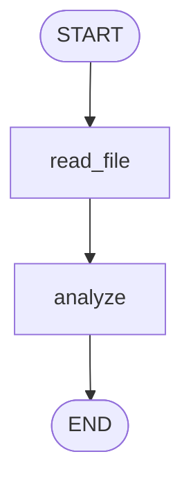
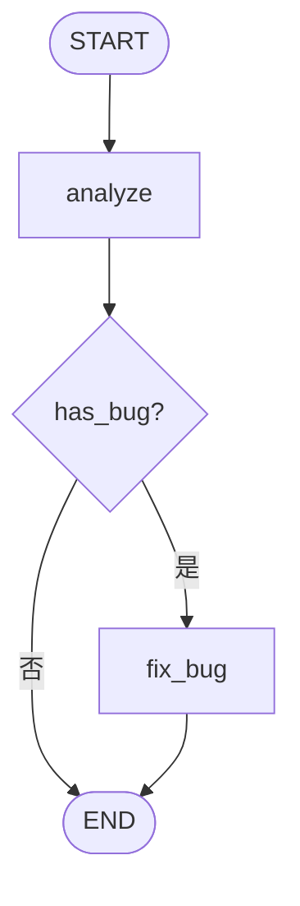
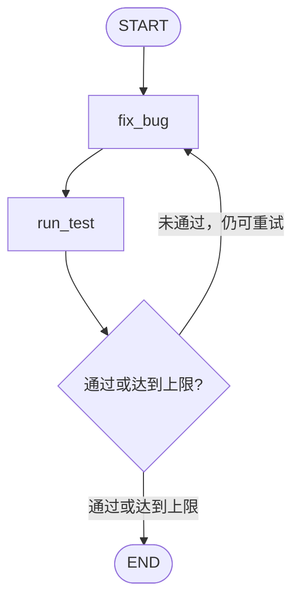
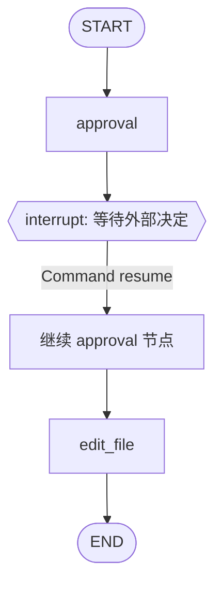
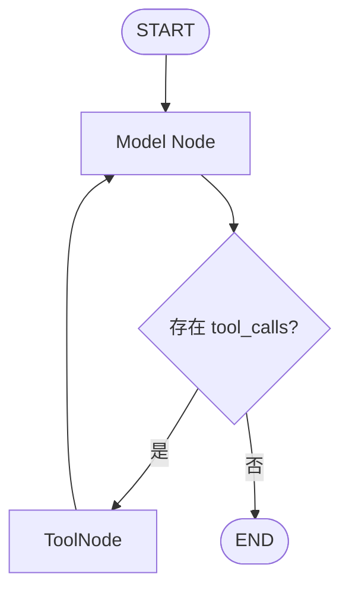

# LangGraph 从零入门：从 StateGraph 到 Coding Agent

> **本章要解决的问题：** 当一个程序不再只是调用一次模型，而是要读取文件、判断是否有 Bug、修改代码、运行测试、失败后重试，甚至需要人工审批和断点恢复时，如何用 LangGraph 组织这整个执行过程？
>
> 本章沿用一个任务：**检查 `refund.py`，修复优惠券部分退款精度问题**。前五个示例不需要模型 API Key；最后一个示例展示真正的模型工具调用。

## 一、先用普通 Python 做完最简单的任务

假设我们只需要读取一段代码，再判断它是否可能有精度风险。

```python
# 概念示例：不访问真实文件系统

def read_file():
    return "amount = round(price * ratio, 2)"


def analyze(code):
    return "存在精度风险" if "round(" in code else "暂未发现 round 调用"


result = analyze(read_file())
print(result)
```

只要任务永远是“读取 → 分析”，普通函数调用就足够了。**不能因为 LangGraph 可以画图，就认为所有程序都应该使用 LangGraph。**

不过，Coding Agent 很快会遇到新的要求：有 Bug 才修复；修复以后运行测试；测试失败则再次修复。我们希望将*执行步骤*与*下一步怎么调度*拆开管理。

LangGraph 的最小模型恰好对应三种东西：

- **State（状态）**：步骤之间共享的数据。
- **Node（节点）**：处理状态、执行某项工作，并返回状态更新的函数。
- **Edge（边）**：描述一个节点执行之后应该去哪里。

先只使用这三项，不引入更复杂的机制。

## 二、实验 1：两个节点组成最小 Graph

### 2.1 将普通函数改写成节点

创建 `example_01_basic.py`：

```python
from typing_extensions import TypedDict
from langgraph.graph import StateGraph, START, END


class State(TypedDict):
    filename: str
    code: str
    analysis: str


def read_file(state: State) -> dict:
    print("执行 read_file")
    # 教学数据：并未真正读取磁盘
    return {"code": "amount = round(price * ratio, 2)"}


def analyze(state: State) -> dict:
    print("执行 analyze")
    return {
        "analysis": (
            "发现可能的精度风险"
            if "round(" in state["code"]
            else "未发现明显的 round 调用"
        )
    }


builder = StateGraph(State)
builder.add_node("read_file", read_file)
builder.add_node("analyze", analyze)

builder.add_edge(START, "read_file")
builder.add_edge("read_file", "analyze")
builder.add_edge("analyze", END)

graph = builder.compile()

result = graph.invoke({
    "filename": "refund.py",
    "code": "",
    "analysis": "",
})
print(result)
```

预期执行轨迹：

```text
执行 read_file
执行 analyze
{
    'filename': 'refund.py',
    'code': 'amount = round(price * ratio, 2)',
    'analysis': '发现可能的精度风险'
}
```

对应流程：



### 2.2 这里与普通函数调用有什么区别？

请注意：`read_file()` **没有直接调用** `analyze()`。

```text
read_file(state)
    |
    | 返回 {"code": "..."}
    v
LangGraph 将更新合并进 State
    |
    | 根据 Edge 选择下一个节点
    v
analyze(更新后的 State)
```

`StateGraph(State)` 声明了状态结构。`add_node()` 注册节点，`add_edge()` 建立执行路径，`compile()` 将构建器转成可执行对象，`invoke()` 才真正开始运行。

节点通常返回**部分状态更新**，而不是自己修改一个共享全局字典。这一分离让 Runtime 有机会管理状态合并、调度及持久化。

此时我们只解决了“多个步骤如何按固定顺序执行”。接下来面对的是分支。

## 三、实验 2：发现 Bug 才修复——条件边

### 3.1 固定顺序为什么不够？

原来我们可以写：

```text
读取 → 分析 → 修复
```

但有时分析结果是“没有 Bug”。此时仍然执行修复，会造成不必要的文件改动。因此需要让下一步由最新 State 决定。



### 3.2 完整示例

创建 `example_02_branch.py`：

```python
from typing_extensions import TypedDict
from langgraph.graph import StateGraph, START, END


class State(TypedDict):
    code: str
    has_bug: bool
    result: str


def analyze(state: State) -> dict:
    has_bug = "round(" in state["code"]
    return {
        "has_bug": has_bug,
        "result": "需要修复" if has_bug else "没有命中示例检查规则",
    }


def fix_bug(state: State) -> dict:
    # 只展示“执行了修改节点”，不是正确的财务算法
    return {
        "code": state["code"].replace("round(", "safe_round("),
        "result": "完成教学用的字符串替换",
    }


def route_after_analysis(state: State):
    return "fix_bug" if state["has_bug"] else END


builder = StateGraph(State)
builder.add_node("analyze", analyze)
builder.add_node("fix_bug", fix_bug)
builder.add_edge(START, "analyze")
builder.add_conditional_edges("analyze", route_after_analysis)
builder.add_edge("fix_bug", END)

graph = builder.compile()

with_bug = graph.invoke({
    "code": "amount = round(price * ratio, 2)",
    "has_bug": False,
    "result": "",
})
without_bug = graph.invoke({
    "code": "amount = price * ratio",
    "has_bug": False,
    "result": "",
})

print(with_bug)
print(without_bug)
```

真正新增的机制只有一个：

```python
builder.add_conditional_edges("analyze", route_after_analysis)
```

`route_after_analysis()` 不执行文件修改，只根据当前状态**选择目的地**。

此时，`analyze` 负责发现问题，`fix_bug` 负责尝试处理问题，而 Graph 负责组织它们之间的控制流。

:::caution 教学边界
这里通过字符串 `"round("` 判断 Bug，只是为了观察路由。`safe_round` 并不是内置的可靠修复函数，也不能替代真正的 `Decimal` 计算、累计分摊规则及回归测试。
:::

## 四、实验 3：测试失败就继续——从分支长出循环

### 4.1 新出现的问题

文件修改后，我们还需要测试。如果测试失败，Agent 应该继续工作，而不是立即结束。

最自然的流程是：



这张 Graph 的图形本身不需要 LLM，它可以由普通的确定性 Python 函数组成。

### 4.2 完整示例

创建 `example_03_loop.py`：

```python
from typing_extensions import TypedDict
from langgraph.graph import StateGraph, START, END


class State(TypedDict):
    attempts: int
    passed: bool
    message: str


def fix_bug(state: State) -> dict:
    attempts = state["attempts"] + 1
    print(f"第 {attempts} 次修复尝试")
    return {"attempts": attempts}


def run_test(state: State) -> dict:
    # 确定性模拟：第二次尝试才成功
    passed = state["attempts"] >= 2
    print("测试结果：", "PASS" if passed else "FAIL")
    return {
        "passed": passed,
        "message": "测试通过" if passed else "仍存在精度问题",
    }


def route_after_test(state: State):
    if state["passed"] or state["attempts"] >= 3:
        return END
    return "fix_bug"


builder = StateGraph(State)
builder.add_node("fix_bug", fix_bug)
builder.add_node("run_test", run_test)
builder.add_edge(START, "fix_bug")
builder.add_edge("fix_bug", "run_test")
builder.add_conditional_edges("run_test", route_after_test)

graph = builder.compile()
result = graph.invoke({
    "attempts": 0,
    "passed": False,
    "message": "",
})
print(result)
```

预期轨迹：

```text
第 1 次修复尝试
测试结果： FAIL
第 2 次修复尝试
测试结果： PASS
```

这就得到最小反馈循环：

```text
执行 → 获得反馈 → 根据反馈决定是否继续
```

`attempts >= 3` 是故意加入的安全边界。真实循环还需要考虑异常、费用、模型调用次数和业务终止条件。

:::note 实验说明
这个程序没有修改真实文件，也没有运行真正的 `pytest`。它只用固定规则验证 Graph 的循环调度。Graph 能循环，不等于模型一定能修好 Bug。
:::

## 五、实验 4：第二次调用怎么接着上一次——Checkpoint

### 5.1 为什么只返回最终 State 还不够？

前面的 Graph 每次都完成一次执行。现在用户可能分两次下指令：

1. “分析退款 Bug。”
2. “接着刚才的结果继续处理。”

如果想保留同一条执行线程的状态，就需要持久化。LangGraph 提供 Checkpointer。

最小示例使用 `InMemorySaver`：它只在当前 Python 进程内保存 Checkpoints，适合学习，不适合生产环境的跨进程恢复。

### 5.2 完整示例

创建 `example_04_checkpoint.py`：

```python
from typing_extensions import TypedDict
from langgraph.graph import StateGraph, START, END
from langgraph.checkpoint.memory import InMemorySaver


class State(TypedDict):
    task: str
    count: int


def process(state: State) -> dict:
    return {"count": state["count"] + 1}


builder = StateGraph(State)
builder.add_node("process", process)
builder.add_edge(START, "process")
builder.add_edge("process", END)

graph = builder.compile(checkpointer=InMemorySaver())
config = {"configurable": {"thread_id": "refund-001"}}

first = graph.invoke({
    "task": "分析退款 Bug",
    "count": 0,
}, config)
print("第一次：", first)

second = graph.invoke({
    "task": "继续修复退款 Bug",
}, config)
print("第二次：", second)

snapshot = graph.get_state(config)
print("当前状态：", snapshot.values)
print("下一步节点：", snapshot.next)
```

预期的关键变化：

```text
第一次：count = 1
第二次：count = 2
```

在相同的 `thread_id` 下，第二次 `invoke()` 可以读取此前保留的状态；新传入的 `task` 更新任务描述，没有传入的 `count` 则沿用此前保存的值。

```text
Thread: refund-001
    |
    +-- 第一次调用 → State.count = 1 → Checkpoint
    |
    +-- 第二次调用 → 恢复已有 State → State.count = 2
```

此时需要分清三个概念：

- **State** 是 Graph 使用的数据。
- **Thread** 通过 `thread_id` 标识一条持久化的执行线。
- **Checkpoint** 记录可用于后续执行或恢复的状态与运行信息。

Checkpoint 不会自动保存任意本地变量、磁盘文件或已经发出的外部 API 请求。

## 六、实验 5：修改文件之前暂停——Human-in-the-Loop

### 6.1 为什么保存状态以后，还要允许主动暂停？

退款代码涉及资金。即使程序已经决定执行修改，我们也可能要求：

> 必须先向用户展示目标文件并获得审批。

在普通 Python 程序中，可以写 `input("允许修改吗？")`，但这要求程序始终阻塞地等待在同一个进程里。

真正的 Agent 服务往往需要把审批信息交给外部 UI，释放当前执行，再由另一请求恢复。这时才需要 `interrupt()` 和 `Command(resume=...)`。

### 6.2 完整示例

创建 `example_05_interrupt.py`：

```python
from typing_extensions import TypedDict
from langgraph.graph import StateGraph, START, END
from langgraph.types import interrupt, Command
from langgraph.checkpoint.memory import InMemorySaver


class State(TypedDict):
    filename: str
    approved: bool
    result: str


def approval(state: State) -> dict:
    decision = interrupt({
        "message": "是否允许修改退款文件？",
        "filename": state["filename"],
    })
    return {"approved": bool(decision)}


def edit_file(state: State) -> dict:
    # 这里只模拟修改；真正的写文件必须另行实现
    if not state["approved"]:
        return {"result": "审批被拒绝，未修改文件"}
    return {"result": "审批通过，模拟文件修改完成"}


builder = StateGraph(State)
builder.add_node("approval", approval)
builder.add_node("edit_file", edit_file)
builder.add_edge(START, "approval")
builder.add_edge("approval", "edit_file")
builder.add_edge("edit_file", END)

graph = builder.compile(checkpointer=InMemorySaver())
config = {"configurable": {"thread_id": "approval-001"}}

paused = graph.invoke({
    "filename": "refund.py",
    "approved": False,
    "result": "",
}, config)
print("中断信息：", paused.get("__interrupt__"))

# 模拟用户批准后，在相同 Thread 恢复执行
resumed = graph.invoke(Command(resume=True), config)
print("恢复后：", resumed)
```

执行路径：



这个例子最重要的不是“弹出确认框”，而是：**Graph 的暂停点与恢复所需的状态由 Runtime 管理**。

:::caution 恢复与副作用
恢复执行时，包含 `interrupt()` 的节点可能从函数开头重新执行。因此不要在 `interrupt()` 之前直接扣款、写文件、发邮件等不可重复的外部操作。Checkpoint 并不自动保证外部副作用只发生一次。
:::

## 七、实验 6：真正的 Agent——Model + ToolNode + Loop

现在我们已经会写 Graph，但前五个实验中的决策都来自固定的 Python 规则。

真正的 Coding Agent 需要让模型选择下一步动作，例如请求 `read_file("refund.py")`。LangGraph 提供内建的 `ToolNode` 来执行模型发出的 Tool Calls。

### 7.1 先理解消息协议

```text
HumanMessage: 用户要求检查 refund.py
          |
          v
Model → AIMessage(tool_calls=[read_file])
          |
          v
ToolNode → ToolMessage(文件内容)
          |
          v
Model → AIMessage(分析结果)
```

这里有两件必须分开的事：

- `model.bind_tools(tools)` 告诉模型可以请求哪些工具。
- `ToolNode(tools)` 才负责根据 `tool_calls` 真正执行工具。

**绑定工具不等于执行工具。**

### 7.2 安装并配置模型

```bash
pip install -U langgraph langchain-openai
export OPENAI_API_KEY="你的密钥"
```

这里采用 `ChatOpenAI`。你也可以用其他实现 `BaseChatModel` 接口、支持工具调用的模型。

### 7.3 完整示例

创建 `example_06_agent.py`：

```python
from langchain_openai import ChatOpenAI
from langchain_core.tools import tool
from langgraph.graph import StateGraph, START, MessagesState
from langgraph.prebuilt import ToolNode, tools_condition


@tool
def read_file(path: str) -> str:
    """读取指定项目文件的内容。"""
    # 教学数据：不访问实际磁盘
    if path == "refund.py":
        return """\
def calculate_refund(price, ratio):
    return round(price * ratio, 2)
"""
    return f"文件不存在：{path}"


tools = [read_file]
model = ChatOpenAI(model="gpt-4.1", temperature=0)
model_with_tools = model.bind_tools(tools)


def call_model(state: MessagesState) -> dict:
    response = model_with_tools.invoke(state["messages"])
    # MessagesState 的 messages 字段具有消息合并规则
    return {"messages": [response]}


builder = StateGraph(MessagesState)
builder.add_node("model", call_model)
builder.add_node("tools", ToolNode(tools))

builder.add_edge(START, "model")
builder.add_conditional_edges("model", tools_condition)
builder.add_edge("tools", "model")

graph = builder.compile()

result = graph.invoke({
    "messages": [
        {
            "role": "user",
            "content": (
                "请先读取 refund.py，再分析可能存在的退款精度问题。"
            ),
        }
    ]
})

for message in result["messages"]:
    message.pretty_print()
```

对应的 Graph：



这段代码需要真实模型服务。因此与前面的确定性实验不同，**模型可能请求工具，也可能直接回答；是否调用 `read_file` 是模型生成结果决定的**。

### 7.4 这里哪些是 LangGraph，哪些来自 LangChain？

| 对象 | 来源 | 工作 |
| --- | --- | --- |
| `StateGraph` | LangGraph | 定义并编译节点图 |
| `START` / `END` | LangGraph | 标识图的入口和出口 |
| `MessagesState` | LangGraph | 提供带消息合并规则的 State |
| `ToolNode` | LangGraph | 执行 Tool Calls |
| `tools_condition` | LangGraph | 根据最新 AIMessage 的工具调用决定路由 |
| `@tool` | LangChain Core | 定义工具协议与参数 |
| `ChatOpenAI` | `langchain-openai` | 调用真实模型 |

这也解释了你此前研究的 LangChain `create_agent()` 为什么使用 LangGraph：**Model、Tool、消息协议各有来源，LangGraph 将这些组件组织成可反复执行的程序。**

## 八、如何观察 Graph 每一步执行了什么？

只看最后的 `invoke()` 结果，可能看不出执行过程。已经有了一个可运行 Graph 后，可以把调用改成 `stream()`。

例如对实验 3 的 `graph`：

```python
for update in graph.stream(
    {
        "attempts": 0,
        "passed": False,
        "message": "",
    },
    stream_mode="updates",
):
    print(update)
```

`updates` 适合观察哪个节点提交了哪些 State 更新，而不必每次输出完整 State。

注意，`updates` 记录的是**节点更新**，不是模型每个 Token 的输出；若要看模型消息流，需要使用对应的消息流模式和模型流式能力。

## 九、LangGraph 到底比普通 Python 多了什么？

现在回看整条演化路径：

| 工程问题 | 最小引入的机制 | 相关 API |
| --- | --- | --- |
| 步骤之间需要传递数据 | State | `StateGraph(State)` |
| 想独立组织执行步骤 | Node | `add_node()` |
| 想固定执行顺序 | Edge | `add_edge()` |
| 有 Bug 才进行修复 | Conditional Edge | `add_conditional_edges()` |
| 测试失败后继续尝试 | Loop | 条件路由回到前面的节点 |
| 第二次调用延续状态 | Checkpointer | `compile(checkpointer=...)` |
| 危险操作需要外部审批 | Interrupt / Resume | `interrupt()`、`Command(resume=...)` |
| 让模型请求真实工具执行 | ToolNode | `ToolNode()`、`tools_condition()` |
| 想看到中间状态更新 | Streaming | `stream(stream_mode="updates")` |

这里仍然有几个边界需要记住：

1. **Graph 不等于模型智能**：Graph 只能调度决策，不能保证决策正确。
2. **工具定义不等于工具执行**：`bind_tools()` 与 `ToolNode` 是不同职责。
3. **Checkpoint 不等于磁盘快照**：它保存 Graph 状态，不能自动回滚 `refund.py`。
4. **中断恢复不等于外部副作用精确一次**：不可重复操作需要额外设计。
5. **`MessagesState` 不等于全部上下文管理**：模型最终看见哪些历史消息，仍取决于模型节点及上层 Middleware 的输入构造。

## 十、从 LangGraph 到 LangChain、DeepAgents

把前面学到的机制放回你一直研究的框架中：

```text
应用：退款 Coding Agent
           |
           v
DeepAgents.create_deep_agent()
    装配 Backend、Filesystem、Subagents 等
           |
           v
LangChain.create_agent()
    收集 Model、Tools、Middleware
    构建 Model Node + ToolNode + Graph
           |
           v
LangGraph Runtime
    运行节点 / 分支 / 循环 / State
    Checkpoint / Interrupt / Resume
           |
           v
LangChain Core + Provider + 工具实现
    模型调用 / 工具调用 / 数据协议
```

因此，LangGraph 不是一个只用于 Agent 的“聊天框架”。它是一套能够组织**有状态、可分支、可循环、可暂停并恢复**的执行逻辑的运行机制。

上层的 LangChain `create_agent()` 让你不必每次手动编写例子 6 中的 Graph；DeepAgents 则在这个 Agent 基础上进一步增加文件系统、任务委派和上下文策略。

## 十一、源码阅读路线

理解六个实验后，再读源码就会更自然。建议按这一顺序：

```text
langgraph/graph/state.py
    |
    | StateGraph 的定义与编译
    v
langgraph/graph/
    |
    | 状态字段、边、消息合并
    v
langgraph/prebuilt/tool_node.py
    |
    | Tool Call 如何执行
    v
langgraph/pregel/
    |
    | 编译后 Graph 的运行与调度
    v
langgraph/checkpoint/
    |
    | 持久化、Thread 和恢复
    v
langgraph/types.py
         interrupt / Command 等控制能力
```

这里的源码路径是**阅读入口**，不是说一次调用严格按照这几个目录依次进入；具体调用链还需按你固定的 LangGraph 版本展开。

## 十二、可以继续做的三个练习

1. 将实验 2 的字符串匹配替换成一个真正的退款单元测试判断，但先不调用 LLM。
2. 将实验 3 的模拟 `run_test()` 替换为受控执行的 `pytest`，并设置修复尝试次数上限。
3. 在实验 6 中加入 Checkpointer 和审批节点，观察 Tool Call、Checkpoint 与恢复的关系。

这样你就可以从最小程序一步一步长出一个真正的 Coding Agent，而不必先背诵 LangGraph 的所有内部术语。

---

## 参考资料与验证说明

本文示例采用 LangGraph Python 的公开 Graph API。相关官方资料：

- [LangGraph Graph API：状态、节点、分支与循环](https://docs.langchain.com/oss/python/langgraph/use-graph-api)
- [LangGraph Quickstart：构建工具调用 Agent](https://docs.langchain.com/oss/python/langgraph/quickstart)
- [LangGraph Persistence：Checkpointer 与 Store](https://docs.langchain.com/oss/python/langgraph/persistence)
- [LangGraph Interrupts：中断与恢复](https://docs.langchain.com/oss/python/langgraph/interrupts)

**实验标注：**前五个示例设计为无需模型 API Key 的本地实验；第六个示例需要 OpenAI API 凭据。本文中的预期输出用于帮助读者对照执行轨迹；编写文档的当前环境未安装 `langgraph`，因此**没有声称这些框架级示例已经在本环境实际运行通过**。示例中的文件读取、修改与 pytest 流程均明确标注了模拟边界。
