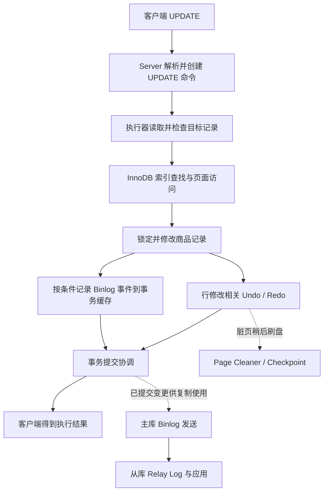

# 一次库存扣减的完整源码旅程

前面十四章，我们一直在追踪一件事：用户购买商品 `42`，MySQL 把库存从 `100` 扣减为 `99`。

```sql
UPDATE products
SET stock = stock - 1
WHERE id = 42 AND stock > 0;
```

起初我们只关心这个操作能否成功。随后，商品越来越多，我们不得不研究如何定位记录；数据要保存在磁盘上，我们开始研究页、B+ 树和 Buffer Pool；多个用户同时购买时，我们需要解释锁；一笔购买不止一条 SQL 时，我们又要处理 Undo 和回滚；最后，已提交修改还必须能够经受崩溃，并有机会传播到另一台 MySQL。

现在这些问题都已有了自己的解答，应该回到最初的 SQL，把它们放回各自真正发生的位置。

但这次回顾有一个容易犯的错误：把 MySQL 所有机制排成一条长长的调用链。例如：

```text
错误的理解：
SQL → B+ 树 → Buffer Pool → 锁 → Undo → Redo → Checkpoint
    → Binlog → Relay Log → COMMIT → 返回客户端
```

它看起来很完整，却暗示所有事情都由这条 UPDATE 依次同步调用完成。事实上，**请求执行、事务提交、后台刷盘和从库复制不是同一种流程**。

因此，本章只做一件事：**用真实源码把一次库存扣减的同步执行链串起来，再清楚标出哪些是执行时涉及的内部机制，哪些属于后台工作或另一个 MySQL 实例的行为。**

> **源码基线**：MySQL Server **8.4.0**，Git Tag [`mysql-8.4.0`](https://github.com/mysql/mysql-server/tree/mysql-8.4.0)。以下真实函数、源码位置均按该版本核对。
>
>
> **固定场景**：InnoDB 表、单表 `UPDATE`、主键 `id = 42`、库存当前为 `100`、条件 `stock > 0`，客户端通过普通文本 SQL 协议发送语句。正常路径中无触发器、无并发阻塞、无错误；会话启用自动提交。涉及 Binlog 的讨论额外要求实例已经启用 Binlog，并满足相应持久化配置。真实环境的计划选择与优化分支须以 `EXPLAIN` 为准。
>
>
> **验证说明**：本章的 Python 教学模型已经实际运行并通过断言；SQL 和双实例检查是可复现实验步骤，**未声称已经在真实 MySQL 服务器执行**。教学模型不代表 MySQL 的完整故障恢复保证。

---

## 1. 先把业务结果固定下来

为了让所有函数都有可以观察的目标，我们先不读源码，而是确认这次请求的输入与输出。

```sql
CREATE DATABASE IF NOT EXISTS mysql_source_lab;
USE mysql_source_lab;

CREATE TABLE IF NOT EXISTS products (
    id BIGINT PRIMARY KEY,
    name VARCHAR(100) NOT NULL,
    stock INT NOT NULL
) ENGINE = InnoDB;

INSERT INTO products (id, name, stock)
VALUES (42, 'Keyboard', 100)
ON DUPLICATE KEY UPDATE name = 'Keyboard', stock = 100;

SET SESSION autocommit = 1;

UPDATE products
SET stock = stock - 1
WHERE id = 42 AND stock > 0;

SELECT ROW_COUNT() AS affected_rows;
SELECT stock FROM products WHERE id = 42;
```

在独立、没有其他并发修改的实验环境中，预期为：

```text
affected_rows = 1
stock         = 99
```

这里的 `affected_rows = 1` 很重要。如果库存为 `0`，这条 UPDATE 在无报错的情况下也可能更新 `0` 条记录。**SQL 执行完成**与**确实成功售出一件商品**不是同一个判断。

不过，“库存变成 99”仍然无法告诉我们数据库内部发生了什么。现在沿着源码追踪它。

## 2. 第一次跨越：客户端文本怎样成为 UPDATE 命令？

我们在第 01、02 章已经找到请求入口。

对于这次普通文本 SQL，主要路径可以压缩成：

```text
客户端发送 COM_QUERY
         |
         v
sql/sql_parse.cc
  do_command()
         |
         v
  dispatch_command()
         |
         v
  dispatch_sql_command()
         |
         v
  parse_sql()
         |
         v
sql/sql_class.cc
  THD::sql_parser()
         |
         v
UPDATE 的语法树 PT_update
         |
         v
  PT_update::make_cmd()
         |
         v
  Sql_cmd_update
```

**这部分解决的是：MySQL 怎样理解用户想做什么。**

最小源码证据来自 [`sql/sql_class.cc`](https://github.com/mysql/mysql-server/blob/mysql-8.4.0/sql/sql_class.cc)：`THD::sql_parser()` 调用解析器，然后通过 `lex->make_sql_cmd(root)` 将得到的语法树转换为 SQL 命令对象。UPDATE 对应的语法树节点及 `make_cmd()` 分别位于 [`sql/parse_tree_nodes.h`](https://github.com/mysql/mysql-server/blob/mysql-8.4.0/sql/parse_tree_nodes.h) 和 [`sql/parse_tree_nodes.cc`](https://github.com/mysql/mysql-server/blob/mysql-8.4.0/sql/parse_tree_nodes.cc)。

读到这里，需要明确 **还没有发生** 的事情：

- 还没有找到商品 `42`；
- 还没有把库存 `100` 计算为 `99`；
- 也没有向 InnoDB 发起具体的记录更新。

解析阶段获得的是表、字段、赋值表达式和条件等结构化信息。它不是数据更新本身。

那么，谁会真正执行这个命令？

在 [`sql/sql_parse.cc`](https://github.com/mysql/mysql-server/blob/mysql-8.4.0/sql/sql_parse.cc) 的 `mysql_execute_command()` 中，UPDATE 的执行会进入命令对象的执行接口；随后，在 [`sql/sql_update.cc`](https://github.com/mysql/mysql-server/blob/mysql-8.4.0/sql/sql_update.cc) 中，单表 UPDATE 的正常路径来到：

```cpp
// 真实源码节选：sql/sql_update.cc
return multitable ? Sql_cmd_dml::execute_inner(thd)
                  : update_single_table(thd);
```

对于这条只更新 `products` 的语句，当前关注的入口就是：

```text
Sql_cmd_update::update_single_table()
```

这一刻，前面两章的任务完成了：**一段 SQL 文本已经成为一个具体的更新执行任务。**

但它仍然必须找到商品 `42`。

## 3. 第二次跨越：如何得到需要更新的那一条记录？

在最原始的 Python 版本中，我们直接写：

```python
product = products[42]
```

可是真实 MySQL 不能凭一个数组下标就找到磁盘中的商品。它需要确定一个访问路径：直接扫描，还是使用主键索引？

在 [`sql/sql_update.cc`](https://github.com/mysql/mysql-server/blob/mysql-8.4.0/sql/sql_update.cc) 的 `Sql_cmd_update::update_single_table()` 中，可以找到单表更新选择并创建读取迭代器的逻辑。对于当前无需先排序或更新扫描键的普通分支，关键语句是：

```cpp
// 真实源码节选：sql/sql_update.cc
iterator = init_table_iterator(thd, table, range_scan,
                               /*table_ref=*/nullptr, /*position=*/nullptr,
                               /*ignore_not_found_rows=*/false,
                               /*count_examined_rows=*/false);
```

我们只看这一步带来的变化：原先的 UPDATE 只是有目标表和 WHERE 条件；现在，执行过程有了一个能够**逐步读出候选记录**的迭代器。

接下来：

```cpp
// 真实源码节选：sql/sql_update.cc
error = iterator->Read();
```

这里的 `Read()` 不是“读取整个表”，而是取得下一条候选记录。读出的记录仍需要和查询条件对应起来。

如果 `id = 42` 是可用的主键等值条件，优化器可以选择利用主键索引定位目标；但“表里有索引”不代表所有查询都一定选择同样的访问方式。这个决定应由实际执行计划验证。

对于我们固定的主键查找场景，进入 InnoDB 后，之前几章研究过的工作就有了位置：

```text
读取候选记录
    |
    v
根据主键在聚簇索引中定位
    |
    v
B+ 树逐层寻找目标叶页
    |
    v
向 Buffer Pool 请求相关页面
    |
    +-- 页面已缓存：复用内存页
    |
    +-- 未缓存：读取页面后继续
    |
    v
在叶页中定位 id=42 的记录
```

这张图是**数据访问流程归纳**，不是逐函数的严格调用栈。

我们此前核对过的源码位置包括：

- [`storage/innobase/row/row0sel.cc`](https://github.com/mysql/mysql-server/blob/mysql-8.4.0/storage/innobase/row/row0sel.cc) 中的 `row_search_mvcc()`：InnoDB 行搜索的核心入口之一；
- [`storage/innobase/btr/btr0cur.cc`](https://github.com/mysql/mysql-server/blob/mysql-8.4.0/storage/innobase/btr/btr0cur.cc) 中的 `btr_cur_search_to_nth_level()`：索引树搜索；
- [`storage/innobase/buf/buf0buf.cc`](https://github.com/mysql/mysql-server/blob/mysql-8.4.0/storage/innobase/buf/buf0buf.cc) 中的 `buf_page_get_gen()`：向 Buffer Pool 获取页面。

你会发现，我们不需要再次花两章解释 B+ 树和 Buffer Pool。

此刻只要把它们放回原来的问题即可：**执行器想拿到一条记录，InnoDB 用索引定位页，再通过缓存机制取得可访问的页面内容。**

这也解释了一个边界：即便采用主键查找，仍然可能涉及多个索引页和数据页的访问；页面是否已经缓存，会影响实际 I/O。不能把“使用主键”理解为一定只有一次磁盘读取。

现在，记录已经被读到。下一步是不是立刻减一？

还需要确认它真正满足购买条件。

## 4. 第三次跨越：什么时候检查条件、什么时候计算新库存？

回到 `Sql_cmd_update::update_single_table()`。

实际执行循环会反复读取候选记录，并判断 WHERE 条件。与当前问题直接相关的代码是：

```cpp
// 真实源码节选：sql/sql_update.cc
const bool skip_record = conds->val_int() == 0;
```

这里 `conds` 表示 UPDATE 的条件表达式。在需要由这一层继续判断条件的路径里，计算结果为假时，当前记录不会进入后续正常更新动作；有些条件可能已经被索引访问或其他优化阶段利用，不应假定每个谓词都在这里逐项重新判断。

我们的购买语句有两个条件：

```sql
id = 42 AND stock > 0
```

找到商品 `42` 仍不代表可以购买。如果库存已经是 `0`，正确结果是没有库存记录被修改。

对满足条件的记录，执行过程需要准备新值。当前语句中的新值来源于旧记录：

```text
旧 stock = 100
表达式：stock - 1
新 stock = 99
```

[`sql/sql_update.cc`](https://github.com/mysql/mysql-server/blob/mysql-8.4.0/sql/sql_update.cc) 在写回前调用 `fill_record_n_invoke_before_triggers(...)`，根据赋值表达式填充新的记录值，并处理相应的更新前触发器逻辑（我们固定的表没有触发器）。

对于这条最简单的更新，不需要把该函数内部所有字段转换规则都展开。最重要的是理解它的**输入和输出**：

- 输入：读到的旧记录、UPDATE 要修改的字段及其表达式；
- 输出：一份可交给存储引擎的更新后记录内容。

接下来数据库终于可以尝试修改这一行了。

## 5. 第四次跨越：Server 的更新怎样到达 InnoDB？

这一段是整条 SQL 路径中最值得完整记住的职责交接。

首先，`Sql_cmd_update::update_single_table()` 的非批量更新分支调用：

```cpp
// 真实源码节选：sql/sql_update.cc
error = table->file->ha_update_row(table->record[1], table->record[0]);
```

这两个记录缓冲区有明确含义：`record[1]` 对应旧记录，`record[0]` 对应新记录。

随后进入 [`sql/handler.cc`](https://github.com/mysql/mysql-server/blob/mysql-8.4.0/sql/handler.cc) 中的 `handler::ha_update_row()`。它不是 InnoDB 独有的入口，而是 Server 与存储引擎之间的一层统一接口。

在该函数中，可以看到先通过存储引擎更新接口处理记录，成功后再根据 Binlog 记录要求处理行变更：

```cpp
// 真实源码节选：sql/handler.cc
MYSQL_TABLE_IO_WAIT(PSI_TABLE_UPDATE_ROW, active_index, error,
                    { error = update_row(old_data, new_data); })
```

这里的 `update_row()` 对于当前 InnoDB 表，会进入 [`storage/innobase/handler/ha_innodb.cc`](https://github.com/mysql/mysql-server/blob/mysql-8.4.0/storage/innobase/handler/ha_innodb.cc) 中的：

```text
ha_innobase::update_row()
```

而 InnoDB 在这里先计算旧记录与新记录之间的字段差异，再交给自己的行更新路径。源码中能找到：

```cpp
// 真实源码节选：storage/innobase/handler/ha_innodb.cc
error = row_update_for_mysql((byte *)old_row, m_prebuilt);
```

其中 `row_update_for_mysql()` 位于 [`storage/innobase/row/row0mysql.cc`](https://github.com/mysql/mysql-server/blob/mysql-8.4.0/storage/innobase/row/row0mysql.cc)。对于我们这样的普通持久化 InnoDB 表，它会进入通过更新执行图处理行修改的路径；再往下，相关实现位于 [`storage/innobase/row/row0upd.cc`](https://github.com/mysql/mysql-server/blob/mysql-8.4.0/storage/innobase/row/row0upd.cc)。

把关键跨层关系放在一起：

```text
Sql_cmd_update::update_single_table()
           |
           v
     handler::ha_update_row()
           |
           v
     ha_innobase::update_row()
           |
           v
     row_update_for_mysql()
           |
           v
     InnoDB 行更新逻辑
```

这条链的重点不在于函数有多少个，而在于为什么有这些层：

- `Sql_cmd_update`：负责这条 UPDATE 的 SQL 执行语义，判断记录是否应修改；
- `handler`：为 Server 提供通用存储引擎操作接口；
- `ha_innobase`：把通用行格式及调用约定转换为 InnoDB 的内部操作；
- InnoDB 行更新：负责真正的数据结构修改，以及对应的事务与日志要求。

到了这里，我们可以合理地说：**SQL 层已经把新旧记录交给存储引擎，InnoDB 负责落实修改。**

不过，还有一个重要限制：不能以为每次 UPDATE 都“直接在原位置覆盖几个字节”。如果字段长度、索引字段或其他条件不同，InnoDB 会走不同的修改分支。当前 `stock` 是固定长度整数、主键不变，才适合以简单路径建立直觉。

## 6. 在 InnoDB 内部，锁、Undo、Redo 各发生在什么位置？

我们此前把这几个机制分开学习，是因为每一个都要先回答自己的问题。现在它们终于能同时回到这一条 UPDATE。

### 6.1 锁：在修改前避免冲突修改破坏结果

假设两个用户同时扣减只剩一件的商品。数据库必须协调它们对同一索引记录的修改，否则两个请求不能可靠地按照数据库的隔离规则完成。

在 InnoDB 的正常更新路径里，读取待修改记录与相应的锁处理密切相关。可以从 [`row0sel.cc`](https://github.com/mysql/mysql-server/blob/mysql-8.4.0/storage/innobase/row/row0sel.cc) 的 `row_search_mvcc()` 及其调用的锁设置逻辑继续追踪。

这里应当强调：**UPDATE 不是普通 `SELECT` 的一致性快照读取。** 它需要依照加锁读取和更新的规则处理目标记录。通过主键精确查找已存在记录时，在常见条件下可针对相应索引记录加锁；具体锁范围还受到隔离级别、索引、查询条件和执行计划影响。

### 6.2 Undo：为撤销和历史版本提供必要信息

上章购买事务中，如果库存扣了但订单插入失败，数据库需要能够把未提交修改撤销。

因此，InnoDB 行修改不能只考虑新值 `99`。它还必须按事务机制保存必要的旧版本/撤销信息，使回滚和一致性读取能够获得所需材料。

Undo 的生成、使用和旧版本构造涉及多个函数和阶段。**不要把 `Undo` 误当成 UPDATE 最后再额外执行的一条业务语句。** 它是 InnoDB 修改处理的一部分，旧版本重建则是在后续需要时发生。

### 6.3 Redo 与脏页：新值在内存里，还要支持崩溃恢复

修改记录之后，包含这条记录的数据页可能先在 Buffer Pool 中发生变化。数据库不能指望事务提交时一定把整个数据页写回数据文件。

对于正常记录页修改，InnoDB 通过微事务等机制记录相应 Redo，并把修改过的页面纳入后续刷盘管理。我们已经在 [`storage/innobase/mtr/mtr0mtr.cc`](https://github.com/mysql/mysql-server/blob/mysql-8.4.0/storage/innobase/mtr/mtr0mtr.cc) 看到过：

```cpp
// 真实源码节选：storage/innobase/mtr/mtr0mtr.cc
add_dirty_blocks_to_flush_list(handle.start_lsn, handle.end_lsn);
```

这是 `mtr_t::Command::execute()` 中正常 Redo 日志路径的关键一步。

它帮助我们把**内存页修改与脏页管理**联系起来，但它不是事务最终的 `COMMIT`。

因此，此时可能同时存在这样的状态：

```text
Buffer Pool 中的商品库存：99
数据文件中的旧页面：       100
与修改有关的 Undo/Redo： 已按相应机制生成或记录
事务最终是否提交：       仍要看提交阶段
```

这里的数字是帮助理解的状态示意，不表示 InnoDB 真实页面必定恰好停留在这个时间点；实际页内容、日志写入和持久化由并发线程与配置共同影响。

**三个事情不要混为一谈：记录内容已改、物理数据页已刷盘、用户事务已提交。**

## 7. 一个容易遗漏的顺序：Binlog 行事件并非等到提交后才“凭空生成”

现在回到刚才已经核对的 `handler::ha_update_row()`。

它在成功调用存储引擎的更新接口之后，还会处理 Binlog 的行记录逻辑：

```cpp
// 真实源码节选：sql/handler.cc
if (unlikely((error = binlog_log_row(table, old_data, new_data, log_func))))
  return error;
```

这段代码非常重要，因为它纠正了一种常见的错误画法：

> “InnoDB 先完成全部事务提交，然后 MySQL 才开始生成这次 UPDATE 的 Binlog。”

真实情况需要分成两个阶段理解。

**语句执行阶段**：对于启用了行格式 Binlog 且符合记录条件的更新，Server 会在更新行的路径中生成对应行事件，并按事务机制写入 Binlog 缓存等结构。

**事务提交阶段**：这批属于事务的 Binlog 信息才进入与存储引擎提交相协调的写入、同步和提交过程。

因此，“生成行变更事件”和“把事务 Binlog 持久化作为提交结果”不是同一个操作。若采用其他 Binlog 格式或某些特殊路径，事件处理细节也会不同；本章这里以常见的 ROW 格式作为例子。

现在，行修改已经完成，事务又是何时真正提交的？

## 8. 第五次跨越：一次成功的 UPDATE 怎样完成事务提交？

在默认 `autocommit = 1`、当前没有显式多语句事务的情况下，一条成功的 UPDATE 作为单语句事务完成提交。若放在 `START TRANSACTION` 与 `COMMIT` 之间，则不能把单条语句结束等同于整个用户事务已经提交。

在 MySQL 8.4.0 的 [`sql/sql_parse.cc`](https://github.com/mysql/mysql-server/blob/mysql-8.4.0/sql/sql_parse.cc) 中，语句清理路径会根据成功或失败选择语句提交或回滚。成功路径中能看到：

```cpp
// 真实源码节选：sql/sql_parse.cc
trans_commit_stmt(thd);
```

[`sql/transaction.cc`](https://github.com/mysql/mysql-server/blob/mysql-8.4.0/sql/transaction.cc) 中的 `trans_commit_stmt()` 进一步进入事务协调逻辑，包括对相应存储引擎执行事务操作。

如果启用了 Binlog 且本次事务有需要记录的内容，上一章研究的内部提交协调就开始发挥作用。

从设计上看，我们要让两件事情保持一致：

1. InnoDB 对这笔购买的提交结论；
2. 供复制使用的 Binlog 对这笔购买的提交结论。

在常见启用 Binlog 的事务提交路径中，相关阶段可归纳为：

```text
需要提交库存扣减事务
         |
         v
存储引擎 Prepare
         |
         v
Binlog 事务缓存进入 Flush / Sync 协调
         |
         v
存储引擎完成 Commit
         |
         v
向客户端完成语句结果反馈
```

在 [`sql/binlog.cc`](https://github.com/mysql/mysql-server/blob/mysql-8.4.0/sql/binlog.cc) 中，可以找到 `MYSQL_BIN_LOG::ordered_commit()`；[`sql/handler.cc`](https://github.com/mysql/mysql-server/blob/mysql-8.4.0/sql/handler.cc) 则包含相应的事务协调入口。组提交会影响参与线程的队列与执行方式，因此这张图是**阶段关系**，不能冒充每个线程都逐行经过的栈轨迹。

还必须指出一个配置前提：`innodb_flush_log_at_trx_commit`、`sync_binlog` 等设置决定日志在提交过程中采用怎样的持久化策略。不能在未知配置的情况下说“返回成功就绝对抵抗所有突然断电”。

现在可以回答一个很多读者最开始不理解的问题：

**为什么数据文件中的商品页还可能没写成 99，客户端却已经收到购买成功？**

因为事务提交不要求该数据页必须同步写回数据文件。对崩溃后的正确恢复，InnoDB 依赖相应的持久化日志与恢复流程；数据库数据页可以随后再安全刷盘。

## 9. 别把后台机制画成同一条 UPDATE 的同步调用链

前面几章我们又研究了 Page Cleaner、Checkpoint 和复制。它们都与这次库存扣减有关，但它们在系统中的位置不同。

### 9.1 Page Cleaner 与 Checkpoint：处理后续页面与恢复进度

当商品所在页面变脏，后台刷盘机制可以在适当时机将其写回数据文件。与此同时，检查点的推进需要考虑尚未安全落盘的相关脏页及日志范围。

**Checkpoint 不是“这条 UPDATE 提交时必须调用的一次全量刷盘”。**

它服务于持续运行中的恢复进度管理。这里我们不再重复第 12 章的完整推导，只把它放回正确的位置：

```text
本次 UPDATE 修改了商品所在页面
             |
             +----> 页面变脏，纳入刷盘管理
                           |
                           v
                     后台适时刷盘
                           |
                           v
                     允许检查点推进
```

这是一条与用户请求执行并行的**状态与后台处理路径**，不是 `UPDATE → Flush → Checkpoint → COMMIT` 的必经顺序。

### 9.2 复制线程：在另一台 MySQL 上消费已提交变更

如果有配置好的从库，而且复制正常运行，那么主库 Binlog 可以被发送并供从库应用。

第 14 章已经确认了相关源码：

```text
主库 Binlog
     |
     v
Binlog_sender::send_events()
     |
     v
网络传输
     |
     v
从库接收并写入 Relay Log
     |
     v
从库应用线程执行事件
     |
     v
从库商品库存 100 → 99
```

对于 ROW 更新事件，应用过程最终也会调用从库存储引擎的行更新接口。但这并不意味着**主库的 UPDATE 在返回客户端前一定要等到从库应用成功**。在典型异步复制中，从库可能暂时仍然显示 `100`。

换句话说，这条 SQL 同时关联三种不同时间尺度：

| 观察对象 | 当前要回答的问题 | 与客户端 UPDATE 的关系 |
|---|---|---|
| 当前请求 | 是否找到、检查并更新商品？ | 同步执行主线 |
| 事务提交 | 是否达成提交结果与要求的日志保证？ | 返回结果前的关键协调过程 |
| 后台刷盘 | 修改的物理数据页何时持久化？ | 可以延后、由后台协调 |
| 从库复制 | 另一实例何时应用已提交事件？ | 通常异步，不等于主库本次调用栈 |

**这比把所有术语塞进一张巨大箭头图，更接近真实数据库的运行方式。**

---

## 10. 一个最小可运行的“整条路线”模型

为了验证刚才区分的几个状态，我们只保留一次购买中最有用的数据：

- 商品在内存中的值；
- 商品在数据文件中的旧值；
- 为回滚保留的历史信息；
- 修改相关的 Redo 示意；
- 尚未提交的 Binlog 事件；
- 已经作为事务结果发布的 Binlog 事件；
- 从库自己的库存。

**下面是教学化简，不是 InnoDB 源码，也没有实现真正的日志刷盘、双阶段提交、行锁或崩溃恢复。** 这里保留 Undo、Redo 的名字，仅用于记录它们要支持的能力，不代表真实字节格式及精确写入顺序。

```python
from dataclasses import dataclass, field

@dataclass
class ToyPurchase:
    disk_stock: int = 100
    memory_stock: int = 100
    replica_stock: int = 100
    undo: list = field(default_factory=list)
    redo: list = field(default_factory=list)
    pending_binlog: list = field(default_factory=list)
    durable_binlog: list = field(default_factory=list)
    committed: bool = False

    def update(self):
        if self.memory_stock <= 0:
            return 0
        before = self.memory_stock
        after = before - 1
        self.undo.append(before)
        self.memory_stock = after
        self.redo.append(("stock", after))
        self.pending_binlog.append(("stock", before, after))
        return 1

    def commit_and_publish(self):
        # 概念动作；不是 fsync、两阶段提交的实现
        self.durable_binlog.extend(self.pending_binlog)
        self.pending_binlog.clear()
        self.committed = True

    def apply_on_replica(self):
        for _, before, after in self.durable_binlog:
            assert self.replica_stock == before
            self.replica_stock = after

s = ToyPurchase()
assert s.update() == 1
print(f"执行更新后: 内存={s.memory_stock}, 磁盘={s.disk_stock}, Binlog缓存事件={len(s.pending_binlog)}")

s.commit_and_publish()
print(f"模拟提交后: 事务已提交={s.committed}, 磁盘页={s.disk_stock}, 可复制事件={len(s.durable_binlog)}")

s.apply_on_replica()
print(f"模拟复制应用后: 从库={s.replica_stock}")

assert (s.memory_stock, s.disk_stock, s.replica_stock) == (99, 100, 99)
```

**实际运行输出（Python 3）：**

```text
执行更新后: 内存=99, 磁盘=100, Binlog缓存事件=1
模拟提交后: 事务已提交=True, 磁盘页=100, 可复制事件=1
模拟复制应用后: 从库=99
```

这次实验不是为了证明 MySQL 的真实崩溃恢复已经通过，而是检查我们理解中的**状态区分是否自洽**：

1. 内存中的值可以先发生变化；
2. 数据文件中的旧值可以暂时不变；
3. 行变更可以先进入未提交事件集合；
4. 提交决定与从库应用属于不同动作；
5. 从库应用不要求主库数据页已经物理刷盘。

如果试图把第 2、3、4、5 步都理解成一个动作，就很难正确解释真实 MySQL 的行为。

## 11. 真实 MySQL 应该怎样验证这条路线？

教学实验让我们能观察状态，但真实服务器的实现还有很多分支。本节提供一个小而完整的验证路径；不要把没有运行的 SQL 标成真实执行截图。

### 11.1 验证一次 UPDATE 的基础输入、输出

在专用实验数据库中执行：

```sql
USE mysql_source_lab;
SET SESSION autocommit = 1;

UPDATE products SET stock = 100 WHERE id = 42;

EXPLAIN UPDATE products
SET stock = stock - 1
WHERE id = 42 AND stock > 0;

UPDATE products
SET stock = stock - 1
WHERE id = 42 AND stock > 0;
SELECT ROW_COUNT() AS affected_rows;
SELECT id, stock FROM products WHERE id = 42;
```

重点看 `EXPLAIN` 是否选择了 `PRIMARY`。查询计划帮助我们判断记录访问路径，但不能单凭它证明一次物理页 I/O 究竟读取了多少次。

### 11.2 验证“语句结束”和“显式事务提交”不是一回事

**首先确保 A 尚未开启事务**，在连接 A 中单独执行一次自动提交的初始化：

```sql
SET SESSION autocommit = 1;
UPDATE products SET stock = 100 WHERE id = 42;
```

确认已提交的库存是 `100` 后，再在连接 A 中执行：

```sql
START TRANSACTION;
UPDATE products SET stock = stock - 1
WHERE id = 42 AND stock > 0;
SELECT stock FROM products WHERE id = 42;
-- 暂时不要 COMMIT
```

此时 A 在自己的事务中可以看到 `99`。**连接 B 不要先开启一个长期事务**，在新连接 B 中运行普通 `SELECT`，预期在 A 提交前看到已提交库存 `100`。默认 `REPEATABLE READ` 下，普通一致性读取不会把 A 尚未提交的新值直接当成已提交数据返回；具体可见值还取决于 B 的快照建立时间。

然后在 A 中：

```sql
COMMIT;
```

在 B 中使用新的自动提交 `SELECT` 再观察。如果 B 已经处于旧的显式 REPEATABLE READ 事务中，必须注意旧快照仍可能影响结果。

这个实验能够验证事务可见性与提交边界，不能证明 Redo 已经真实刷盘。

### 11.3 检查日志持久化与复制前提

```sql
SHOW VARIABLES LIKE 'log_bin';
SHOW VARIABLES LIKE 'binlog_format';
SHOW VARIABLES LIKE 'innodb_flush_log_at_trx_commit';
SHOW VARIABLES LIKE 'sync_binlog';
```

如果实例启用了 Binlog，并且具备查看日志的权限，可以结合 `SHOW BINARY LOG STATUS` 和 `mysqlbinlog` 检查这次事务对应的事件。注意，日志格式、其他并发事务、GTID 和具体版本配置都会影响输出；不要预先假定每个实例都会出现完全相同的事件文本。

真实源码调用链仍应通过固定 Commit 的静态分析或调试器断点验证。`EXPLAIN`、状态变量和 SQL 输出只能提供某些阶段的外部证据。

### 11.4 想要更进一步，可分别设置断点

如果你自行构建了 MySQL 8.4.0 的可调试版本，可从下列入口按层验证，而不是一次设置数十个断点：

| 调试目的 | 候选断点 | 观察内容 |
|---|---|---|
| 证明请求进入 | `dispatch_sql_command` | SQL 文本和连接上下文 |
| 证明已形成 UPDATE 命令 | `Sql_cmd_update::update_single_table` | 目标表、条件、计划分支 |
| 证明 SQL 层提交行更新 | `handler::ha_update_row` | old/new record |
| 证明进入 InnoDB | `ha_innobase::update_row` | 更新向量与事务上下文 |
| 证明进入 InnoDB 更新 | `row_update_for_mysql` | 内部行更新入口 |
| 观察单语句事务处理 | `trans_commit_stmt` | 自动提交与多语句事务区别 |
| 观察启用 Binlog 时的提交协调 | `MYSQL_BIN_LOG::ordered_commit` | 组提交阶段与线程角色 |

上述断点是**调试定位建议**，不是声称已经附上了一条真实的 GDB 调用栈。编译优化、符号信息与实际执行分支都可能影响断点行为。

---

## 12. 最后，才把 MySQL 的整体结构画出来

现在我们已经能用自己的语言解释下面这张图中的每一部分，而不需要靠背诵模块名。



> 这是**调用链与数据依赖的综合教学图**，实线不全是逐函数直接调用，虚线特意表示独立的后续工作。Undo 与 Redo 也不是必须按图中的同一条顺序依次生成。真正的线程、日志顺序以及故障行为应以对应源码路径和配置为准。

如果需要一张**只表示当前请求主要同步职责**的更严格简化图，应当缩成：

```text
COM_QUERY
   |
   v
解析 SQL / 创建 Sql_cmd_update
   |
   v
Sql_cmd_update::update_single_table()
   |
   v
迭代读取候选记录、检查条件、计算新值
   |
   v
handler::ha_update_row()
   |
   v
ha_innobase::update_row()
   |
   v
InnoDB 行修改
   |
   v
语句事务处理及必要的提交协调
   |
   v
返回执行结果
```

它省略了很多真实函数，却保留了我们一直追踪的核心问题：

**一条用户描述的库存修改请求，怎样成为真正的数据修改，并在事务规则下完成。**

## 13. 我们理解了什么，也还有什么没解决？

整个系列最开始的 Python 实现只有一行：

```python
products[42]["stock"] -= 1
```

它让库存变化，却没有提供一个独立数据库系统所需要的完整语义。

今天我们重新阅读同一个操作时，可以逐层解释：

- **从文本到命令**：MySQL 如何理解要修改的表、字段、条件和赋值；
- **从命令到目标记录**：为什么要有读取路径，以及 InnoDB 如何利用索引、页面与缓存定位记录；
- **从旧值到新值**：Server 如何检查条件、计算新记录，再通过 handler 接口进入 InnoDB；
- **从单次修改到正确事务**：为什么需要锁、Undo 和回滚能力；
- **从内存修改到可靠提交**：Redo、脏页管理和事务提交分别承担什么任务；
- **从本地到其他实例**：为什么需要 Binlog，以及复制为什么可能滞后于主库提交。

但**完成主线不代表掌握了全部 MySQL**。例如：

- 如果不通过主键而通过商品名称查询，会出现二级索引和回表问题；
- 如果一次 UPDATE 涉及多个索引字段，记录修改路径可能需要更多索引维护；
- 如果复杂事务出现锁循环，还要研究死锁检测；
- 如果长期存在旧快照，还要研究 Purge 如何清理历史版本；
- 如果一次查询关联订单与商品，则需要深入多表执行计划。

这些问题应当从已经理解的主线自然分叉，作为独立专题研究，而不是硬塞进“每次扣库存都必须经过”的调用链。

**至此，我们真正完成的是一条可以复述、可以继续向下查证的 MySQL 源码阅读主线。**

再看到最初的 SQL：

```sql
UPDATE products
SET stock = stock - 1
WHERE id = 42 AND stock > 0;
```

我们不再只说它把 `100` 变成 `99`。

我们能解释这件事**发生在哪里、经过哪些职责边界、为什么需要这些机制，以及哪些后续工作并不阻塞同一条语句的执行**。

这比记住更多术语，更接近真正理解一个数据库系统。

---

## 本章固定版本源码地图

**全部链接固定在 MySQL Server 8.4.0 / `mysql-8.4.0`。** 链接是源码浏览入口，具体运行应按照本文声明的语句类型、表结构、事务配置和计划分支判断。

| 所属层 | 文件 | 关键函数或入口 | 本章关注的职责 |
|---|---|---|---|
| 客户端命令 | [`sql/sql_parse.cc`](https://github.com/mysql/mysql-server/blob/mysql-8.4.0/sql/sql_parse.cc) | `do_command()`、`dispatch_command()`、`dispatch_sql_command()` | 接收文本命令 |
| 解析 | [`sql/sql_class.cc`](https://github.com/mysql/mysql-server/blob/mysql-8.4.0/sql/sql_class.cc) | `THD::sql_parser()` | SQL 解析与转换 |
| 语句对象 | [`sql/parse_tree_nodes.cc`](https://github.com/mysql/mysql-server/blob/mysql-8.4.0/sql/parse_tree_nodes.cc) | `PT_update::make_cmd()` | 创建 UPDATE 命令 |
| SQL 执行 | [`sql/sql_update.cc`](https://github.com/mysql/mysql-server/blob/mysql-8.4.0/sql/sql_update.cc) | `Sql_cmd_update::update_single_table()` | 读取候选行、检查条件、准备更新 |
| 存储引擎接口 | [`sql/handler.cc`](https://github.com/mysql/mysql-server/blob/mysql-8.4.0/sql/handler.cc) | `handler::ha_update_row()` | 通用行更新与 Binlog 行事件处理 |
| InnoDB 接口 | [`storage/innobase/handler/ha_innodb.cc`](https://github.com/mysql/mysql-server/blob/mysql-8.4.0/storage/innobase/handler/ha_innodb.cc) | `ha_innobase::update_row()` | 转换更新信息并调用 InnoDB |
| 行读取 | [`storage/innobase/row/row0sel.cc`](https://github.com/mysql/mysql-server/blob/mysql-8.4.0/storage/innobase/row/row0sel.cc) | `row_search_mvcc()` | 记录定位与读取相关处理 |
| 索引定位 | [`storage/innobase/btr/btr0cur.cc`](https://github.com/mysql/mysql-server/blob/mysql-8.4.0/storage/innobase/btr/btr0cur.cc) | `btr_cur_search_to_nth_level()` | 索引树导航 |
| 页面获取 | [`storage/innobase/buf/buf0buf.cc`](https://github.com/mysql/mysql-server/blob/mysql-8.4.0/storage/innobase/buf/buf0buf.cc) | `buf_page_get_gen()` | 从 Buffer Pool 获取页面 |
| InnoDB 行修改 | [`storage/innobase/row/row0mysql.cc`](https://github.com/mysql/mysql-server/blob/mysql-8.4.0/storage/innobase/row/row0mysql.cc)、[`row0upd.cc`](https://github.com/mysql/mysql-server/blob/mysql-8.4.0/storage/innobase/row/row0upd.cc) | `row_update_for_mysql()`、`row_upd_clust_step()` | 实际记录更新 |
| Redo / 脏页 | [`storage/innobase/mtr/mtr0mtr.cc`](https://github.com/mysql/mysql-server/blob/mysql-8.4.0/storage/innobase/mtr/mtr0mtr.cc) | `mtr_t::Command::execute()` | 相关日志与脏页管理 |
| 语句提交 | [`sql/transaction.cc`](https://github.com/mysql/mysql-server/blob/mysql-8.4.0/sql/transaction.cc) | `trans_commit_stmt()` | 语句结束后的事务处理 |
| Binlog 提交协调 | [`sql/binlog.cc`](https://github.com/mysql/mysql-server/blob/mysql-8.4.0/sql/binlog.cc) | `MYSQL_BIN_LOG::ordered_commit()` | Binlog 组提交协调 |
| 复制 | [`sql/rpl_binlog_sender.cc`](https://github.com/mysql/mysql-server/blob/mysql-8.4.0/sql/rpl_binlog_sender.cc)、[`sql/rpl_replica.cc`](https://github.com/mysql/mysql-server/blob/mysql-8.4.0/sql/rpl_replica.cc) | `Binlog_sender::send_events()`、`queue_event()` | 变更发送与 Relay Log 接收 |

**官方文档：**

- [MySQL 8.4：InnoDB 存储引擎](https://dev.mysql.com/doc/refman/8.4/en/innodb-storage-engine.html)
- [MySQL 8.4：事务与 COMMIT](https://dev.mysql.com/doc/refman/8.4/en/commit.html)
- [MySQL 8.4：InnoDB 自动提交与事务](https://dev.mysql.com/doc/refman/8.4/en/innodb-autocommit-commit-rollback.html)
- [MySQL 8.4：崩溃恢复](https://dev.mysql.com/doc/refman/8.4/en/innodb-recovery.html)
- [MySQL 8.4：复制](https://dev.mysql.com/doc/refman/8.4/en/replication.html)

**阅读边界：** 本章有意只选择一次正常单表、主键条件、无触发器的 UPDATE 作为主干；源代码真实存在大量异常处理、优化分支和并发路径。图示中的调用层次、状态依赖与后台流程已分别标识；凡属教学化简的代码和实验，不视为对真实 MySQL 运行时序或容灾保证的证明。
